<div dir="rtl">

<div align="center" dir="ltr">


# Clash#

</div>

<div align="center">

**کلاینت پروکسی Windows که از ریشه بومی است**

</div>

<div align="center" dir="ltr">

[](https://github.com/Water-Run/ClashSharp/actions/workflows/ci.yml)
[](./LICENSE)
[](#نصب)
[](./global.json)

[English](./README.md) · [简体中文](./README-zh.md) · [繁體中文](./README-zh-Hant.md) · [한국어](./README-ko.md) · [Русский](./README-ru.md) · **فارسی**

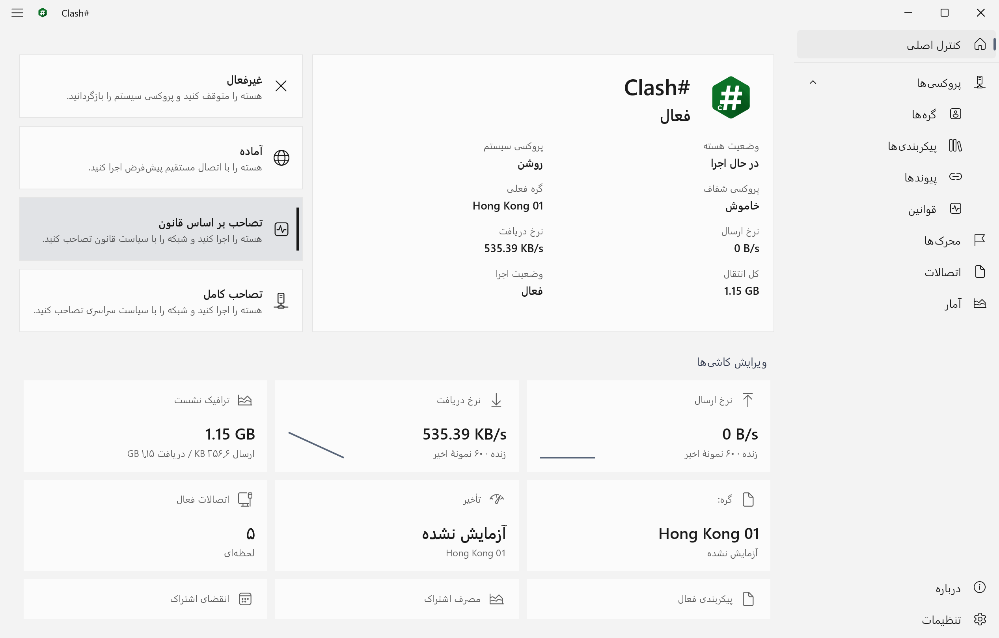

</div>

> [!IMPORTANT]
> ‏Clash#&lrm; 1.0.0 در دست توسعه است و نسخهٔ رسمی منتشرشده‌ای ندارد. بسته‌های تولیدشده توسط CI نسخه‌های آزمایشی امضانشده‌اند و برای استفادهٔ روزمره در نظر گرفته نشده‌اند.

‏Clash#&lrm; یک کلاینت پروکسی Windows بر پایهٔ هستهٔ [mihomo](https://github.com/MetaCubeX/mihomo) است. با C# و .NET 10 و WinUI 3 نوشته شده، به‌صورت بستهٔ MSIX عرضه می‌شود و نصب و تعمیر آن بر عهدهٔ نصب‌کنندهٔ اختصاصی خودش است. این برنامه صفحهٔ وب در یک پنجره نیست: مرورگر تعبیه‌شده‌ای وجود ندارد و هر کنترل، اعلان، منوی سینی، سرویس و تنظیم، همان چیزی است که Windows می‌شناسد.

## چرا Clash#&lrm;

| | |
| :--- | :--- |
| **از ریشه بومی** | کنترل‌های WinUI 3، طراحی Fluent، کاشی‌های Windows، اعلان‌های سیستم، ناحیهٔ اعلان، سرویس‌ها و تنظیمات پروکسی Windows، همان‌طور که Windows در نظر گرفته است. [بیشتر](#از-ریشه-بومی) |
| **یکپارچگی با Windows در یک گام** | یک نصب‌کننده برنامه، سرویس پروکسی شفاف و گواهی بسته را مستقر می‌کند. بازیابی پس از خروج، خرابی و راه‌اندازی مجدد درون‌ساخت است. [بیشتر](#یکپارچگی-با-windows-در-یک-گام) |
| **آمادهٔ Agent** | سرور محلی MCP به Agent اجازه می‌دهد وضعیت واقعی را بخواند و، فقط با اجازهٔ شما، تغییر دهد. هر مجوز یک کلید جداگانه است. [بیشتر](#agent-با-رضایت-شما-mcp) |
| **مدیر نصب مستقل** | ‏`Setup.exe` هر آنچه را خودش روی رایانه گذاشته نصب، تعمیر، ارتقا و حذف می‌کند و پس از وقفه ادامه می‌دهد. [بیشتر](#مدیر-نصب-مستقل) |
| **خودکارسازی که خودش را توضیح می‌دهد** | محرک‌ها با برقراری همهٔ شرط‌ها کنش‌ها را به ترتیب اجرا می‌کنند. [بیشتر](#محرک‌ها) |
| **قابلیت‌های چین قاره‌ای** | قراردادهای نمایشی اختیاری برای نام مناطق، پرچم‌ها و متن که فقط بر رابط اعمال می‌شوند. [بیشتر](#قابلیت‌های-چین-قاره‌ای) |
| **داده‌های قابل انتقال** | صادرکردن و واردکردن تنظیمات، پیکربندی‌ها و اشتراک‌ها؛ صادرکردن گزارش‌ها؛ نگهداری آمار بلندمدت. [بیشتر](#داده‌های-قابل-انتقال) |

## از ریشه بومی

### کنترل اصلی

«کنترل اصلی» از کاشی‌هایی ساخته شده که در یک نگاه Windows‌اند. آن‌ها وضعیت هسته، سرعت، ترافیک، تأخیر، مصرف و انقضای اشتراک، IP عمومی و موارد دیگر را نشان می‌دهند. کاشی‌ها قابل نمایش، پنهان‌سازی و مرتب‌سازی‌اند و شش چیدمان درون‌ساخت شروع سریع را ممکن می‌کنند: پیش‌فرض، گسترده، حداقلی، فنی، عمومی و همهٔ کاشی‌ها.


### سازوکارهای Windows، همان‌طور که طراحی شده‌اند

| سازوکار Windows | کاری که Clash#&lrm; با آن می‌کند |
| :--- | :--- |
| **طراحی و جنس‌های Fluent** | کنترل‌های بومی WinUI 3 و نمادهای Fluent. از پوستهٔ روشن یا تیرهٔ سیستم، رنگ تأکیدی سیستم، پوسته‌های با کنتراست بالا و مقیاس متن پیروی می‌کند. |
| **اعلان‌ها** | اعلان‌های واقعی Windows با یک کلید اصلی و سه سطح، با بازگشت به برنامه با کلیک. مجوزها و تنظیمات تمرکز خود Windows همیشه مقدم‌اند. |
| **ناحیهٔ اعلان** | نماد سینی که رنگش وضعیت فعلی را نشان می‌دهد، با منویی برای کارهای رایج. |
| **راه‌اندازی** | اجرا هنگام ورود از ثبت راه‌اندازی خود Windows استفاده می‌کند. پاک‌سازی جداگانهٔ هنگام ورود می‌تواند بدون انتظار برای برنامه، پروکسی را بازگرداند. |
| **سرویس‌ها** | پروکسی شفاف در یک سرویس Windows اجرا می‌شود که مدیر کنترل سرویس آن را مدیریت می‌کند، با نظارت و راه‌اندازی مجدد خودکار هسته. |
| **حفاظت از اعتبارنامه‌ها** | توکن Agent و اعتبارنامه‌های کنترل‌کننده با حفاظت از داده در Windows محافظت می‌شوند. |
| **طول عمر فرایندها** | فرایندهای فرزند در یک شیء کار (job object) زندگی می‌کنند؛ پس برنامهٔ متوقف‌شده هرگز هسته‌ای را پشت سر نمی‌گذارد. |
| **تنظیمات پروکسی Windows** | پروکسی سیستم را تصاحب می‌کند و دقیقاً همان چیزی را که جایگزین کرده بود برمی‌گرداند. |
| **بسته‌بندی MSIX** | نصب و حذف تمیز، ورودی منوی Start و هویتی سازگار با نوار وظیفه. |
| **زبان‌ها** | هشت زبان رابط که بی‌درنگ عوض می‌شوند، از جمله فارسی با چینش راست‌به‌چپ. |

### هشت زبان

زبان رابط بی‌درنگ عوض می‌شود و چند متن که Windows فراهم می‌کند، مانند نام رنگ‌ها، در اجرای بعدی تغییر می‌کنند. برای فارسی صفحه‌ها، پنجره‌های گفت‌وگو و منوی سینی راست‌به‌چپ می‌شوند.

<p align="center">
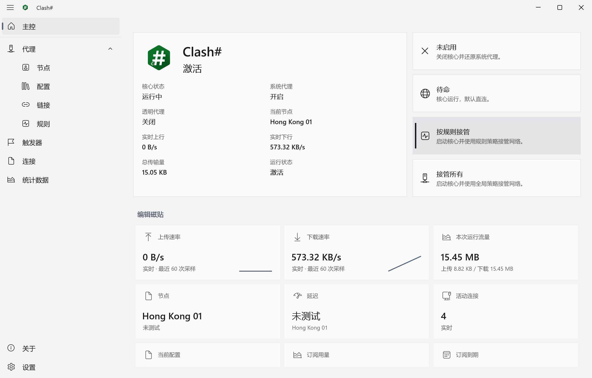&nbsp;&nbsp;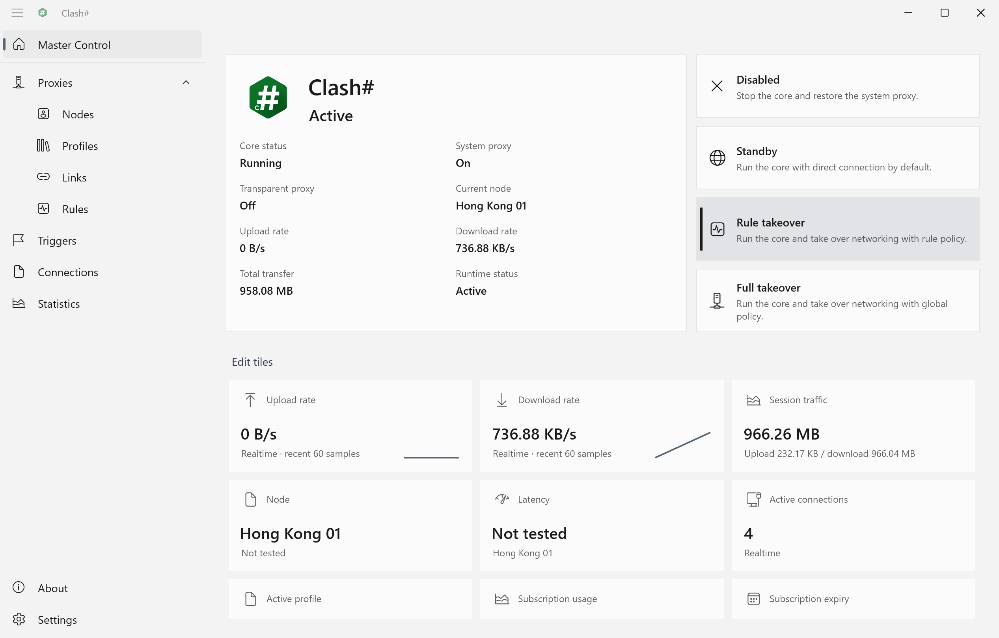&nbsp;
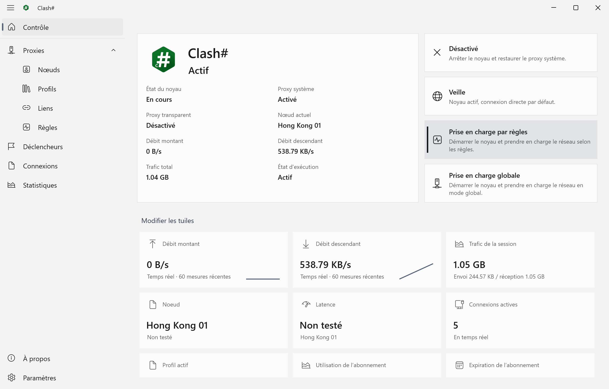&nbsp;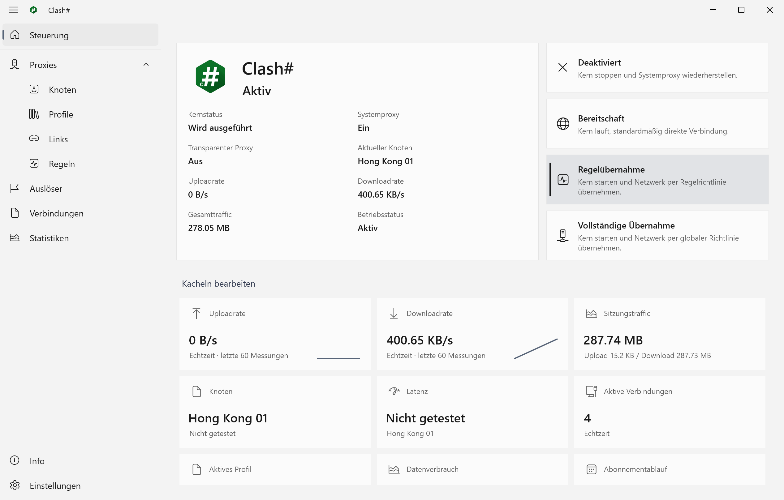&nbsp;&nbsp;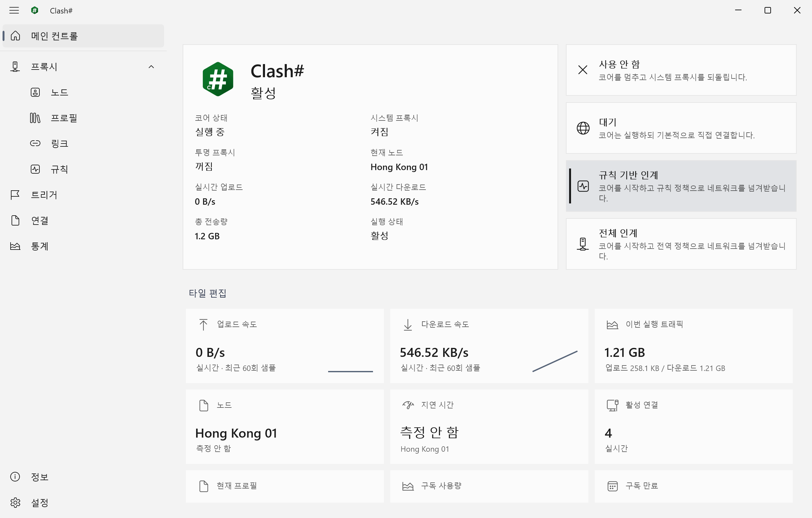
</p>

### اعلان‌ها

‏Clash#&lrm; می‌گوید چه چیزی تغییر کرده، به کدام شیء مربوط بوده و گام بعدی چیست، و در بقیهٔ موارد ساکت می‌ماند. «فعال‌سازی اعلان‌های سیستم» کلید اصلی است و سطح، میزان اعلان‌ها را تعیین می‌کند:

| سطح | دربارهٔ چه چیزهایی اعلان می‌گیرید |
| :--- | :--- |
| **فقط بحرانی** | توقف غیرمنتظرهٔ هسته، در دسترس نبودن سرویس پروکسی شفاف، ناتوانی در اعمال یا تأیید تصاحب، بررسی راه‌اندازی که نیاز به اقدام دارد، و منقضی شدن اشتراک فعال یا تمام شدن حجم آن. |
| **پیش‌فرض** | موارد بالا، به‌علاوهٔ تغییر حالت و پروکسی شفاف، انتخاب پیکربندی و گره، شکست واردکردن یا به‌روزرسانی، پایان مهلت آزمون‌ها، پیام‌های محرک‌ها، و اشتراک فعالی که ظرف سه روز منقضی می‌شود یا ۹۰٪ حجمش مصرف شده است. |
| **بیشتر** | همهٔ موارد بالا، به‌علاوهٔ واردکردن، به‌روزرسانی، صادرکردن و ذخیرهٔ موفق تنظیمات. |

یادآوری اشتراک در هر مرحله فقط یک بار ارسال می‌شود و پس از تمدید یا بازنشانی حجم دوباره آغاز می‌شود. اعلان شکست همان دلیل و کد پشتیبانی‌ای را دارد که صفحه نشان می‌دهد؛ بنابراین برای دانستن علت لازم نیست پنجره را باز کنید. بررسی‌های غیرفعال، کنش‌های لغوشده و نمونه‌برداری هرگز اعلان نمی‌دهند.

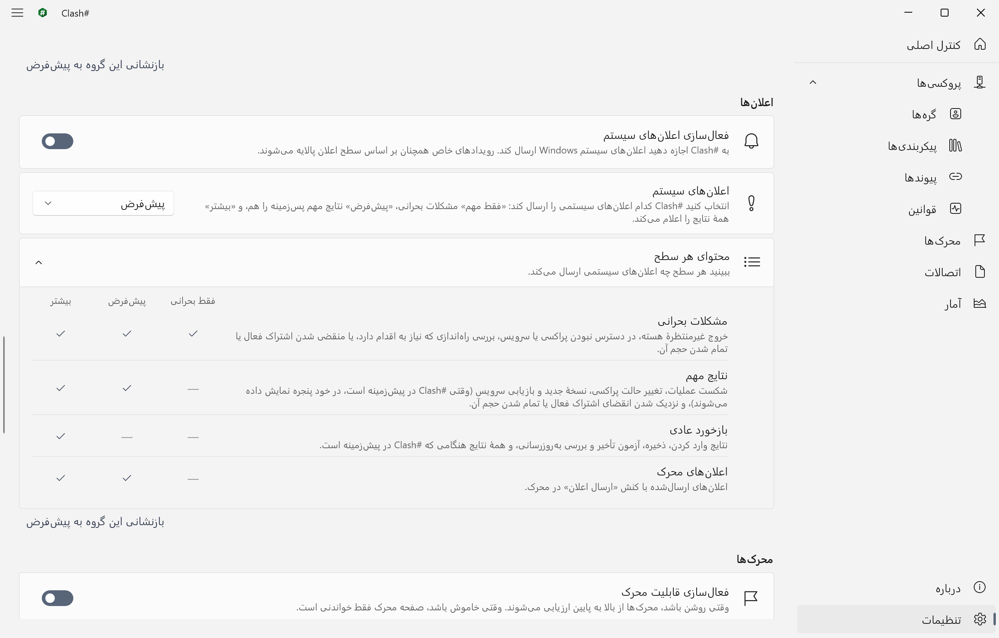

## یکپارچگی با Windows در یک گام

### حالت‌ها

‏Clash#&lrm; هر حالت را بر اساس اثر آن بر شبکه نام‌گذاری می‌کند:

| Clash#&lrm; | نام رایج | رفتار |
| :--- | :--- | :--- |
| **غیرفعال** | خاموش | هسته متوقف و پروکسی سیستم بازگردانده می‌شود. |
| **آماده** | مستقیم | هسته در حال اجراست و ترافیک به‌طور پیش‌فرض مستقیم می‌رود. |
| **تصاحب بر اساس قانون** | قانون | ترافیک طبق قوانین پیکربندی مسیریابی می‌شود. |
| **تصاحب کامل** | سراسری | همهٔ ترافیک از پروکسی انتخاب‌شده عبور می‌کند. |

پروکسی شفاف (TUN) با گزینهٔ «پروکسی شفاف» در **تنظیمات › پروکسی** کنترل می‌شود و به‌طور پیش‌فرض روشن است. در صورت روشن بودن و در دسترس بودن سرویس Mihomo، تصاحب از طریق TUN انجام می‌شود و برنامه‌هایی را که پروکسی سیستم را نمی‌خوانند نیز در بر می‌گیرد. در صورت مستقر نبودن سرویس Mihomo، تصاحب از طریق پروکسی سیستم Windows انجام می‌شود.

> [!CAUTION]
> پروکسی شفاف مسیریابی و DNS کل رایانه را تصاحب می‌کند. Clash#&lrm; برای یک رایانه با یک کاربر تعاملی طراحی شده و ترافیک نشست‌های کاربری مختلف را از یکدیگر جدا نمی‌کند.

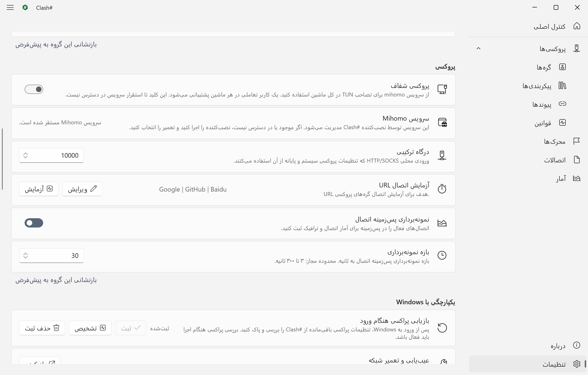

### بازیابی‌ای که لازم نیست به آن فکر کنید

| وضعیت | کاری که Clash#&lrm; می‌کند |
| :--- | :--- |
| از برنامه خارج می‌شوید | هسته را متوقف و پروکسی سیستمی را که متعلق به Clash#&lrm; است بازمی‌گرداند (قابل تنظیم). |
| برنامه از کار می‌افتد | فرایند بازیابی بی‌درنگ پروکسی سیستم را بازمی‌گرداند. |
| Windows زودتر خاموش می‌شود | تنظیم باقی‌مانده در راه‌اندازی بعدی، یا اگر پاک‌سازی راه‌اندازی ثبت شده باشد هنگام ورود، شناسایی و پاک می‌شود. |
| هسته به‌طور غیرمنتظره متوقف می‌شود | به شما اعلان داده می‌شود و سرویس در چارچوب یک سقف تلاش، هسته را دوباره راه‌اندازی می‌کند. |
| تصاحب قابل تأیید نیست | تغییر ناموفق به‌جای آنکه اعمال‌شده فرض شود نگه داشته و گزارش می‌شود؛ کنش بعدی شما آن را حل می‌کند. |

### بررسی‌های راه‌اندازی و اصلاح بومی

پیش از شروع حالت پروکسی، Clash#&lrm; وجود فرایند خارجی mihomo، درگاه اشغال‌شده، پروکسی دستی Windows و دیگر آداپتورهای TUN یا VPN را بررسی می‌کند و برای مواردی که به‌طور ایمن قابل رسیدگی‌اند اصلاح پیشنهاد می‌دهد. **تنظیمات › یکپارچگی با Windows** برای WSL، ترمینال‌ها و برنامه‌های Microsoft Store که پروکسی سیستم را نمی‌خوانند جداگانه عیب‌یابی می‌کند و برای هر کدام اصلاح را اعمال یا بازمی‌گرداند.

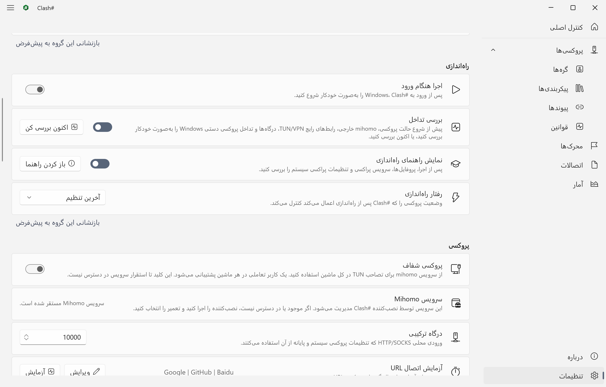

## Agent با رضایت شما (MCP)

سرور محلی MCP یک Agent را به وضعیت واقعی، تنظیمات، پیکربندی‌ها، عیب‌یابی و تاریخچهٔ نگهداری‌شده وصل می‌کند. به‌طور پیش‌فرض خاموش است و فقط روی loopback گوش می‌دهد (`http://127.0.0.1:20000/mcp`). هر مجوز یک کلید جداگانه است، کنترل پروکسی مجوز مستقل می‌خواهد و Agent نمی‌تواند مجوزهای خودش را تغییر دهد.

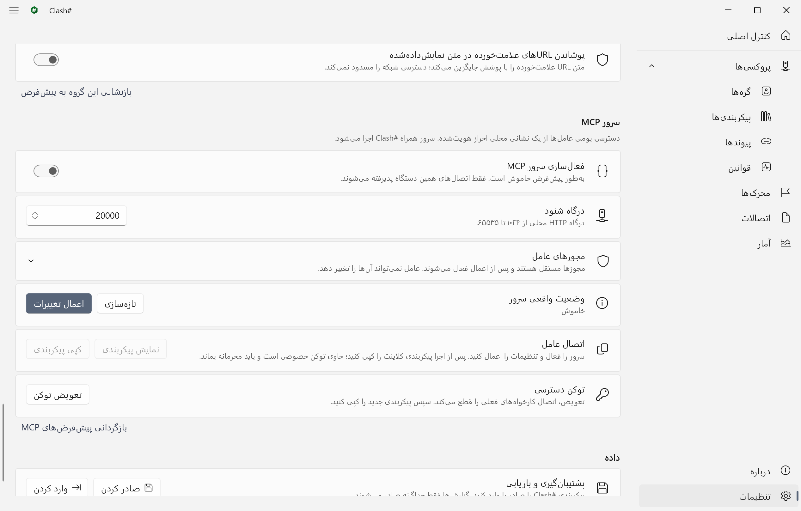

1. در **تنظیمات › سرور MCP** سرور را فعال و مجوزهای موردنظر را انتخاب کنید. فقط خواندن وضعیت از قبل انتخاب شده است.
2. **اعمال تغییرات** را بزنید و مطمئن شوید وضعیت واقعی **در حال اجرا** است.
3. با **کپی پیکربندی** نشانی و سرآیند احراز هویت را به کارخواهی با پشتیبانی Streamable HTTP بدهید. این رونوشت از تاریخچهٔ کلیپ‌بورد Windows و همگام‌سازی ابری مستثنا می‌شود.

برای ترکیب مجوزها و رفع اشکال، [راهنمای اتصال و مجوزها (انگلیسی)](./docs/guides/native-agent.md) را ببینید.

## مدیر نصب مستقل

‏`Setup.exe` یک برنامهٔ Windows جداگانه است، نه جادوگری که به برنامه چسبانده شده باشد. برای کاربر جاری نصب می‌کند، تنها برای بخش‌های سطح رایانه دسترسی مدیر می‌خواهد و بعداً دقیقاً همان چیزی را که نصب کرده، از جمله سرویس و گواهی تحت مدیریت خود، تعمیر، ارتقا یا حذف می‌کند. هر گام ثبت می‌شود؛ پس عملیات نیمه‌تمام ادامه می‌یابد و رایانه را نیمه‌نصب رها نمی‌کند، و حالت اولیه قابل بازگردانی است. نصب‌کننده همان هشت زبان برنامه را دارد: به‌طور پیش‌فرض از زبان نمایش Windows پیروی می‌کند و پیش از آغاز عملیات می‌توانید زبان را از گوشهٔ بالای پنجره تغییر دهید.


## محرک‌ها

یک محرک فهرستی مرتب از کنش‌ها را وقتی همهٔ شرط‌هایش برقرار شد اجرا می‌کند. شرط‌ها شامل ورود به برنامه، شروع پروکسی، اعلان‌های سطح انتخاب‌شده، ترافیک در یک بازهٔ زمانی، ترافیک اجرای جاری، سرعت، تعداد اتصال‌های فعال، مدت اجرا و زمان سیستم‌اند. کنش‌ها شامل تغییر حالت، قطع اتصال‌ها، روشن و خاموش کردن پروکسی شفاف، نمونه‌برداری از اتصال‌ها یا اجرا هنگام ورود، ارسال اعلان و خروج‌اند. هر محرک نشان می‌دهد آخرین بار کِی اجرا شده است.

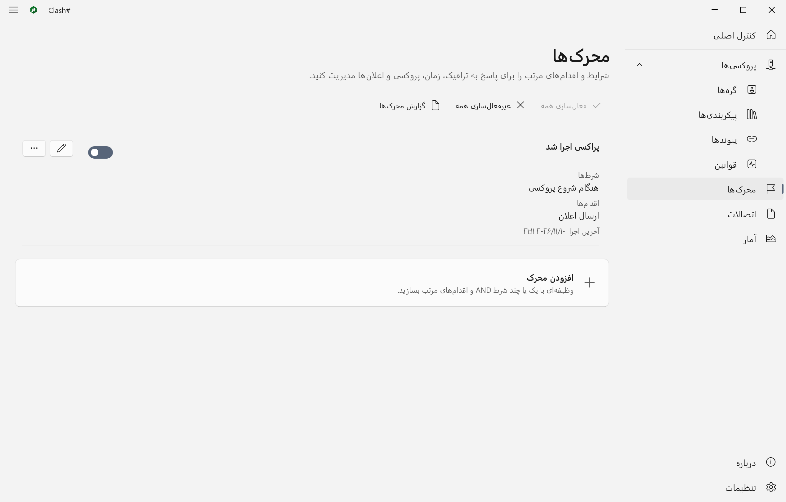

## قابلیت‌های چین قاره‌ای

قراردادهای نمایشی اختیاری برای کسانی که Clash#&lrm; را در چین قاره‌ای به کار می‌برند، در **تنظیمات › قابلیت‌های چین قاره‌ای**. این قابلیت‌ها فقط آنچه رابط نشان می‌دهد را تغییر می‌دهند: پیکربندی‌ها، گزارش‌ها، جست‌وجو، متن رونوشت‌شده و داده‌های صادرشده هرگز تغییر نمی‌کنند و هیچ‌یک از این‌ها دسترسی به شبکه را مسدود نمی‌کند.

«پالایه بررسی داخلی» دامنهٔ این قراردادها را تعیین می‌کند و هر گزینه گزینه‌های پیش از خود را هم در بر دارد:

| گزینه | آنچه رابط نشان می‌دهد |
| :--- | :--- |
| **فقط جایگزینی پرچم** | تایوان با پرچم جمهوری خلق چین نمایش داده می‌شود؛ هنگ‌کنگ و ماکائو پرچم منطقهٔ خود را نگه می‌دارند. |
| **فقط جایگزینی پرچم و تکمیل متن** | نام مناطق نیز از همان قرارداد پیروی می‌کند، برای مثال «چین هنگ‌کنگ»، «چین ماکائو» و «چین تایوان». |
| **جایگزینی پرچم، تکمیل متن و پالایش کلیدواژه** | فهرستی کوتاه از واژه‌های حساس چینی نیز در متن نمایش‌داده‌شده پوشانده می‌شود. |

پیش‌فرض جایگزینی پرچم و تکمیل متن است و گزینهٔ **غیرفعال** همه را خاموش می‌کند. کلید جداگانهٔ «پوشاندن URLهای علامت‌خورده در متن نمایش‌داده‌شده» نشانی‌های فهرست درون‌ساخت را هم می‌پوشاند و به‌طور پیش‌فرض خاموش است.

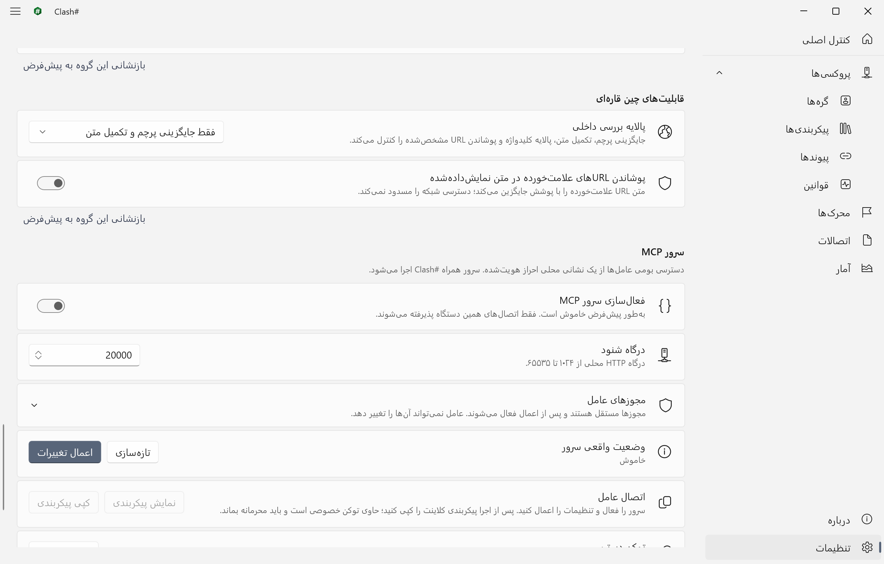

## داده‌های قابل انتقال

**تنظیمات › داده** تنظیمات Clash#&lrm; را در یک پرونده صادر می‌کند، به‌دلخواه همراه با پیکربندی پروکسی و اشتراک‌ها، و دوباره وارد می‌کند. گزارش‌ها جداگانه به‌صورت پایگاه‌دادهٔ SQLite صادر می‌شوند. آمار ترافیک، اتصال‌ها، سلامت گره‌ها و برخورد قوانین به تفکیک پیکربندی، گره و زمان به‌صورت محلی نگهداری می‌شود و پیش از هر حذف، پیش‌نمایش پاک‌سازی نشان داده می‌شود.

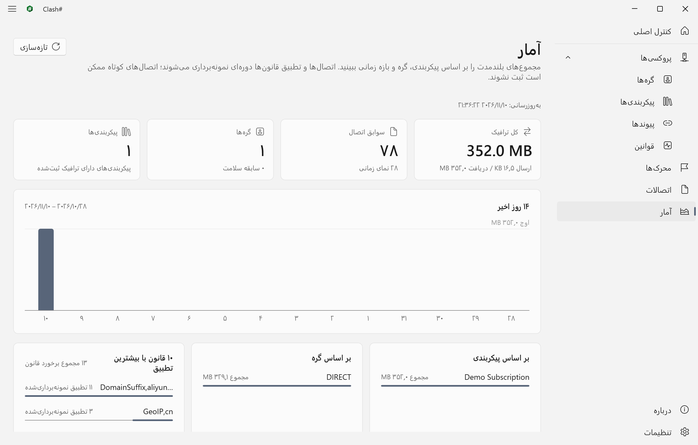&nbsp;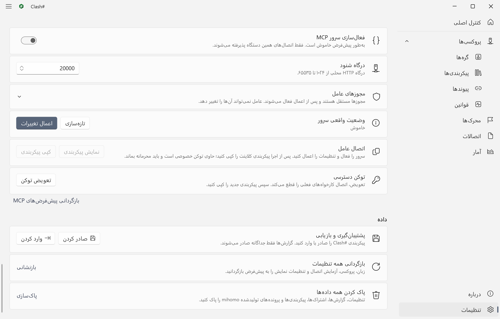

## نصب

**پیش‌نیازهای سیستم:** ‏Windows 11 x64، یا Windows Server 2025 همراه با Desktop Experience.

پس از انتشار نسخهٔ رسمی، بسته‌ها در صفحهٔ [Releases](https://github.com/Water-Run/ClashSharp/releases) منتشر می‌شوند.

1. بستهٔ انتشار بارگیری و از حالت فشرده خارج می‌شود. `Setup.exe` باید کنار پوشهٔ `payload` باقی بماند.
2. ‏`Setup.exe` در نشست کاربری جاری اجرا می‌شود. برنامه برای کاربری که نصب‌کننده را اجرا کرده نصب می‌شود؛ اجرا با دسترسی مدیر و نصب پیشین .NET لازم نیست.
3. درخواست تأیید مدیر Windows را تأیید کنید. نصب‌کننده سرویس Mihomo را مستقر می‌کند و گواهی بستهٔ Clash#&lrm; را به‌طور خودکار مدیریت می‌کند. پیش از تأیید، ناشر نمایش‌داده‌شده باید بررسی شود.

تعمیر، ارتقا و حذف همگی با اجرای دوبارهٔ همان نصب‌کننده انجام می‌شوند.

> [!WARNING]
> حذف باید از طریق `Setup.exe` انجام شود. حذف تنها از «Settings › Apps» در Windows، منابع سطح رایانه از جمله سرویس Mihomo را برجا می‌گذارد.

## شروع کار

1. پیوند اشتراک در **پروکسی‌ها › پیوندها** افزوده می‌شود. Clash#&lrm; پیکربندی مربوط را بارگیری و اعتبارسنجی می‌کند.
2. در **پروکسی‌ها › پیکربندی‌ها** تأیید می‌شود که این پیکربندی، پیکربندی جاری است.
3. در **کنترل اصلی**، حالت **تصاحب بر اساس قانون** انتخاب می‌شود.
4. در **پروکسی‌ها › گره‌ها** گره انتخاب می‌شود؛ پیش از آن می‌توان آزمون تأخیر را اجرا کرد.

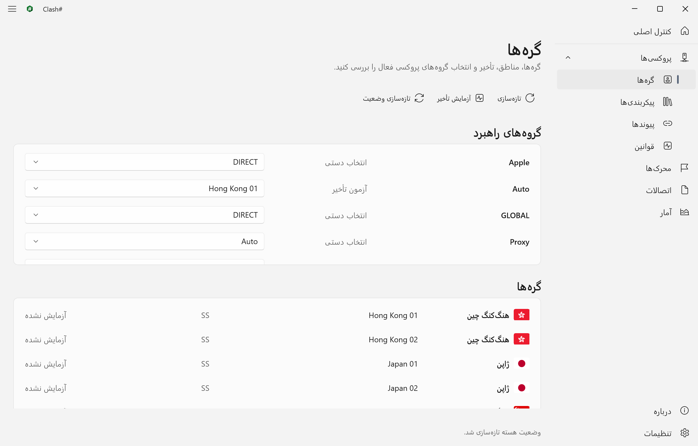&nbsp;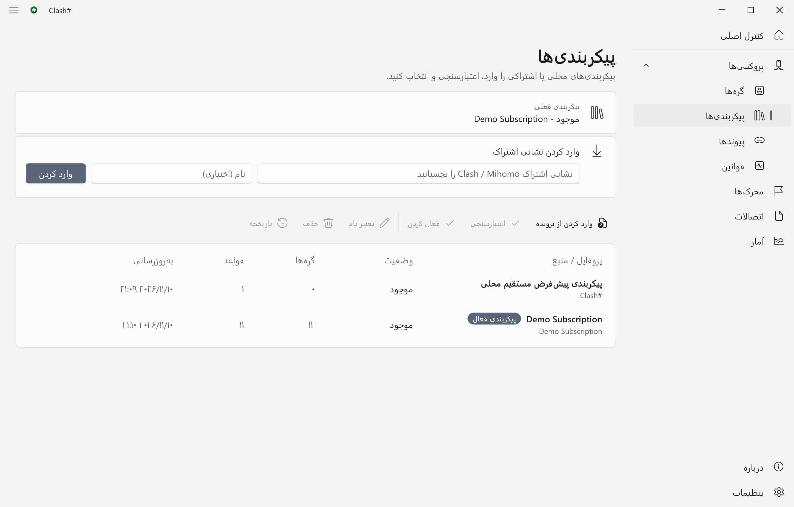

‏Clash#&lrm; در هر بار راه‌اندازی راهنمایی نمایش می‌دهد که نتایج بررسی اشتراک، سرویس پروکسی شفاف، بازیابی هنگام راه‌اندازی و تنظیمات باقی‌ماندهٔ پروکسی را خلاصه می‌کند. این راهنما در **تنظیمات › راه‌اندازی** غیرفعال می‌شود.

درگاه ترکیبی محلی به‌طور پیش‌فرض `10000` است و HTTP و SOCKS را با هم پوشش می‌دهد. برنامه‌هایی که پروکسی سیستم را نمی‌خوانند می‌توانند مستقیماً از `127.0.0.1:10000` استفاده کنند. درگاه در **تنظیمات › پروکسی** تغییر می‌کند.

با بستن پنجرهٔ اصلی، Clash#&lrm; به‌طور پیش‌فرض به سینی کوچک می‌شود و به کار ادامه می‌دهد. برای خروج، گزینهٔ «خروج ایمن» در منوی سینی در نظر گرفته شده است؛ هنگام خروج، به‌طور پیش‌فرض هسته متوقف و پروکسی سیستم بازگردانده می‌شود.

با روشن بودن «فعال‌سازی نشانگر رنگی وضعیت سینی» در **تنظیمات › سینی نوار وظیفه**، نماد سینی وضعیت فعلی را با رنگ نشان می‌دهد:

|  |  |  |
| :---: | :---: | :---: |
| غیرفعال یا آماده | پروکسی سیستم | پروکسی شفاف |

### صفحه‌ها

| صفحه | کاربرد |
| :--- | :--- |
| **کنترل اصلی** | تغییر حالت؛ کاشی‌ها وضعیت هسته، سرعت، ترافیک، تأخیر، مصرف اشتراک، IP عمومی و موارد دیگر را نشان می‌دهند. |
| **پروکسی‌ها** | گره‌ها، پیکربندی‌ها (همراه با تاریخچهٔ نسخه‌ها)، پیوندهای اشتراک و قوانین. |
| **محرک‌ها** | وظایف خودکارسازی که از بالا به پایین ارزیابی می‌شوند. |
| **اتصالات** | اتصال‌های فعال همراه با فرایند، قانون منطبق و مسیر پروکسی. |
| **آمار** | جمع‌های بلندمدت به تفکیک پیکربندی، گره و زمان؛ گزارش‌های سیستم نیز از این صفحه باز می‌شوند. |
| **تنظیمات** | زبان و ظاهر، راه‌اندازی، پروکسی، یکپارچگی با Windows، سرور MCP و مجوزها، اعلان‌ها، سینی، قابلیت‌های چین قاره‌ای و پشتیبان‌گیری از داده. |

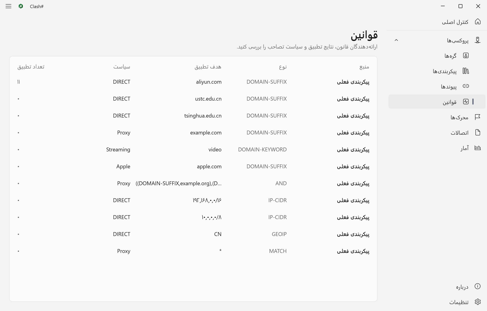&nbsp;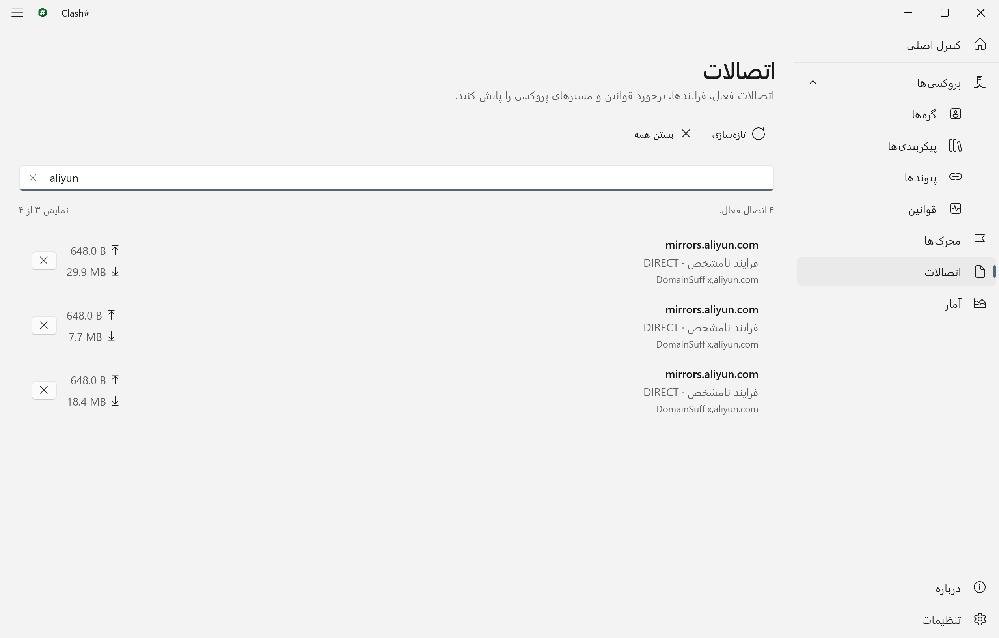

## پرسش‌های متداول

<details>
<summary><b>‏WSL، ترمینال یا برنامه‌های Microsoft Store از طریق پروکسی به شبکه دسترسی ندارند</b></summary>
<br />

این برنامه‌ها پروکسی سیستم Windows را نمی‌خوانند. در **تنظیمات › یکپارچگی با Windows** برای هر یک عیب‌یابی انجام و بر اساس نتیجه اصلاح اعمال می‌شود؛ هر اصلاح در هر زمان قابل بازگردانی است. با روشن بودن پروکسی شفاف، ترافیک این برنامه‌ها نیز تصاحب می‌شود.
</details>

<details>
<summary><b>هنگام راه‌اندازی تداخل گزارش می‌شود</b></summary>
<br />

بررسی تداخل چهار حالت را پوشش می‌دهد: فرایند خارجی mihomo، درگاه پروکسی اشغال‌شده، پروکسی دستی روشن Windows، و دیگر آداپتورهای TUN یا VPN. پنجرهٔ گفت‌وگو هر مورد را توضیح می‌دهد و هر جا اصلاح به‌طور ایمن ممکن باشد، آن را ارائه می‌کند. آداپتورهای TUN و VPN فقط گزارش می‌شوند؛ Clash#&lrm; آن‌ها را غیرفعال نمی‌کند. بررسی در هر زمان از **تنظیمات › راه‌اندازی** قابل تکرار است.
</details>

<details>
<summary><b>پس از خروج غیرعادی، پروکسی سیستم روشن می‌ماند</b></summary>
<br />

هنگام خروج غیرعادی Clash#&lrm;، فرایند بازیابی بی‌درنگ پروکسی سیستمی را که هنوز متعلق به Clash#&lrm; است بازمی‌گرداند. اگر رایانه پیش از آن خاموش شده باشد، Clash#&lrm; در راه‌اندازی بعدی تنظیم باقی‌مانده را بررسی و پاک می‌کند. همچنین «بازیابی پراکسی هنگام ورود» در **تنظیمات › یکپارچگی با Windows** قابل ثبت است تا همین پاک‌سازی هنگام ورود به Windows و بدون انتظار برای اجرای Clash#&lrm; انجام شود.
</details>

<details>
<summary><b>پروکسی شفاف با اشتراک من شروع نمی‌شود</b></summary>
<br />

سرویس پروکسی شفاف هسته را با پرونده‌های GeoData خودش و مجموعه‌ای ثابت از گزینه‌های ایمن اجرا می‌کند؛ بنابراین هرگز نشانی بارگیری، درگاه‌های شنود اضافی یا اعتبارنامه را از پیکربندی نمی‌گیرد. ‏Clash#&lrm; نشانی بی‌خطر بارگیری GeoData (`geox-url`) را خودکار کنار می‌گذارد و اگر پیکربندی چیزی را تنظیم کرده باشد که سرویس نمی‌تواند میزبانی کند، مثل شنوندهٔ DNS یا درگاه اضافی، آن را همراه با کد پشتیبانی اعلام می‌کند. آن مورد را حذف کنید یا پروکسی شفاف را خاموش کنید و از پروکسی سیستم استفاده کنید.
</details>

<details>
<summary><b>یک کنش ناموفق بود و همهٔ کنش‌های بعدی هم ناموفق‌اند</b></summary>
<br />

تغییر ناموفق پروکسی به‌جای آنکه اعمال‌شده فرض شود نگه داشته و گزارش می‌شود. تغییر حالت یا کلید پروکسی شفاف آن را به‌طور خودکار و در چارچوب کنش شما دوباره امتحان می‌کند. پیوند **تلاش دوباره** در اعلان صفحهٔ **تنظیمات** همان کار را بدون تغییر چیز دیگری انجام می‌دهد.
</details>

<details>
<summary><b>پشتیبان‌گیری و به‌روزرسانی</b></summary>
<br />

در **تنظیمات › داده**، تنظیمات Clash#&lrm; در یک پرونده صادر می‌شود و در صورت نیاز پیکربندی پروکسی و اشتراک‌ها را نیز در بر می‌گیرد تا بعداً وارد شود. گزارش‌ها جداگانه به‌صورت پایگاه‌دادهٔ SQLite صادر می‌شوند؛ ورود آن‌ها پشتیبانی نمی‌شود.

صفحهٔ **درباره** نسخه‌های جدید را در GitHub Releases بررسی می‌کند. به‌روزرسانی‌ها توسط نصب‌کننده نصب می‌شوند.
</details>

## ساخت از کد منبع

وضعیت فعلی پیاده‌سازی، اعتبارسنجی نامزدها و برنامهٔ توسعه در [مستندات توسعه](./docs/README.md) آمده است.

ساخت به Windows x64،‏ PowerShell 7 و نسخه‌ای از .NET SDK که در [`global.json`](./global.json) مشخص شده نیاز دارد.

<div dir="ltr">

```powershell
dotnet restore ClashSharp/ClashSharp.slnx --locked-mode
dotnet build   ClashSharp/ClashSharp.slnx -c Release -p:Platform=x64 --no-restore
dotnet test    ClashSharp/ClashSharp.Tests/ClashSharp.Tests.csproj -c Release -p:Platform=x64 --no-build
```

</div>

مراحل ساخت بستهٔ نصب در [Installer/README.md](./ClashSharp/Installer/README.md) (به زبان چینی) شرح داده شده است.

<details>
<summary><b>ساختار مخزن</b></summary>
<br />

| مسیر | محتوا |
| :--- | :--- |
| `ClashSharp/ClashSharp` | برنامهٔ WinUI 3 |
| `ClashSharp/ClashSharp.Core` · `.Application` · `.Infrastructure` | مدل دامنه، منطق برنامه، و آداپتورهای Windows و ذخیره‌سازی |
| `ClashSharp/ClashSharp.MihomoService` | سرویس Windows که هسته را برای پروکسی شفاف اجرا می‌کند |
| `ClashSharp/ClashSharp.RecoveryWatchdog` | فرایند بازیابی که پس از خروج غیرعادی پروکسی سیستم را بازمی‌گرداند |
| `ClashSharp/ClashSharp.Installer*` | نصب‌کنندهٔ WPF و منطق تراکنشی آن |
| `ClashSharp/SandboxTest` | آزمون‌های دود بسته در Windows Sandbox |
| `docs/` | سوابق طراحی و توسعه (به زبان چینی) |

</details>

قراردادهای کدنویسی در [CodingStyle.md](./CodingStyle.md) آمده است.

## مجوز

هستهٔ پروکسی [mihomo](https://github.com/MetaCubeX/mihomo) از MetaCubeX است که تحت مجوز GPL-3.0 منتشر می‌شود. داده‌های GeoIP و GeoSite از [meta-rules-dat](https://github.com/MetaCubeX/meta-rules-dat) تأمین می‌شوند.

‏Clash#&lrm; تحت مجوز [AGPL-3.0](./LICENSE) منتشر شده است.

</div>
