<div align="center">


# Clash#

**뿌리부터 Windows 네이티브인 프록시 클라이언트**

[](https://github.com/Water-Run/ClashSharp/actions/workflows/ci.yml)
[](./LICENSE)
[](#설치)
[](./global.json)

[English](./README.md) · [简体中文](./README-zh.md) · [繁體中文](./README-zh-Hant.md) · **한국어** · [Русский](./README-ru.md) · [فارسی](./README-fa.md)


</div>

> [!IMPORTANT]
> Clash# 1.0.0은 개발 중이며, 정식 릴리스는 아직 없다. CI가 생성하는 설치 패키지는 서명되지 않은 테스트 빌드로, 일상적인 사용을 위한 것이 아니다.

Clash#는 [mihomo](https://github.com/MetaCubeX/mihomo) 코어 기반의 Windows 프록시 클라이언트이다. C#과 .NET 10, WinUI 3로 개발되어 MSIX 패키지로 배포되며, 설치와 복구는 전용 설치 프로그램이 담당한다. 창 안에 웹 페이지를 띄우는 방식이 아니다. 내장 브라우저는 없고, 모든 컨트롤·알림·트레이 메뉴·서비스·설정이 실제 Windows의 것이다.

## Clash#를 선택하는 이유

| | |
| :--- | :--- |
| **뿌리부터 네이티브** | WinUI 3 컨트롤, Fluent 디자인, Windows 타일, 시스템 알림, 알림 영역, 서비스, Windows 프록시 설정을 Windows가 의도한 방식 그대로 사용한다. [자세히](#뿌리부터-네이티브) |
| **Windows 통합을 한 번에** | 설치 프로그램 하나가 앱, 투명 프록시 서비스, 패키지 인증서를 배포한다. 종료·충돌·재시작 복구가 내장되어 있다. [자세히](#windows-통합을-한-번에) |
| **Agent 지원** | 로컬 MCP 서버로 Agent가 실제 상태를 읽고, 허용한 경우에만 변경한다. 모든 권한은 별도의 스위치이다. [자세히](#동의-아래-연결하는-agent-mcp) |
| **독립 설치 관리자** | `Setup.exe`가 설치, 복구, 업그레이드, 제거를 수행하고 자신이 컴퓨터에 둔 모든 것을 되돌린다. 중단되어도 이어서 진행한다. [자세히](#독립-설치-관리자) |
| **스스로 설명하는 자동화** | 트리거는 모든 조건이 충족되면 순서대로 동작을 실행한다. [자세히](#트리거) |
| **중국 본토 특화 기능** | 지역 이름, 국기, 텍스트에 대한 선택적 표시 규범으로, 인터페이스에만 적용된다. [자세히](#중국-본토-특화-기능) |
| **이식 가능한 데이터** | 설정, 프로필, 구독을 내보내고 가져온다. 로그를 내보내고 장기 통계를 보관한다. [자세히](#이식-가능한-데이터) |

## 뿌리부터 네이티브

### 메인 컨트롤

메인 컨트롤은 한눈에 Windows임을 알 수 있는 타일로 구성된다. 타일은 코어 상태, 속도, 트래픽, 지연 시간, 구독 사용량과 만료일, 공인 IP 등을 보여 준다. 타일은 표시·숨김·순서 변경이 가능하며, 기본·확장·최소·기술·일반·모든 타일의 여섯 가지 내장 배치로 빠르게 시작할 수 있다.


### 설계된 대로 사용하는 Windows 메커니즘

| Windows 메커니즘 | Clash#가 하는 일 |
| :--- | :--- |
| **Fluent 디자인과 소재** | 네이티브 WinUI 3 컨트롤과 Fluent 아이콘. 시스템의 밝은/어두운 테마, 시스템 강조 색, 고대비 테마, 텍스트 크기 조정을 따른다. |
| **알림** | 전체 스위치와 세 단계를 갖춘 실제 Windows 알림이며, 클릭하면 앱으로 돌아온다. Windows 자체의 권한과 집중 모드 설정이 항상 우선한다. |
| **알림 영역** | 현재 상태를 색으로 나타내는 트레이 아이콘과 자주 쓰는 동작의 메뉴. |
| **시작 프로그램** | 로그인 시 실행은 Windows의 시작 등록을 사용한다. 별도의 로그인 시 정리 작업은 앱을 기다리지 않고 프록시를 복원할 수 있다. |
| **서비스** | 투명 프록시는 서비스 제어 관리자가 관리하는 Windows 서비스에서 실행되며, 코어를 감독하고 자동으로 다시 시작한다. |
| **자격 증명 보호** | Agent 토큰과 컨트롤러 자격 증명은 Windows 데이터 보호로 보호된다. |
| **프로세스 수명** | 자식 프로세스는 작업 개체에 속하므로, 앱이 종료된 뒤 코어가 남지 않는다. |
| **Windows 프록시 설정** | 시스템 프록시를 인계하고, 바꾸었던 값을 그대로 되돌려 놓는다. |
| **MSIX 패키징** | 깔끔한 설치와 제거, 시작 메뉴 항목, 작업 표시줄에 적합한 식별 정보. |
| **언어** | 즉시 전환되는 여덟 가지 인터페이스 언어이며, 오른쪽에서 왼쪽으로 쓰는 페르시아어도 포함한다. |

### 여덟 가지 언어

인터페이스 언어는 즉시 바뀌며, 색 이름처럼 Windows가 제공하는 일부 텍스트는 다음 실행 때 따라 바뀐다. 페르시아어는 페이지, 대화 상자, 트레이 메뉴를 오른쪽에서 왼쪽으로 뒤집는다.

<p align="center">
&nbsp;&nbsp;&nbsp;
&nbsp;&nbsp;&nbsp;
</p>

### 알림

Clash#는 무엇이 바뀌었는지, 어떤 대상에 관한 것인지, 다음에 무엇을 하면 되는지를 알려 주고, 그 밖에는 조용히 있는다. ‘시스템 알림 사용’이 전체 스위치이며, 단계로 알림의 양을 정한다.

| 단계 | 알림을 받는 경우 |
| :--- | :--- |
| **중요한 알림만** | 코어가 예기치 않게 중지됨, 투명 프록시 서비스를 사용할 수 없게 됨, 인계를 적용하거나 확인하지 못함, 시작 점검에서 조치가 필요함, 현재 구독이 만료되었거나 데이터를 모두 사용함. |
| **기본** | 위 항목에 더해 모드와 투명 프록시 변경, 프로필·노드 선택, 가져오기·업데이트 실패, 테스트 시간 초과, 트리거 메시지, 3일 안에 만료되거나 데이터를 90% 사용한 현재 구독. |
| **더 많이** | 위 항목에 더해 가져오기·업데이트·내보내기·설정 저장 성공. |

구독 알림은 단계마다 한 번만 보내며, 갱신하거나 데이터가 초기화되면 다시 시작한다. 실패 알림에는 페이지에 표시되는 것과 같은 원인과 지원 코드가 들어 있어, 창을 열지 않고도 이유를 알 수 있다. 수동적인 점검, 취소된 동작, 샘플링은 알리지 않는다.

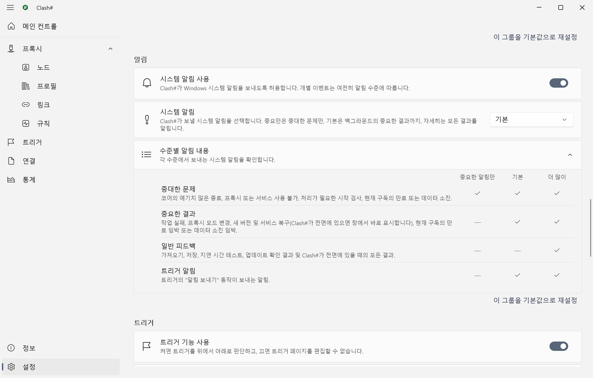

## Windows 통합을 한 번에

### 모드

Clash#는 각 모드를 네트워크에 미치는 작용에 따라 명명한다.

| Clash# | 일반적인 이름 | 동작 |
| :--- | :--- | :--- |
| **사용 안 함** | 끄기 | 코어를 중지하고 시스템 프록시를 복원한다. |
| **대기** | 직접 연결 | 코어는 실행되며, 트래픽은 기본적으로 직접 연결된다. |
| **규칙 기반 인계** | 규칙 | 프로필의 규칙에 따라 트래픽을 분류한다. |
| **전체 인계** | 전역 | 모든 트래픽이 선택한 프록시를 거친다. |

투명 프록시(TUN)는 **설정 › 프록시**의 ‘투명 프록시’로 제어하며, 기본값은 켜짐이다. 켜져 있고 Mihomo 서비스를 사용할 수 있으면 인계는 TUN을 통해 이루어지며, 시스템 프록시를 읽지 않는 프로그램도 그 대상이 된다. Mihomo 서비스가 배포되지 않은 경우 인계는 Windows 시스템 프록시를 통해 이루어진다.

> [!CAUTION]
> 투명 프록시는 컴퓨터 전체의 라우팅과 DNS를 인계한다. Clash#는 ‘컴퓨터 한 대, 대화형 사용자 한 명’을 전제로 설계되었으며, 사용자 세션 간 트래픽 격리를 제공하지 않는다.

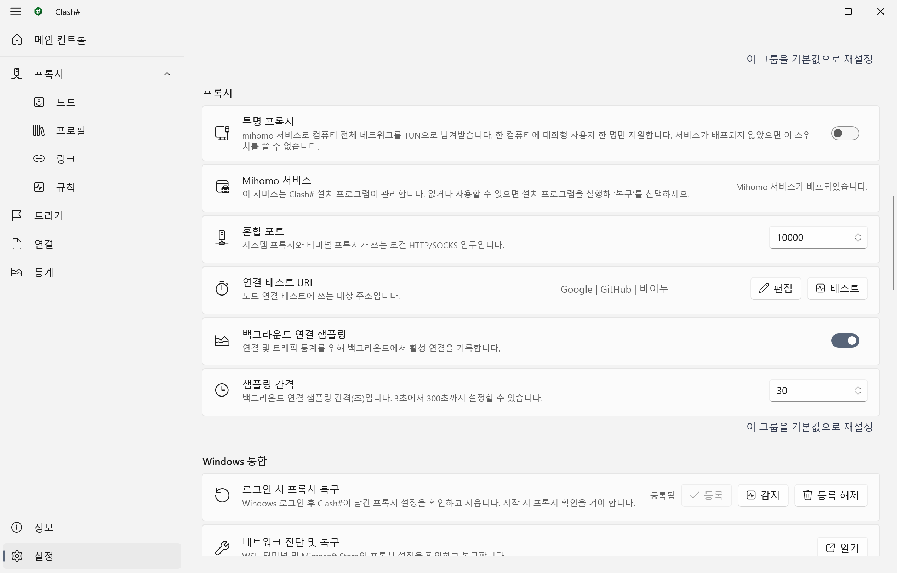

### 신경 쓸 필요 없는 복구

| 상황 | Clash#가 하는 일 |
| :--- | :--- |
| 앱을 종료함 | 코어를 중지하고, Clash#가 소유한 시스템 프록시를 복원한다(설정 가능). |
| 앱이 충돌함 | 복구 프로세스가 즉시 시스템 프록시를 복원한다. |
| Windows가 먼저 종료됨 | 남은 설정을 다음 실행 때, 시작 시 정리를 등록했다면 로그인 시점에 감지하여 정리한다. |
| 코어가 예기치 않게 중지됨 | 알림이 표시되고, 서비스가 정해진 횟수 안에서 코어를 다시 시작한다. |
| 인계를 확인할 수 없음 | 실패한 변경은 적용된 것으로 간주하지 않고 보존하여 보고하며, 다음 동작에서 해결된다. |

### 시작 점검과 네이티브 보정

프록시 모드를 시작하기 전에 Clash#는 외부 mihomo 프로세스, 사용 중인 포트, Windows 수동 프록시, 다른 TUN·VPN 어댑터를 점검하고, 안전하게 처리할 수 있는 항목에는 수정을 제공한다. **설정 › Windows 통합**는 시스템 프록시를 읽지 않는 WSL, 터미널, Microsoft Store 앱을 각각 진단하고, 항목별로 보정을 적용하거나 되돌린다.

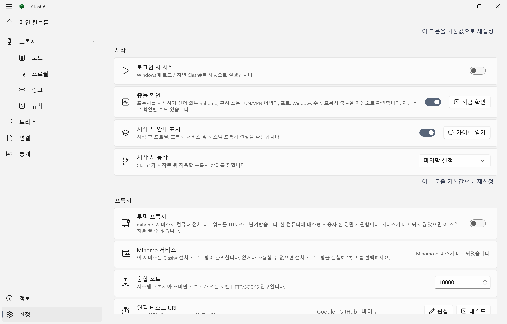

## 동의 아래 연결하는 Agent (MCP)

로컬 MCP 서버는 Agent를 실제 상태, 설정, 프로필, 진단, 보관된 기록에 연결한다. 기본값은 꺼짐이며 루프백(`http://127.0.0.1:20000/mcp`)에서만 수신한다. 각 권한은 별도의 스위치이고, 프록시 제어에는 독립된 허가가 필요하며, Agent는 자신의 권한을 바꿀 수 없다.


1. **설정 › MCP 서버**에서 서버를 활성화하고 허용할 권한을 선택한다. 상태 읽기만 미리 선택되어 있다.
2. **변경 적용**을 선택하고 실제 상태가 **실행 중**인지 확인한다.
3. **클라이언트 구성 복사**로 엔드포인트와 인증 헤더를 Streamable HTTP를 지원하는 클라이언트에 설정한다. 복사한 내용은 Windows 클립보드 기록과 클라우드 동기화에서 제외된다.

권한 조합과 문제 해결은 [연결 및 권한 가이드(영문)](./docs/guides/native-agent.md)를 참조한다.

## 독립 설치 관리자

`Setup.exe`는 앱에 덧붙인 마법사가 아니라 별도의 Windows 애플리케이션이다. 현재 사용자를 위해 설치하며, 컴퓨터 수준의 부분에만 관리자 권한을 요청한다. 이후 서비스와 관리하는 인증서를 포함해 설치한 것을 정확히 복구, 업그레이드, 제거한다. 모든 단계가 기록되므로 중단된 작업은 반쯤 설치된 컴퓨터를 남기지 않고 이어서 진행되며, 원래 상태로 되돌릴 수 있다. 설치 프로그램은 앱과 같은 여덟 가지 언어를 지원한다. 기본적으로 Windows 표시 언어를 따르며, 작업을 시작하기 전에는 창 오른쪽 위에서 바꿀 수 있다.

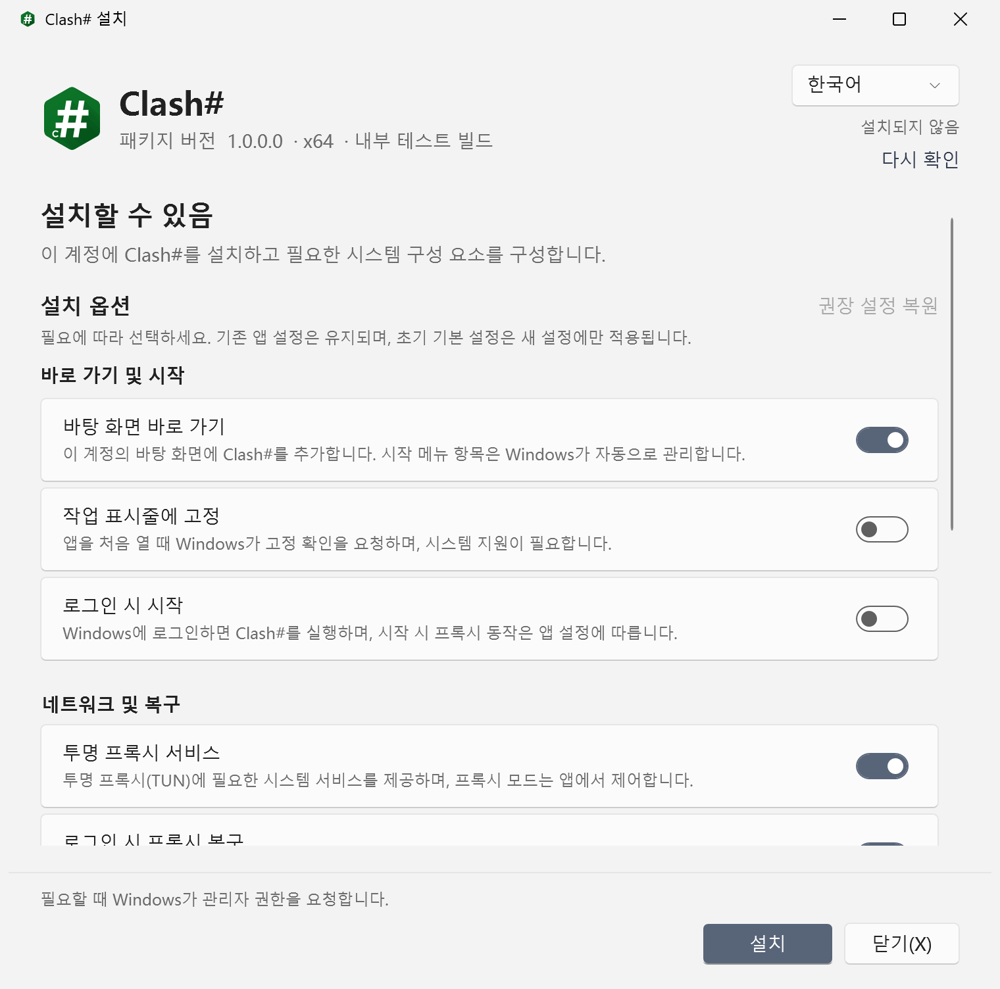

## 트리거

트리거는 모든 조건이 충족되면 정해진 동작을 순서대로 실행한다. 조건에는 앱 진입, 프록시 시작, 지정한 단계의 알림, 시간 창의 트래픽, 현재 실행의 트래픽, 속도, 활성 연결 수, 실행 시간, 시스템 시각이 있다. 동작에는 모드 전환, 연결 끊기, 투명 프록시·연결 샘플링·로그인 시 실행의 켜기와 끄기, 알림 보내기, 종료가 있다. 각 트리거는 마지막으로 실행된 시각을 보여 준다.

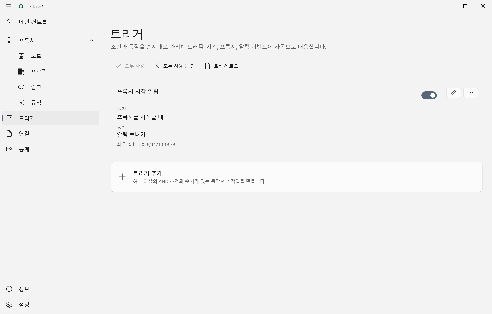

## 중국 본토 특화 기능

중국 본토에서 Clash#를 사용하는 사람을 위한 선택적 표시 규범으로, **설정 › 중국 본토 특화 기능**에 있다. 인터페이스에 표시되는 내용만 바꾸며, 프로필, 로그, 검색, 복사한 텍스트, 내보낸 데이터는 변경하지 않는다. 이 기능은 네트워크 접근을 차단하지 않는다.

‘내장 심의 필터’에서 규범의 범위를 고르며, 뒤의 선택지는 앞의 선택지를 모두 포함한다.

| 선택지 | 인터페이스에 표시되는 내용 |
| :--- | :--- |
| **국기 대체만** | 대만이 중화인민공화국 국기로 표시되며, 홍콩과 마카오는 각자의 지역 깃발을 유지한다. |
| **국기 대체와 텍스트 보완만** | 지역 이름도 같은 규범을 따른다. 예: ‘중국 홍콩’, ‘중국 마카오’, ‘중국 타이완’. |
| **국기 대체, 텍스트 보완, 키워드 필터링** | 민감한 중국어 용어의 짧은 목록도 표시되는 텍스트에서 가려진다. |

기본값은 국기 대체와 텍스트 보완이며, **사용 안 함**을 고르면 모두 꺼진다. 별도의 스위치 ‘표시 텍스트에서 표시된 URL 가리기’는 내장 목록의 주소도 가리며, 기본값은 꺼짐이다.

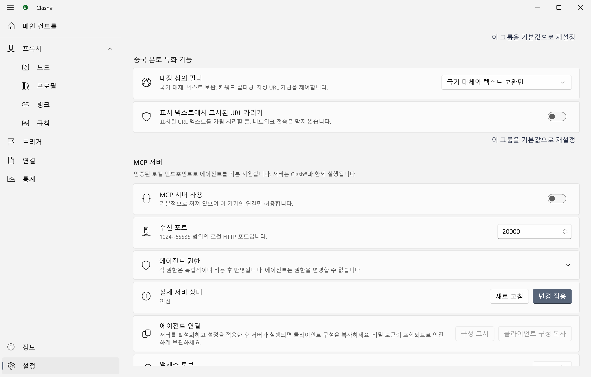

## 이식 가능한 데이터

**설정 › 데이터**는 Clash# 설정을 하나의 파일로 내보내며, 프록시 구성과 구독을 함께 포함할 수 있고, 다시 가져올 수 있다. 로그는 SQLite 데이터베이스로 따로 내보낸다. 트래픽, 연결, 노드 상태, 규칙 일치 통계는 프로필, 노드, 시간별로 로컬에 보관되며, 삭제하기 전에 정리 미리 보기를 제공한다.

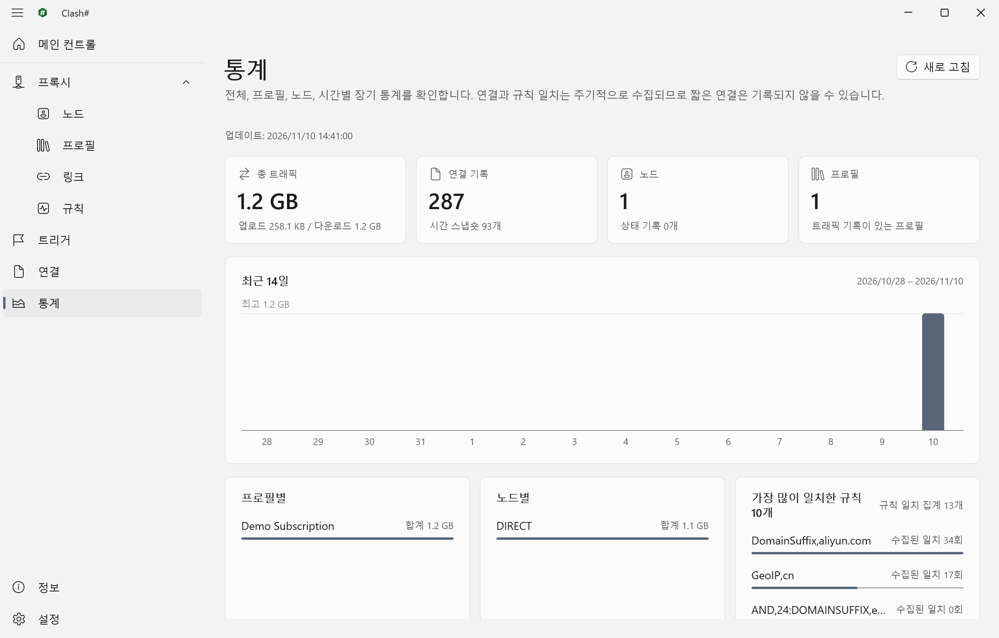

## 설치

**시스템 요구 사항**: Windows 11 x64, 또는 데스크톱 환경을 포함한 Windows Server 2025.

정식 버전이 릴리스되면 설치 패키지는 [Releases](https://github.com/Water-Run/ClashSharp/releases) 페이지에 게시된다.

1. 릴리스 패키지를 내려받아 압축을 해제한다. `Setup.exe`는 같은 위치의 `payload` 폴더와 함께 두어야 한다.
2. 현재 사용자 세션에서 `Setup.exe`를 실행한다. 앱은 설치 프로그램을 실행한 사용자에게 설치되며, 관리자 권한으로 실행하거나 .NET을 미리 설치할 필요는 없다.
3. Windows의 관리자 승인 요청을 확인한다. 설치 프로그램이 Mihomo 서비스를 배포하고 Clash# 패키지 인증서를 자동으로 관리한다. 승인하기 전에 표시된 게시자를 확인해야 한다.

복구, 업그레이드, 제거는 모두 같은 설치 프로그램을 다시 실행하여 수행한다.

> [!WARNING]
> 제거는 `Setup.exe`를 통해 수행해야 한다. Windows의 ‘설정 › 앱’에서만 제거하면 Mihomo 서비스 등 컴퓨터 수준의 리소스가 남는다.

## 시작하기

1. **프록시 › 링크**에서 구독 링크를 추가한다. Clash#가 해당 프로필을 내려받아 검증한다.
2. **프록시 › 프로필**에서 해당 프로필이 현재 프로필인지 확인한다.
3. **메인 컨트롤**에서 **규칙 기반 인계**를 선택한다.
4. **프록시 › 노드**에서 노드를 선택한다. 선택 전에 지연 시간 측정을 실행할 수 있다.

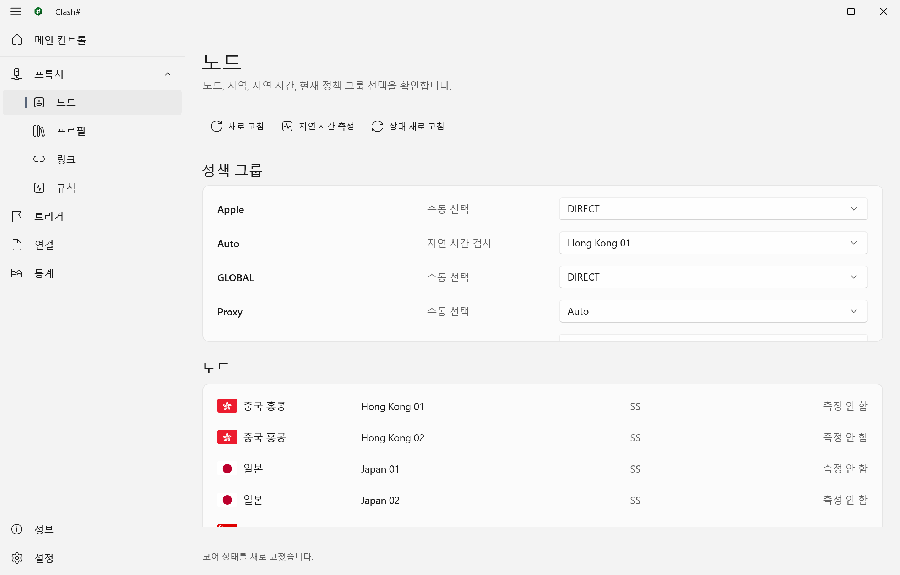&nbsp;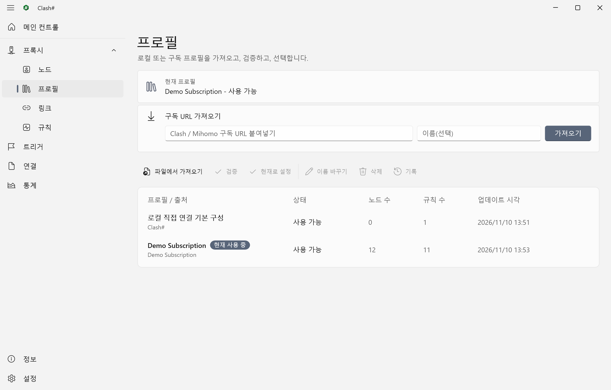

Clash#는 시작할 때마다 시작 안내를 표시하여 구독, 투명 프록시 서비스, 시작 시 복원, 남은 프록시 설정의 점검 결과를 요약한다. 이 안내는 **설정 › 시작**에서 끌 수 있다.

로컬 혼합 포트의 기본값은 `10000`이며, HTTP와 SOCKS가 함께 사용한다. 시스템 프록시를 읽지 않는 프로그램은 `127.0.0.1:10000`을 직접 사용할 수 있다. 포트는 **설정 › 프록시**에서 변경한다.

기본 창을 닫으면 Clash#는 기본적으로 트레이로 최소화되어 계속 실행된다. 종료에는 트레이 메뉴의 ‘안전하게 종료’를 사용한다. 종료 시에는 기본적으로 코어가 중지되고 시스템 프록시가 복원된다.

**설정 › 작업 표시줄 트레이**의 ‘트레이 색상 상태 표시 사용’을 켜면 트레이 아이콘이 색상으로 현재 상태를 나타낸다.

|  |  |  |
| :---: | :---: | :---: |
| 사용 안 함 또는 대기 | 시스템 프록시 | 투명 프록시 |

### 페이지

| 페이지 | 용도 |
| :--- | :--- |
| **메인 컨트롤** | 모드 전환. 타일로 코어 상태, 속도, 트래픽, 지연 시간, 구독 사용량, 공인 IP 등을 표시한다. |
| **프록시** | 노드, 프로필(버전 기록 포함), 구독 링크, 규칙. |
| **트리거** | 자동화 작업. 위에서 아래로 순서대로 판단한다. |
| **연결** | 활성 연결과 각 연결의 프로세스, 일치한 규칙, 프록시 경로. |
| **통계** | 프로필, 노드, 시간별로 집계한 장기 통계. 시스템 로그도 여기에서 연다. |
| **설정** | 언어와 외관, 시작, 프록시, Windows 통합, MCP 서버와 권한, 알림, 트레이, 중국 본토 특화 기능, 데이터 백업. |

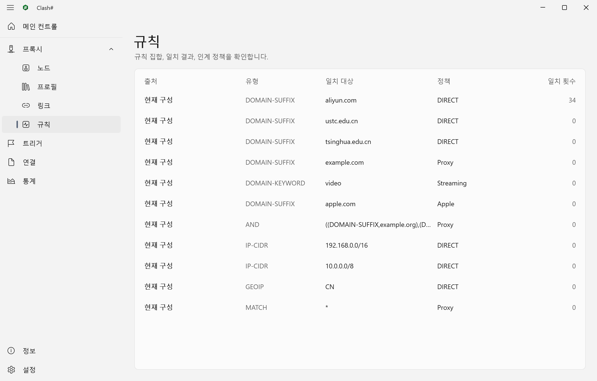&nbsp;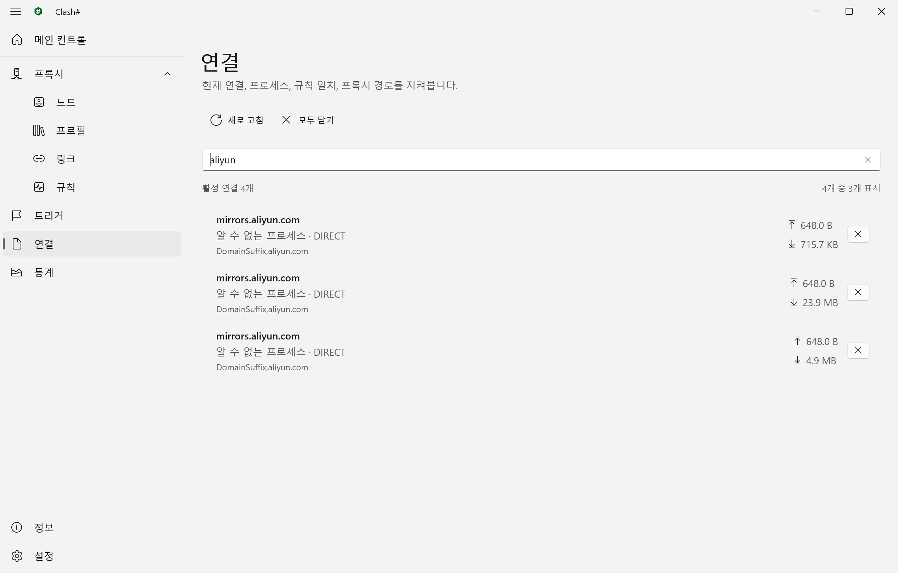

## 자주 묻는 질문

<details>
<summary><b>WSL, 터미널, Microsoft Store 앱이 프록시를 통해 네트워크에 접근하지 못한다</b></summary>
<br />

해당 프로그램은 Windows 시스템 프록시를 읽지 않는다. **설정 › Windows 통합**에서 각 항목을 진단하고 결과에 따라 보정을 적용할 수 있으며, 보정은 언제든 되돌릴 수 있다. 투명 프록시를 켜면 이러한 프로그램의 트래픽도 인계된다.
</details>

<details>
<summary><b>시작 시 충돌이 보고된다</b></summary>
<br />

충돌 확인은 네 가지 경우를 다룬다. 외부 mihomo 프로세스, 사용 중인 프록시 포트, 켜져 있는 Windows 수동 프록시, 다른 TUN 또는 VPN 어댑터이다. 대화 상자는 항목별로 설명하고, 안전하게 처리할 수 있는 항목에는 수정 동작을 제공한다. TUN과 VPN 어댑터는 알림만 표시하며, Clash#가 자동으로 끄지 않는다. 확인은 **설정 › 시작**에서 언제든 다시 실행할 수 있다.
</details>

<details>
<summary><b>비정상 종료 후 시스템 프록시가 켜진 상태로 남아 있다</b></summary>
<br />

Clash#가 비정상 종료되면 복구 프로세스가 Clash#에 속한 시스템 프록시를 즉시 복원한다. 그 전에 컴퓨터가 종료된 경우에는 다음 실행 시 Clash#가 남은 설정을 점검하고 정리한다. 또한 **설정 › Windows 통합**에서 ‘로그인 시 프록시 복구’를 등록하면, Clash# 실행을 기다리지 않고 Windows 로그인 시점에 같은 정리가 실행된다.
</details>

<details>
<summary><b>투명 프록시가 내 구독에서 시작되지 않는다</b></summary>
<br />

투명 프록시 서비스는 자체 GeoData 파일과 고정된 안전 옵션 집합으로 코어를 실행하므로, 프로필에서 다운로드 주소, 추가 수신 포트, 자격 증명을 가져오지 않는다. 무해한 GeoData 다운로드 주소(`geox-url`)는 Clash#가 자동으로 제외하며, DNS 수신기나 추가 포트처럼 서비스가 호스팅할 수 없는 항목이 프로필에 있으면 지원 코드와 함께 알려 준다. 해당 항목을 제거하거나, 투명 프록시를 끄고 시스템 프록시를 사용한다.
</details>

<details>
<summary><b>동작 하나가 실패한 뒤 이후의 동작도 모두 실패한다</b></summary>
<br />

실패한 프록시 변경은 적용된 것으로 간주되지 않고 보존되어 보고된다. 모드나 투명 프록시 스위치를 바꾸면 사용자의 동작의 일부로 자동으로 다시 시도된다. **설정**의 안내에 있는 **다시 시도** 링크는 다른 것을 바꾸지 않고 같은 동작을 수행한다.
</details>

<details>
<summary><b>백업과 업데이트</b></summary>
<br />

**설정 › 데이터**에서 Clash# 설정을 하나의 파일로 내보낼 수 있으며, 프록시 구성과 구독을 함께 포함할 수 있다. 내보낸 파일은 이후 가져와 복원한다. 로그는 SQLite 데이터베이스로 따로 내보낼 수 있으며, 가져오기는 지원하지 않는다.

**정보** 페이지는 GitHub Releases에서 새 버전을 확인한다. 업데이트는 설치 프로그램이 수행한다.
</details>

## 소스에서 빌드

현재 구현 상태, 후보 검증, 개발 계획은 [개발 문서](./docs/README.md)를 참조한다.

Windows x64, PowerShell 7, 그리고 [`global.json`](./global.json)에 지정된 버전의 .NET SDK가 필요하다.

```powershell
dotnet restore ClashSharp/ClashSharp.slnx --locked-mode
dotnet build   ClashSharp/ClashSharp.slnx -c Release -p:Platform=x64 --no-restore
dotnet test    ClashSharp/ClashSharp.Tests/ClashSharp.Tests.csproj -c Release -p:Platform=x64 --no-build
```

설치 패키지 빌드 절차는 [Installer/README.md](./ClashSharp/Installer/README.md)(중국어)에 있다.

<details>
<summary><b>저장소 구성</b></summary>
<br />

| 경로 | 내용 |
| :--- | :--- |
| `ClashSharp/ClashSharp` | WinUI 3 본 프로그램 |
| `ClashSharp/ClashSharp.Core` · `.Application` · `.Infrastructure` | 도메인 모델, 애플리케이션 로직, Windows 및 저장소 어댑터 |
| `ClashSharp/ClashSharp.MihomoService` | 투명 프록시용 코어를 실행하는 Windows 서비스 |
| `ClashSharp/ClashSharp.RecoveryWatchdog` | 비정상 종료 후 시스템 프록시를 복원하는 복구 프로세스 |
| `ClashSharp/ClashSharp.Installer*` | WPF 설치 프로그램과 트랜잭션 로직 |
| `ClashSharp/SandboxTest` | Windows 샌드박스 기반 설치 패키지 스모크 테스트 |
| `docs/` | 설계 기록과 개발 기록(중국어) |

</details>

코딩 규칙은 [CodingStyle.md](./CodingStyle.md)에 있다.

## 라이선스

프록시 코어는 MetaCubeX의 [mihomo](https://github.com/MetaCubeX/mihomo)이며 GPL-3.0으로 배포된다. GeoIP와 GeoSite 데이터는 [meta-rules-dat](https://github.com/MetaCubeX/meta-rules-dat)에서 제공된다.

Clash#는 [AGPL-3.0](./LICENSE) 라이선스로 공개된다.
