<div align="center">


# Clash#

**Прокси-клиент для Windows, нативный с самого основания**

[](https://github.com/Water-Run/ClashSharp/actions/workflows/ci.yml)
[](./LICENSE)
[](#установка)
[](./global.json)

[English](./README.md) · [简体中文](./README-zh.md) · [繁體中文](./README-zh-Hant.md) · [한국어](./README-ko.md) · **Русский** · [فارسی](./README-fa.md)

&nbsp;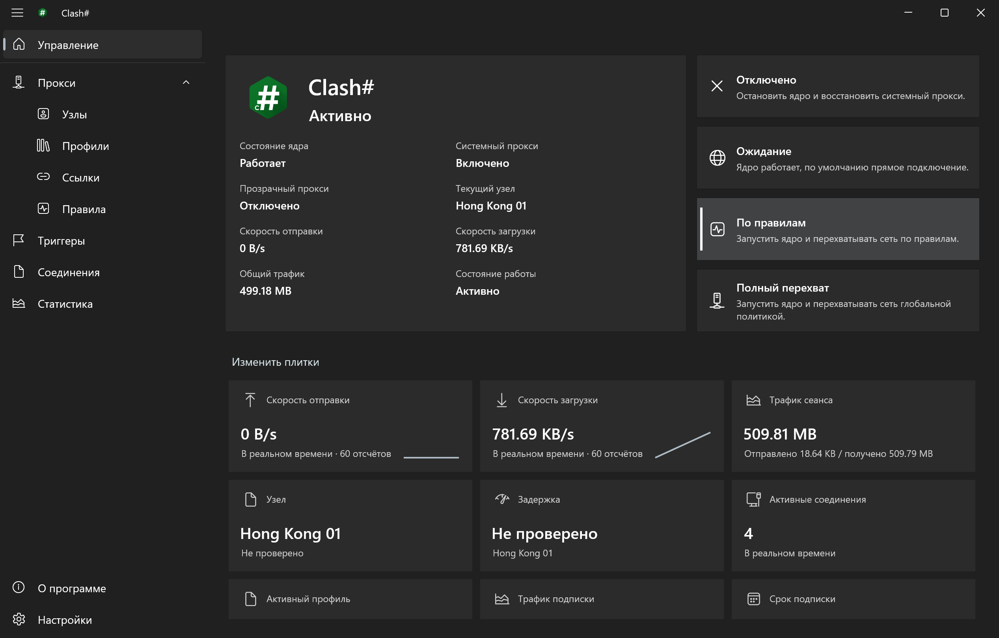

</div>

> [!IMPORTANT]
> Clash# 1.0.0 находится в разработке; официального выпуска нет. Пакеты, собираемые CI, являются неподписанными тестовыми сборками и не предназначены для повседневного использования.

Clash# — прокси-клиент для Windows на ядре [mihomo](https://github.com/MetaCubeX/mihomo). Он написан на C# с использованием .NET 10 и WinUI 3, распространяется в виде пакета MSIX, а устанавливается и восстанавливается собственным установщиком. Это не веб-страница в окне: встроенного браузера нет, а каждый элемент управления, уведомление, меню в трее, служба и параметр — настоящие, принадлежащие Windows.

## Почему Clash#

| | |
| :--- | :--- |
| **Нативность с самого основания** | Элементы WinUI 3, дизайн Fluent, плитки Windows, системные уведомления, область уведомлений, службы и параметры прокси Windows используются так, как задумано в Windows. [Подробнее](#нативность-с-самого-основания) |
| **Интеграция с Windows за один шаг** | Один установщик разворачивает приложение, службу прозрачного прокси и сертификат пакета. Восстановление после выхода, сбоя и перезагрузки встроено. [Подробнее](#интеграция-с-windows-за-один-шаг) |
| **Готов к работе с Agent** | Локальный сервер MCP позволяет Agent читать реальное состояние и, только с вашего разрешения, изменять его. Каждое разрешение — отдельный переключатель. [Подробнее](#agent-с-вашего-согласия-mcp) |
| **Отдельный менеджер установки** | `Setup.exe` устанавливает, восстанавливает, обновляет и удаляет всё, что сам разместил на компьютере, и продолжает работу после прерывания. [Подробнее](#отдельный-менеджер-установки) |
| **Автоматизация, объясняющая себя** | Триггеры выполняют действия по порядку, когда выполнены все условия. [Подробнее](#триггеры) |
| **Функции материкового Китая** | Необязательные правила отображения названий регионов, флагов и текста, применяемые только к интерфейсу. [Подробнее](#функции-материкового-китая) |
| **Переносимые данные** | Экспорт и импорт настроек, профилей и подписок; экспорт журналов; долгосрочная статистика. [Подробнее](#переносимые-данные) |

## Нативность с самого основания

Clash# не подражает Windows, а собран из того, что даёт сама Windows. Помимо элементов управления WinUI 3 и оформления Fluent, первым делом встречаются вещи, которые есть только в Windows: плитки, системные уведомления и область уведомлений.

### Плитки

«Управление» — это стена из плиток, так Windows показывает живую информацию со времён меню «Пуск». Каждая плитка — один факт, который обновляется сам: состояние ядра, скорость отдачи и загрузки, трафик за сеанс и суммарный, текущий узел и задержка, активные соединения, расход и срок подписки, настройки DNS, память и время работы ядра, внешний IP-адрес и другое. Плитки и ведут себя как плитки: щелчок выполняет действие (например, запускает проверку соединения или запрашивает внешний IP), перетаскивание меняет порядок, а правая кнопка или долгое касание открывают команды самой плитки, например «Открепить от панели». Всего плиток 74, и не все они только показывают значения: у некоторых есть переключатели и действия — системные уведомления, запуск при входе, тема, язык, экспорт и импорт, так что панель может служить и пультом управления.


### Правка плиток и раскладки

«Изменить плитки» открывает нативный список всех плиток с поиском и счётчиком. Начните с «Шаблон раскладки»: «По умолчанию», «Расширенный», «Минимум», «Технический», «Общий» или «Все плитки». Затем отметьте нужные плитки, воспользуйтесь «Показать все» и «Скрыть все» или вернитесь к началу командой «Вернуть рекомендуемую раскладку». «Сохранить как шаблон» сохраняет вашу раскладку, «Удалить выбранный шаблон» удаляет её, а «Восстановить шаблоны по умолчанию» возвращает встроенные. Раскладки и шаблоны входят в настройки, которые можно экспортировать и импортировать.

<p align="center">
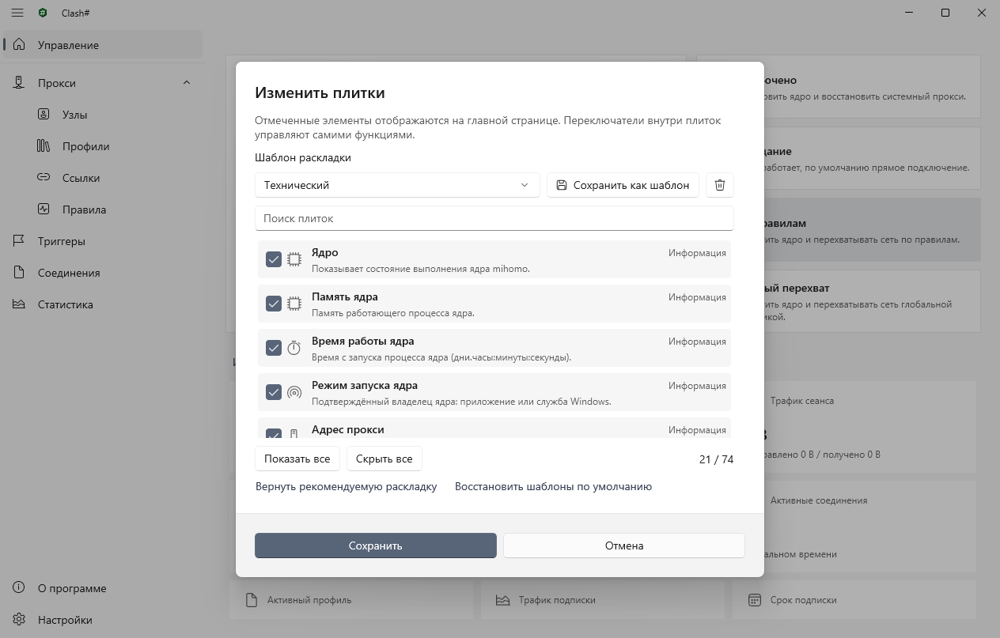&nbsp;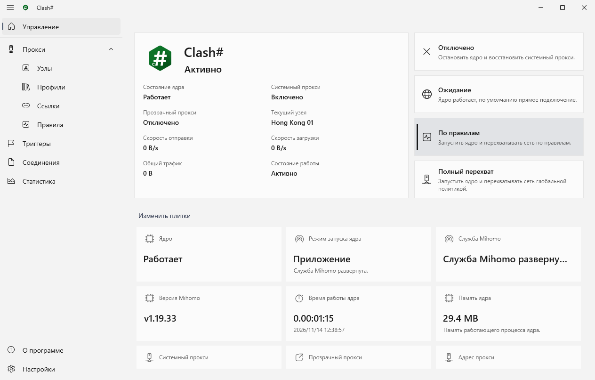
</p>

### Уведомления

<p align="center">
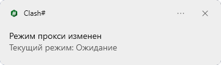
</p>

Это настоящие всплывающие уведомления Windows: они появляются в углу экрана и остаются в центре уведомлений.

Clash# сообщает, что изменилось, к какому объекту это относится и что делать дальше, а в остальное время молчит. Параметр «Включить системные уведомления» включает и выключает их все, а уровень задаёт объём:

| Уровень | О чём вы получаете уведомления |
| :--- | :--- |
| **Только важные** | Ядро неожиданно остановилось, служба прозрачного прокси стала недоступна, перехват не удалось применить или проверить, проверка при запуске требует действий, либо текущая подписка истекла или исчерпала трафик. |
| **По умолчанию** | Всё перечисленное, а также смена режима и прозрачного прокси, выбор профиля и узла, неудачные импорт и обновление, превышение времени теста, сообщения триггеров и текущая подписка, которая истекает в ближайшие три дня или израсходовала 90 % трафика. |
| **Больше** | Всё перечисленное, а также успешные импорт, обновление, экспорт и сохранение настроек. |

Напоминание о подписке приходит один раз на каждом этапе и начинается заново после продления или сброса трафика. Уведомление об ошибке содержит ту же причину и код поддержки, что и страница, поэтому узнать причину можно, не открывая окно. Пассивные проверки, отменённые действия и выборка данных никогда не вызывают уведомлений.

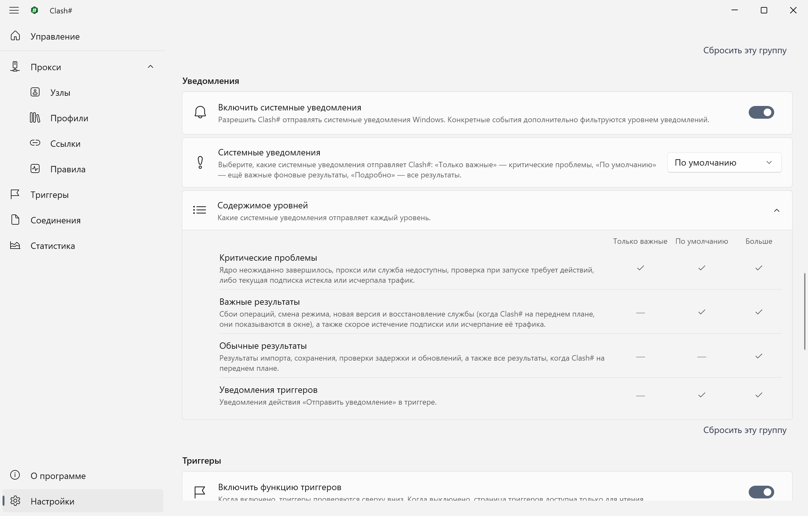

### Область уведомлений

Значок в трее — настоящий значок области уведомлений. Его контекстное меню — стандартное меню Windows: «Статус», «Режим», «Страницы», «Прозрачный прокси», «Настройки» и «Безопасный выход»; в разделе **Настройки › Панель задач и трей** выбирают, какие пункты показывать и в каком порядке. При включённом цветовом индикаторе по цвету значка сразу видно состояние, а в языках с письмом справа налево меню зеркально отражается, как и собственные меню Windows.

<p align="center">
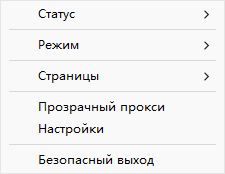
</p>

### Механизмы Windows — так, как они задуманы

| Механизм Windows | Что с ним делает Clash# |
| :--- | :--- |
| **Дизайн и материалы Fluent** | Нативные элементы WinUI 3 и значки Fluent. Следует системной светлой или тёмной теме, системному цвету акцента, темам высокой контрастности и масштабированию текста. |
| **Уведомления** | Настоящие уведомления Windows с общим выключателем и тремя уровнями; щелчок по ним возвращает в приложение. Собственные разрешения и режимы фокусировки Windows всегда имеют приоритет. |
| **Область уведомлений** | Значок в трее, цвет которого показывает текущее состояние, и меню с частыми действиями. |
| **Автозапуск** | Запуск при входе использует собственную регистрацию автозагрузки Windows. Отдельная очистка при входе может восстановить прокси, не дожидаясь приложения. |
| **Службы** | Прозрачный прокси работает в службе Windows под управлением диспетчера служб, с наблюдением и автоматическим перезапуском ядра. |
| **Защита учётных данных** | Токен Agent и учётные данные контроллера защищены средствами защиты данных Windows. |
| **Время жизни процессов** | Дочерние процессы находятся в объекте задания, поэтому после остановки приложения ядро не остаётся запущенным. |
| **Параметры прокси Windows** | Перехватывает системный прокси и возвращает ровно то, что заменил. |
| **Пакеты MSIX** | Чистая установка и удаление, пункт в меню «Пуск» и удобный для панели задач идентификатор. |
| **Языки** | Восемь языков интерфейса, переключаемых мгновенно, включая персидский с письмом справа налево. |

### Восемь языков

Язык интерфейса меняется сразу; немногие тексты, которые предоставляет Windows, например названия цветов, обновятся при следующем запуске. Для персидского страницы, диалоги и меню в области уведомлений зеркально отражаются справа налево.

<p align="center">
&nbsp;&nbsp;&nbsp;
&nbsp;&nbsp;&nbsp;
</p>

## Интеграция с Windows за один шаг

### Режимы

Режимы Clash# названы по их действию на сеть:

| Clash# | Общепринятое название | Поведение |
| :--- | :--- | :--- |
| **Отключено** | Выкл. | Ядро останавливается, системный прокси восстанавливается. |
| **Ожидание** | Напрямую | Ядро работает, трафик по умолчанию идёт напрямую. |
| **По правилам** | Правила | Трафик распределяется по правилам профиля. |
| **Полный перехват** | Глобальный | Весь трафик идёт через выбранный прокси. |

Прозрачный прокси (TUN) управляется параметром «Прозрачный прокси» в разделе **Настройки › Прокси** и по умолчанию включён. Если он включён и служба Mihomo доступна, перехват выполняется через TUN и распространяется также на программы, не использующие системный прокси. Если служба Mihomo не развёрнута, перехват выполняется через системный прокси Windows.

> [!CAUTION]
> Прозрачный прокси перехватывает маршрутизацию и DNS всего компьютера. Clash# рассчитан на один компьютер с одним интерактивным пользователем и не изолирует трафик между пользовательскими сеансами.

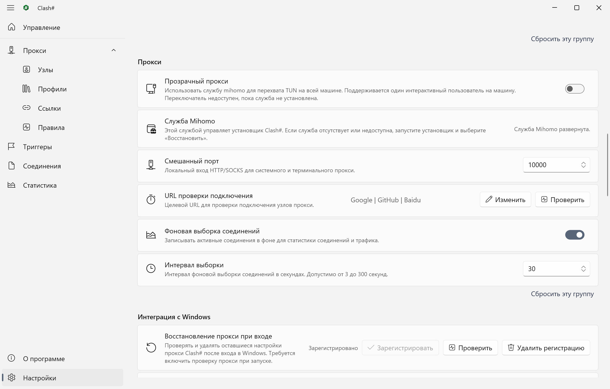

### Восстановление, о котором не нужно думать

| Ситуация | Что делает Clash# |
| :--- | :--- |
| Вы выходите из приложения | Останавливает ядро и восстанавливает системный прокси, принадлежащий Clash# (настраивается). |
| Приложение аварийно завершается | Процесс восстановления немедленно возвращает системный прокси. |
| Windows выключается раньше | Оставшаяся настройка обнаруживается и удаляется при следующем запуске или при входе, если зарегистрирована очистка при запуске. |
| Ядро неожиданно останавливается | Вы получаете уведомление, а служба перезапускает ядро в пределах бюджета попыток. |
| Перехват не удаётся проверить | Неудавшееся изменение сохраняется и сообщается, а не выдаётся за применённое; следующее действие устраняет проблему. |

### Проверки при запуске и нативные исправления

Перед запуском режима прокси Clash# проверяет наличие внешнего процесса mihomo, занятого порта, ручного прокси Windows и других адаптеров TUN или VPN и предлагает исправления для того, что можно обработать безопасно. Раздел **Настройки › Интеграция с Windows** отдельно диагностирует WSL, терминалы и приложения Microsoft Store, которые не используют системный прокси, и применяет или откатывает исправление для каждого из них.

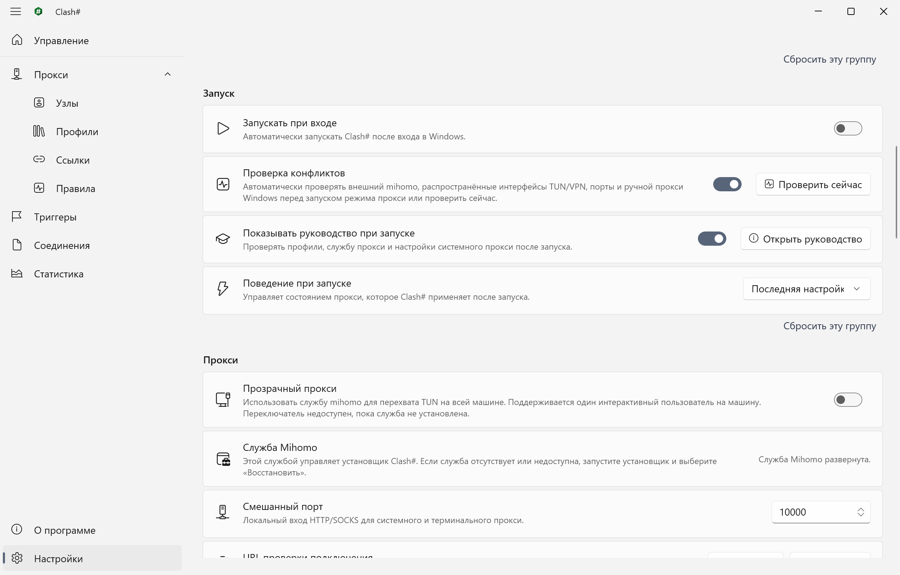

## Agent с вашего согласия (MCP)

Локальный сервер MCP соединяет Agent с реальным состоянием, настройками, профилями, диагностикой и сохранённой историей. По умолчанию он выключен и слушает только петлевой интерфейс (`http://127.0.0.1:20000/mcp`). Каждое разрешение — отдельный переключатель, управление прокси требует собственного разрешения, а Agent не может менять собственные права.

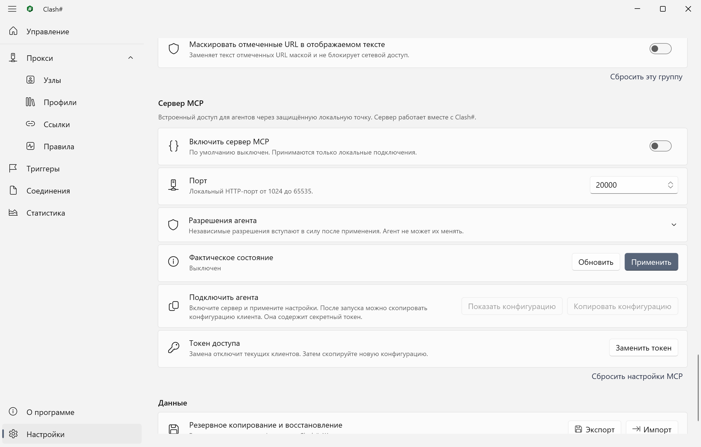

1. Откройте **Настройки › Сервер MCP**, включите сервер и выберите разрешения. Заранее выбрано только чтение состояния.
2. Нажмите **Применить** и убедитесь, что фактическое состояние — **Работает**.
3. С помощью **Копировать конфигурацию** передайте адрес и заголовок авторизации клиенту с поддержкой Streamable HTTP. Копия исключается из истории буфера обмена Windows и облачной синхронизации.

Сочетания разрешений и решение проблем описаны в [руководстве по подключению и разрешениям (на английском языке)](./docs/guides/native-agent.md).

## Отдельный менеджер установки

`Setup.exe` — самостоятельное приложение Windows, а не мастер, пристроенный к программе. Он устанавливает программу для текущего пользователя и запрашивает права администратора только для частей уровня компьютера, а позже восстанавливает, обновляет или удаляет ровно то, что установил, включая службу и управляемый им сертификат. Каждый шаг записывается, поэтому прерванная операция продолжается, а не оставляет наполовину установленный компьютер, и исходное состояние можно вернуть. Установщик поддерживает те же восемь языков, что и приложение: по умолчанию он следует языку интерфейса Windows, а до начала операции язык можно сменить в верхнем углу окна.

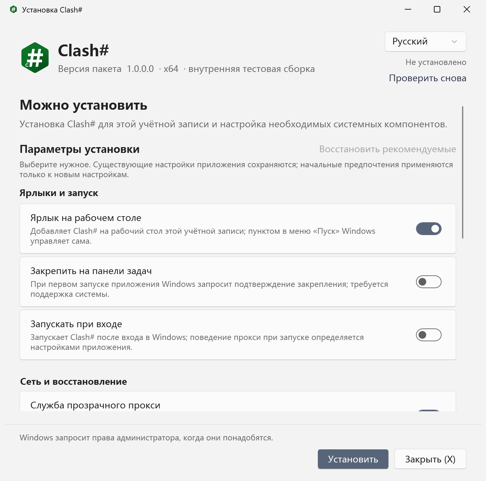

## Триггеры

Триггер выполняет упорядоченный список действий, когда выполнены все его условия. Условия: вход в приложение, запуск прокси, уведомления выбранного уровня, трафик за временное окно, трафик текущего запуска, скорость, число активных соединений, время работы и системное время. Действия: смена режима, разрыв соединений, включение и выключение прозрачного прокси, выборки соединений и запуска при входе, отправка уведомления и выход. Для каждого триггера показано, когда он срабатывал в последний раз.

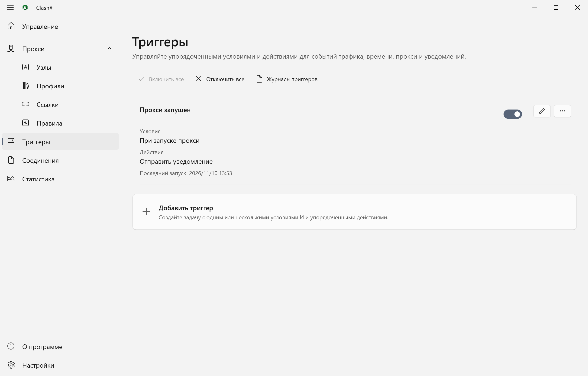

## Функции материкового Китая

Необязательные правила отображения для тех, кто использует Clash# в материковом Китае; находятся в разделе **Настройки › Функции материкового Китая**. Они изменяют только то, что показывает интерфейс: профили, журналы, поиск, скопированный текст и экспортированные данные не изменяются никогда, и ничто здесь не блокирует доступ к сети.

Параметр «Встроенный фильтр проверки» задаёт, насколько далеко идут правила; каждый вариант включает предыдущие:

| Вариант | Что показывает интерфейс |
| :--- | :--- |
| **Только замена флагов** | Тайвань отображается с флагом Китайской Народной Республики; Гонконг и Макао сохраняют флаги своих регионов. |
| **Только замена флагов и дополнение текста** | Названия регионов тоже следуют этой норме, например «Китай, Гонконг», «Китай, Макао» и «Китай, Тайвань». |
| **Флаги, дополнение текста и фильтр ключевых слов** | Короткий список чувствительных китайских слов также скрывается в отображаемом тексте. |

По умолчанию включены замена флагов и дополнение текста, а вариант **Не включать** отключает всё. Отдельный переключатель «Маскировать отмеченные URL в отображаемом тексте» скрывает и адреса из встроенного списка; по умолчанию он выключен.

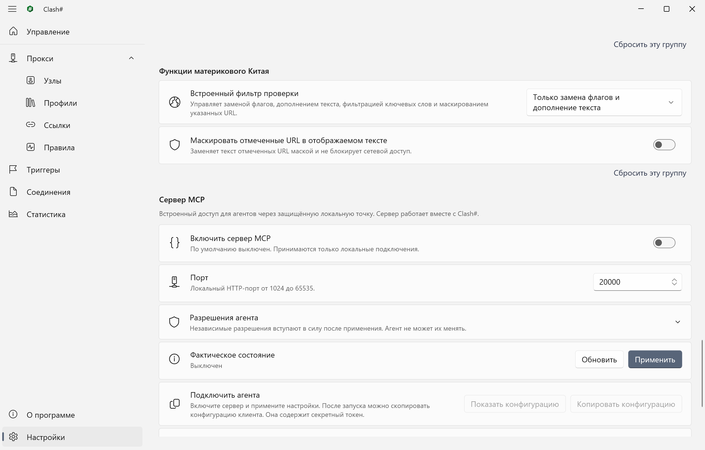

## Переносимые данные

**Настройки › Данные** экспортирует настройки Clash# в один файл, при необходимости вместе с конфигурацией прокси и подписками, и импортирует его обратно. Журналы экспортируются отдельно в виде базы данных SQLite. Статистика трафика, соединений, состояния узлов и срабатываний правил хранится локально по профилям, узлам и времени, а перед удалением показывается предварительный просмотр очистки.

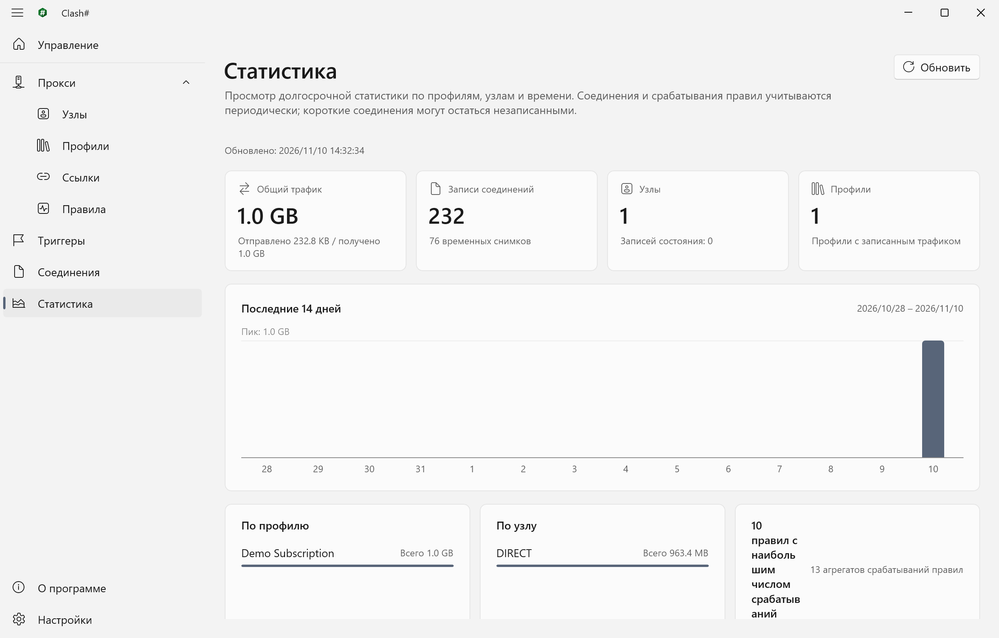&nbsp;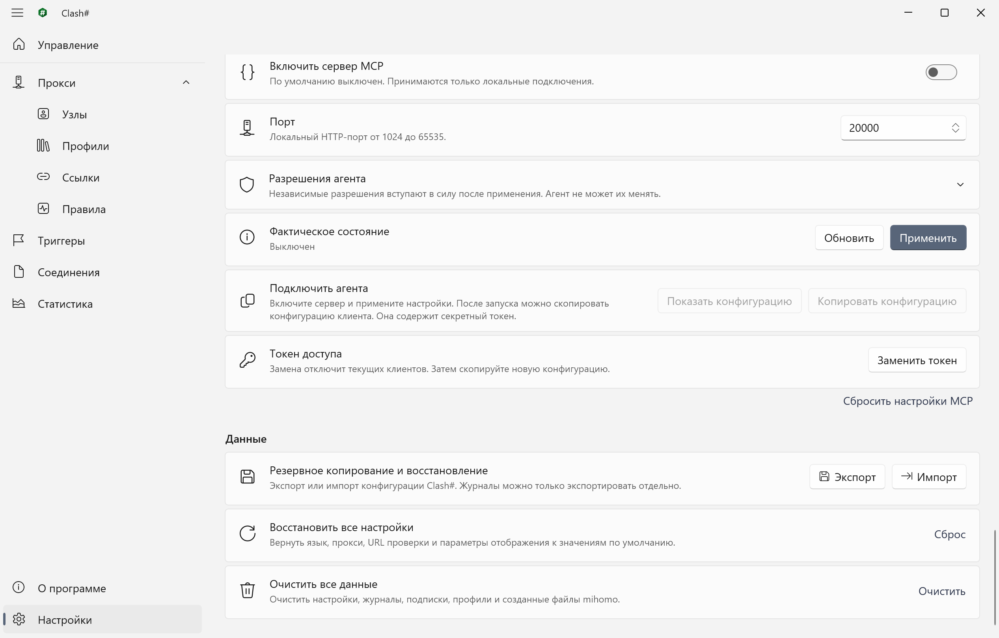

## Установка

**Системные требования:** Windows 11 x64 или Windows Server 2025 с возможностями рабочего стола.

После выхода официальной версии пакеты публикуются на странице [Releases](https://github.com/Water-Run/ClashSharp/releases).

1. Пакет выпуска скачивается и распаковывается. `Setup.exe` должен находиться рядом с папкой `payload`.
2. `Setup.exe` запускается в текущем сеансе пользователя. Приложение устанавливается для пользователя, запустившего установщик; запуск от имени администратора и предварительная установка .NET не требуются.
3. Подтвердите запрос администратора Windows. Установщик разворачивает службу Mihomo и автоматически управляет сертификатом пакета Clash#. Перед подтверждением следует проверить отображаемого издателя.

Восстановление, обновление и удаление выполняются повторным запуском того же установщика.

> [!WARNING]
> Удаление следует выполнять через `Setup.exe`. При удалении только через «Параметры › Приложения» Windows ресурсы уровня компьютера, в том числе служба Mihomo, остаются.

## Начало работы

1. В разделе **Прокси › Ссылки** добавляется ссылка на подписку. Clash# загружает и проверяет соответствующий профиль.
2. В разделе **Прокси › Профили** проверяется, что этот профиль является текущим.
3. На странице **Управление** выбирается режим **По правилам**.
4. В разделе **Прокси › Узлы** выбирается узел; предварительно можно выполнить проверку задержки.

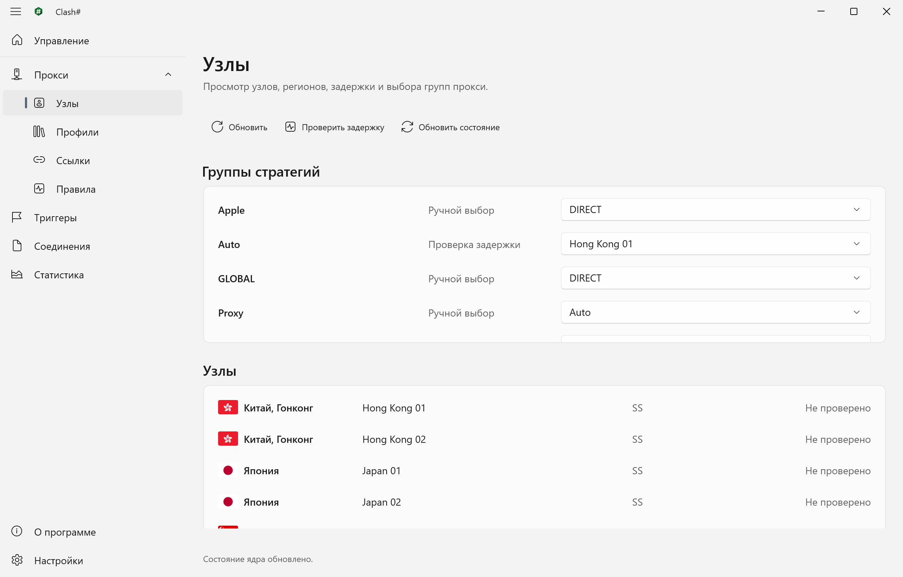&nbsp;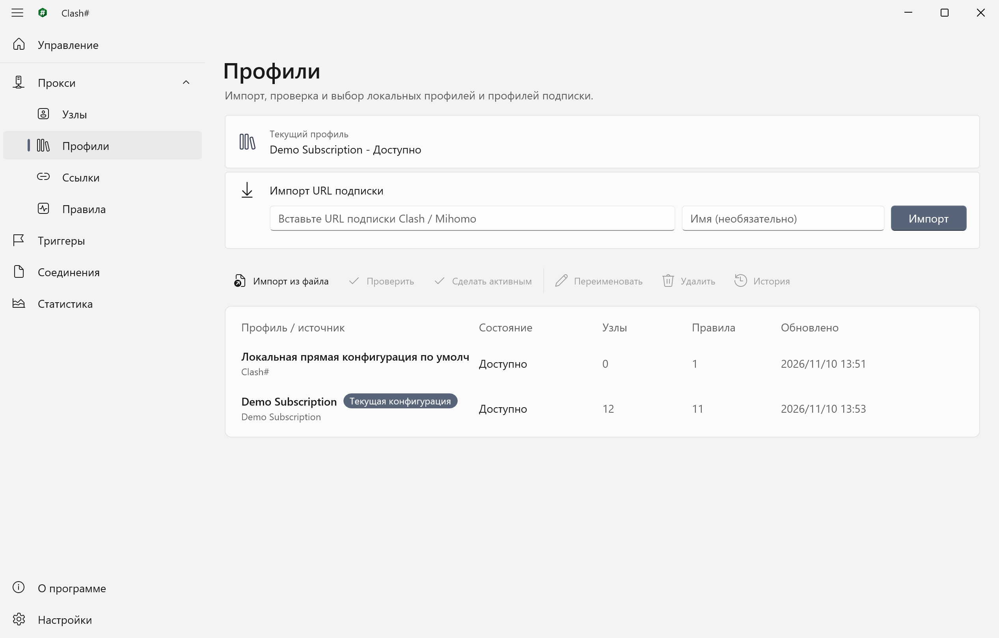

При каждом запуске Clash# показывает руководство, сводящее результаты проверок подписки, службы прозрачного прокси, восстановления при запуске и остаточных настроек прокси. Руководство отключается в разделе **Настройки › Запуск**.

Локальный смешанный порт по умолчанию — `10000`; он обслуживает HTTP и SOCKS. Программы, не использующие системный прокси, могут обращаться к `127.0.0.1:10000` напрямую. Порт изменяется в разделе **Настройки › Прокси**.

При закрытии главного окна Clash# по умолчанию сворачивается в трей и продолжает работу. Для выхода предназначен пункт «Безопасный выход» в меню трея; при выходе по умолчанию ядро останавливается, а системный прокси восстанавливается.

При включённом параметре «Включить цветовой индикатор состояния в трее» в разделе **Настройки › Панель задач и трей** значок в трее обозначает текущее состояние цветом:

|  |  |  |
| :---: | :---: | :---: |
| Отключено или Ожидание | Системный прокси | Прозрачный прокси |

### Страницы

| Страница | Назначение |
| :--- | :--- |
| **Управление** | Переключение режимов; плитки показывают состояние ядра, скорость, трафик, задержку, расход подписки, внешний IP и другие сведения. |
| **Прокси** | Узлы, профили (с историей версий), ссылки на подписки и правила. |
| **Триггеры** | Задачи автоматизации, проверяемые сверху вниз. |
| **Соединения** | Активные соединения с процессом, сработавшим правилом и маршрутом прокси. |
| **Статистика** | Долгосрочные итоги по профилям, узлам и времени; отсюда же открываются системные журналы. |
| **Настройки** | Язык и оформление, запуск, прокси, интеграция с Windows, сервер MCP и разрешения, уведомления, трей, функции материкового Китая и резервное копирование данных. |

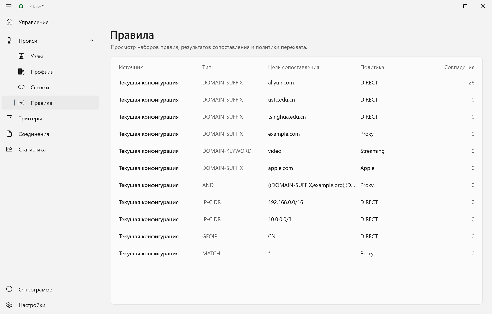&nbsp;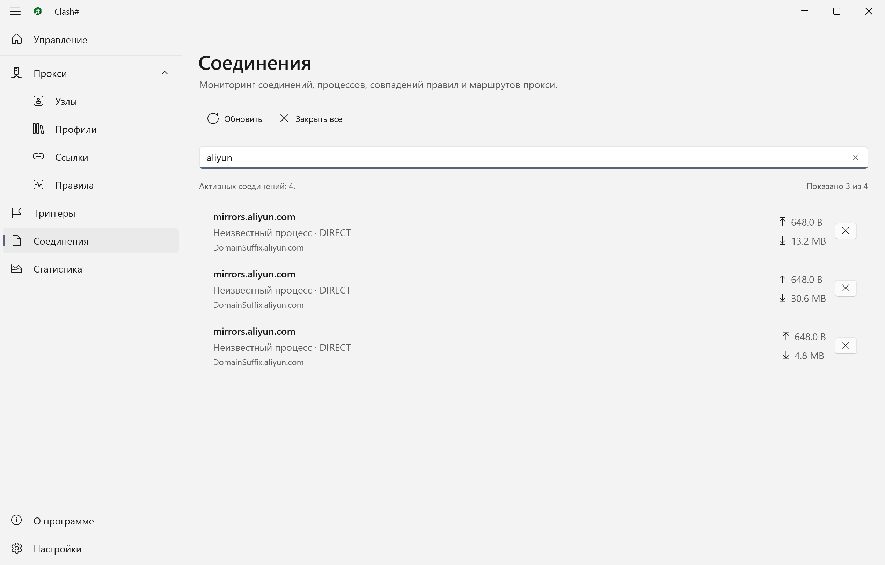

## Частые вопросы

<details>
<summary><b>WSL, терминал или приложение Microsoft Store не получают доступ к сети через прокси</b></summary>
<br />

Эти программы не используют системный прокси Windows. В разделе **Настройки › Интеграция с Windows** для каждой из них выполняется диагностика и по её результату применяется исправление; исправление можно откатить в любой момент. При включённом прозрачном прокси трафик таких программ также перехватывается.
</details>

<details>
<summary><b>При запуске сообщается о конфликте</b></summary>
<br />

Проверка конфликтов охватывает четыре случая: внешний процесс mihomo, занятый порт прокси, включённый ручной прокси Windows и другие адаптеры TUN или VPN. Диалог поясняет каждый пункт и предлагает исправление там, где его можно применить безопасно. Об адаптерах TUN и VPN только сообщается; Clash# их не отключает. Проверку можно повторить в любой момент в разделе **Настройки › Запуск**.
</details>

<details>
<summary><b>После аварийного завершения системный прокси остаётся включённым</b></summary>
<br />

При аварийном завершении Clash# процесс восстановления немедленно возвращает системный прокси, всё ещё принадлежащий Clash#. Если компьютер был выключен раньше, Clash# проверяет и удаляет остаточную настройку при следующем запуске. Кроме того, в разделе **Настройки › Интеграция с Windows** можно зарегистрировать «Восстановление прокси при входе», чтобы та же очистка выполнялась при входе в Windows, не дожидаясь запуска Clash#.
</details>

<details>
<summary><b>Прозрачный прокси не запускается с моей подпиской</b></summary>
<br />

Служба прозрачного прокси запускает ядро со своими файлами GeoData и фиксированным набором безопасных параметров, поэтому никогда не берёт из профиля адреса загрузки, дополнительные порты прослушивания и учётные данные. Безвредный адрес загрузки GeoData (`geox-url`) Clash# исключает автоматически, а если профиль задаёт то, что служба разместить не может, например прослушиватель DNS или дополнительный порт, сообщает об этом с кодом поддержки. Удалите эту запись или отключите прозрачный прокси и используйте системный прокси.
</details>

<details>
<summary><b>Одно действие завершилось ошибкой, и все последующие тоже</b></summary>
<br />

Неудавшееся изменение прокси сохраняется и сообщается, а не выдаётся за применённое. При смене режима или переключателя прозрачного прокси оно автоматически повторяется в рамках вашего действия. Ссылка **Повторить** в уведомлении на странице **Настройки** делает то же самое, ничего больше не меняя.
</details>

<details>
<summary><b>Резервное копирование и обновления</b></summary>
<br />

В разделе **Настройки › Данные** настройки Clash# экспортируются в один файл, при необходимости вместе с конфигурацией прокси и подписками, для последующего импорта. Журналы экспортируются отдельно в виде базы данных SQLite; их импорт не поддерживается.

Страница **О программе** проверяет наличие новых версий на GitHub Releases. Обновления устанавливаются установщиком.
</details>

## Сборка из исходного кода

Текущее состояние реализации, проверка кандидатов и план разработки описаны в [документации разработки](./docs/README.md).

Для сборки требуются Windows x64, PowerShell 7 и версия .NET SDK, указанная в [`global.json`](./global.json).

```powershell
dotnet restore ClashSharp/ClashSharp.slnx --locked-mode
dotnet build   ClashSharp/ClashSharp.slnx -c Release -p:Platform=x64 --no-restore
dotnet test    ClashSharp/ClashSharp.Tests/ClashSharp.Tests.csproj -c Release -p:Platform=x64 --no-build
```

Сборка пакета установщика описана в [Installer/README.md](./ClashSharp/Installer/README.md) (на китайском языке).

<details>
<summary><b>Структура репозитория</b></summary>
<br />

| Путь | Содержимое |
| :--- | :--- |
| `ClashSharp/ClashSharp` | Приложение WinUI 3 |
| `ClashSharp/ClashSharp.Core` · `.Application` · `.Infrastructure` | Модель предметной области, логика приложения, адаптеры Windows и хранилища |
| `ClashSharp/ClashSharp.MihomoService` | Служба Windows, запускающая ядро для прозрачного прокси |
| `ClashSharp/ClashSharp.RecoveryWatchdog` | Процесс восстановления системного прокси после аварийного завершения |
| `ClashSharp/ClashSharp.Installer*` | Установщик на WPF и логика его транзакций |
| `ClashSharp/SandboxTest` | Проверки пакета в Windows Sandbox |
| `docs/` | Проектные и рабочие записи (на китайском языке) |

</details>

Соглашения о коде описаны в [CodingStyle.md](./CodingStyle.md).

## Лицензия

Ядро прокси — [mihomo](https://github.com/MetaCubeX/mihomo) от MetaCubeX, распространяется по лицензии GPL-3.0. Данные GeoIP и GeoSite предоставляются проектом [meta-rules-dat](https://github.com/MetaCubeX/meta-rules-dat).

Clash# распространяется по лицензии [AGPL-3.0](./LICENSE).
