<div align="center">


# Clash#

**從根上原生的 Windows 代理客戶端**

[](https://github.com/Water-Run/ClashSharp/actions/workflows/ci.yml)
[](./LICENSE)
[](#安裝)
[](./global.json)

[English](./README.md) · [简体中文](./README-zh.md) · **繁體中文** · [한국어](./README-ko.md) · [Русский](./README-ru.md) · [فارسی](./README-fa.md)

&nbsp;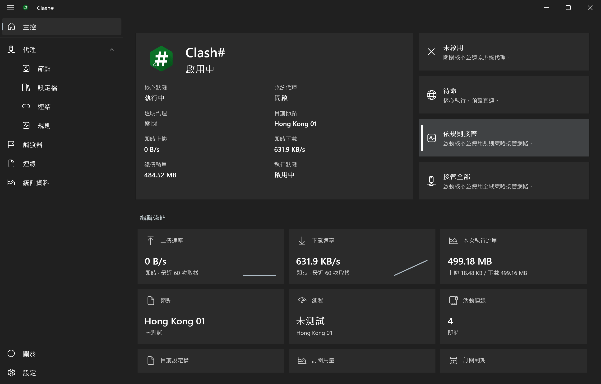

</div>

> [!IMPORTANT]
> Clash# 1.0.0 尚在開發中，目前沒有正式釋出版本。CI 生成的安裝包為未簽名的測試構建，不適用於日常使用。

Clash# 是基於 [mihomo](https://github.com/MetaCubeX/mihomo) 核心的 Windows 代理客戶端。主程式採用 C#、.NET 10 與 WinUI 3 開發，以 MSIX 包分發，由獨立的安裝器負責安裝與修復。它不是裝進視窗裡的網頁：沒有內嵌瀏覽器，每一個控制元件、通知、托盤選單、服務與設定，都是真正的 Windows 元件。

## 為什麼選擇 Clash#

| | |
| :--- | :--- |
| **從根上原生** | WinUI 3 控制元件、Fluent 設計、Windows 磁貼、系統通知、通知區域、服務與 Windows 代理設定，全部按 Windows 的方式使用。[詳細瞭解](#從根上原生) |
| **Windows 功能一步到位** | 一個安裝器同時部署應用、透明代理服務與軟體包證書；結束、當機潰與重啟後的恢復均已內建。[詳細瞭解](#windows-功能一步到位) |
| **為 Agent 而備** | 本機 MCP 伺服器讓 Agent 讀取真實狀態，並且僅在你允許時才能修改。每項權限都是獨立開關。[詳細瞭解](#經你許可的-agentmcp) |
| **獨立的安裝管理器** | `Setup.exe` 負責安裝、修復、升級，並移除它放到機器上的一切；中斷後可繼續。[詳細瞭解](#獨立的安裝管理器) |
| **會解釋自己的自動化** | 觸發器在全部條件滿足後按順序執行動作。[詳細瞭解](#觸發器) |
| **中國大陸特色功能** | 可選的地區名稱、旗幟與文字顯示規範，僅作用於介面。[詳細瞭解](#中國大陸特色功能) |
| **資料可攜帶** | 設定、設定檔與訂閱可匯出匯入；日誌可匯出；統計資料長期留存。[詳細瞭解](#資料可攜帶) |

## 從根上原生

### 主控

主控由一眼就像 Windows 的磁貼組成，顯示核心狀態、速率、流量、延遲、訂閱用量與到期、公網 IP 等資訊。磁貼可顯示、隱藏與排序，並提供六套內建佈局以便快速上手：預設、較多、極簡、技術向、廣泛大眾與全部磁貼。


### 按 Windows 本來的方式使用系統機制

| Windows 機制 | Clash# 如何使用 |
| :--- | :--- |
| **Fluent 設計與材質** | 原生 WinUI 3 控制元件與 Fluent 圖示，跟隨系統的淺色／深色主題與系統主題色，支援高對比度主題與文字縮放。 |
| **通知** | 真正的 Windows 通知，一個總開關加三個級別，點選後回到應用程式。Windows 自身的通知許可與專注設定始終生效。 |
| **通知區域** | 托盤圖示以顏色表示目前狀態，選單提供常用操作。 |
| **開機啟動** | 登入時啟動使用 Windows 自己的啟動註冊；另有獨立的登入清理項，可不等應用啟動就還原代理。 |
| **服務** | 透明代理執行在由服務控制管理器管理的 Windows 服務中，對核心進行監督並在失敗時自動重啟。 |
| **認證資訊保護** | Agent 令牌與控制器認證資訊由 Windows 資料保護機制保護。 |
| **處理程序生命週期** | 子處理程序放入工作物件，應用程式停止後不會遺留核心處理程序。 |
| **Windows 代理設定** | 接管系統代理，並原樣還原被它替換的內容。 |
| **MSIX 打包** | 乾淨的安裝與解除安裝、開始選單入口與軟體包標識。 |
| **介面語言** | 八種介面語言即時切換，含從右到左佈局的波斯語。 |

### 八種語言

介面文字即時切換語言，色彩名稱等少數由 Windows 提供的文字在下次啟動後跟隨；波斯語會把頁面、對話方塊和系統匣選單鏡像為由右至左。

<p align="center">
&nbsp;&nbsp;&nbsp;
&nbsp;&nbsp;&nbsp;
</p>

### 通知

Clash# 告訴你發生了什麼變化、與哪個項目有關、接下來該做什麼，其餘時間保持安靜。「啟用系統通知」是總開關，級別決定通知的多寡：

| 級別 | 會通知的內容 |
| :--- | :--- |
| **僅重要** | 核心意外停止、透明代理服務無法使用、接管未能套用或驗證、啟動檢查需要處理，以及目前訂閱已到期或流量已用完。 |
| **預設** | 上述內容，加上模式與透明代理變更、設定檔與節點選擇、匯入或更新失敗、測試逾時、觸發器訊息，以及目前訂閱三天內到期或流量已用到 90%。 |
| **詳細** | 以上全部，加上匯入、更新、匯出與設定儲存成功。 |

訂閱提醒每個階段只發一次，續費或流量重置後重新開始。失敗通知帶有與頁面相同的原因和支援代碼，不必開啟視窗也能知道原因。被動檢查、已取消的操作與取樣不會產生通知。

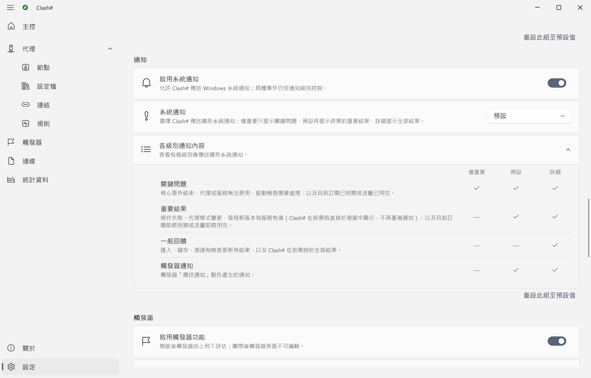

## Windows 功能一步到位

### 模式

Clash# 以模式對網路的作用為其命名：

| Clash# | 常見名稱 | 行為 |
| :--- | :--- | :--- |
| **未啟用** | 關閉 | 停止核心，還原系統代理。 |
| **待命** | 直連 | 核心執行，流量預設直連。 |
| **依規則接管** | 規則 | 按設定檔中的規則分流。 |
| **接管全部** | 全域性 | 全部流量經由所選代理。 |

透明代理（TUN）由 **設定 › 代理** 中的「透明代理」控制，預設開啟。開啟且 Mihomo 服務可用時，接管透過 TUN 完成，不讀取系統代理的程式同樣受其覆蓋；服務未部署時，接管改由 Windows 系統代理完成。

> [!CAUTION]
> 透明代理接管整臺電腦的路由與 DNS。Clash# 按「一臺電腦、一個互動使用者」設計，不提供多使用者會話之間的流量隔離。

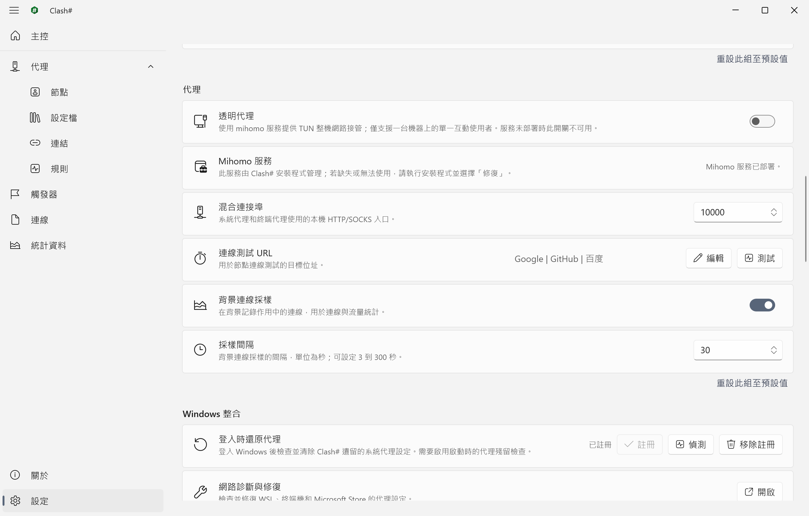

### 無需操心的恢復

| 情形 | Clash# 的做法 |
| :--- | :--- |
| 你結束應用程式 | 停止核心，並還原歸 Clash# 所有的系統代理（可設定）。 |
| 應用程式當機 | 復原處理程序立即還原系統代理。 |
| Windows 先於恢復而關機 | 下次啟動時檢測並清理殘留；若註冊了啟動清理，則在登入時清理。 |
| 核心意外停止 | 通知你，並由服務在限額內重啟核心。 |
| 接管無法驗證 | 失敗的變更會被保留並如實報告，而不是當作已應用；你的下一次操作會處理它。 |

### 啟動檢查與原生修正

啟動代理前，Clash# 會檢查外部 mihomo 處理程序、埠占用、Windows 手動代理以及其他 TUN／VPN 網路卡，並對可安全處理的項目提供修復。**設定 › Windows 整合** 分別診斷不讀取系統代理的 WSL、終端與 Microsoft Store 應用，並逐項應用或撤銷修正。

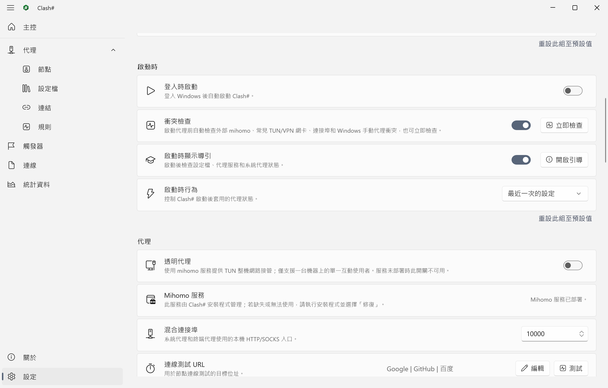

## 經你許可的 Agent（MCP）

本機 MCP 伺服器將 Agent 接入真實的狀態、設定、設定檔、診斷及留存歷史。它預設關閉，僅監聽回送位址（`http://127.0.0.1:20000/mcp`）。各項權限獨立開關，代理狀態控制需要另外授權，Agent 無法修改自己的權限。

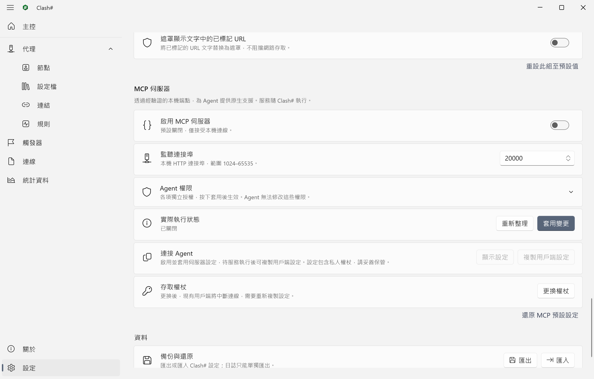

1. 開啟 **設定 › MCP 伺服器**，啟用伺服器並選擇授權範圍。僅預選狀態讀取。
2. 點選 **套用變更**，確認實際狀態為 **執行中**。
3. 點選 **複製用戶端設定**，將端點及認證標頭設定到支援 Streamable HTTP 的客戶端。這份複製內容會被排除在 Windows 剪貼簿歷史和雲端同步之外。

權限組合與疑難排解見[連線與權限指南](./docs/guides/native-agent.zh-CN.md)。

## 獨立的安裝管理器

`Setup.exe` 是一個獨立的 Windows 應用程式，而不是附掛在應用程式上的精靈。它為目前使用者安裝，僅在電腦層級的部分請求管理員權限，之後可以修復、升級或移除它安裝的全部內容，包括它所管理的服務與證書。每一步都有記錄，因此中斷的操作會繼續而不是留下裝了一半的機器，也可以恢復到原始狀態。安裝程式與應用程式一樣支援八種語言：預設跟隨 Windows 顯示語言，開始操作前也可以在視窗右上角切換。

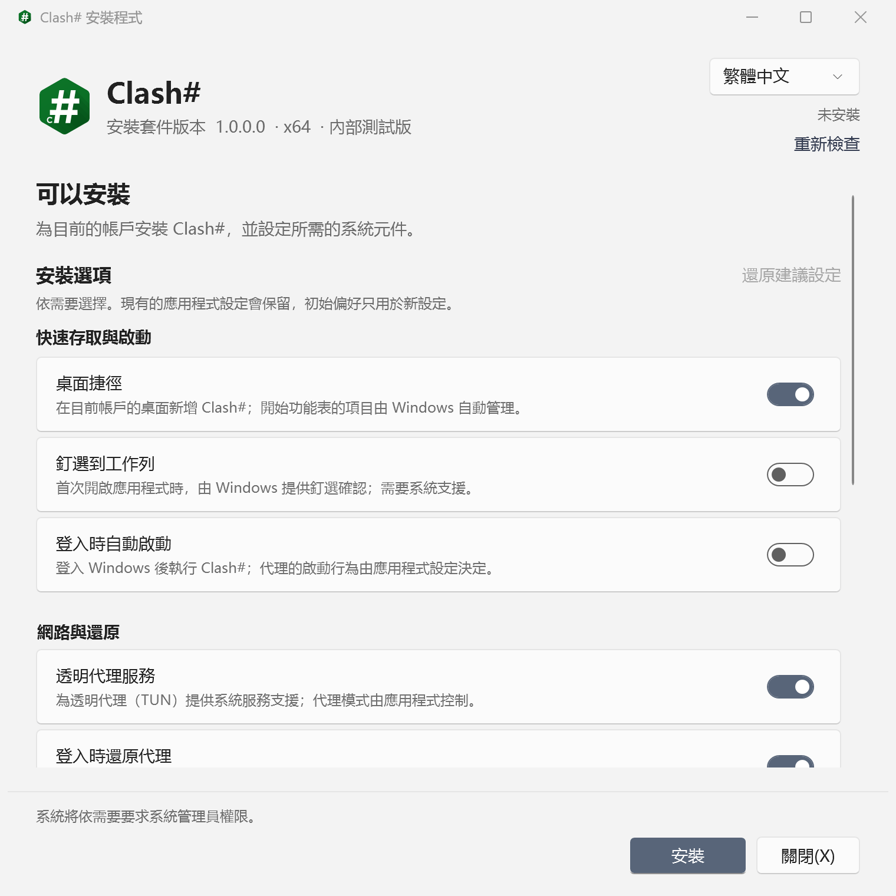

## 觸發器

觸發器在全部條件滿足後，按順序執行一組動作。條件包括進入程式、啟動代理、某級別的通知、單位時間內流量、本次執行流量、速率、活動連線數、執行時間與系統時間。動作包括切換模式、關閉連線、開關透明代理、連線取樣或登入時啟動、傳送通知與結束程式。每個觸發器會顯示最近一次觸發的時間。

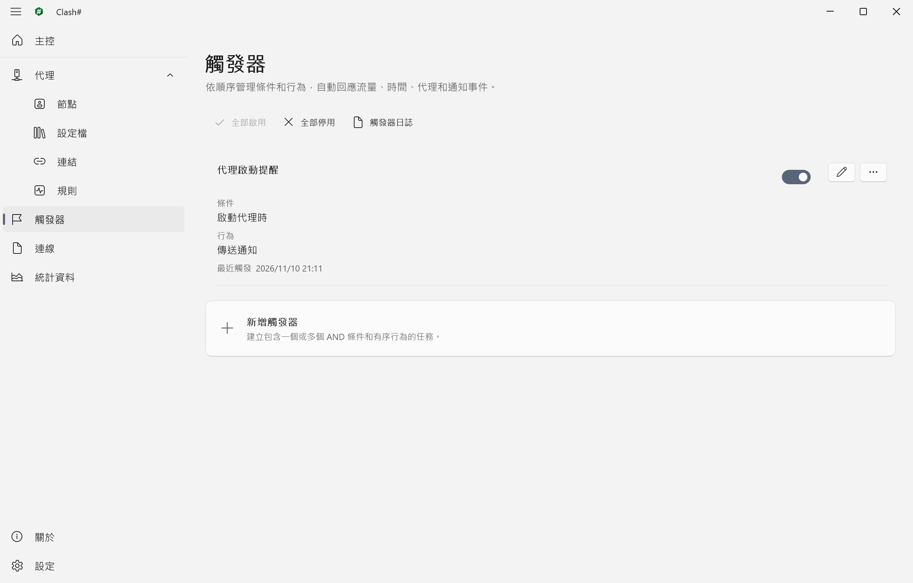

## 中國大陸特色功能

面向在中國大陸使用 Clash# 的可選顯示規範，位於 **設定 › 中國大陸特色功能**。它們只改變介面的顯示：設定檔、日誌、搜尋、複製內容與匯出資料不會被修改，也不會阻止任何網路存取。

「內建審核過濾」決定規範的範圍，後一項包含前一項的全部內容：

| 選項 | 介面顯示 |
| :--- | :--- |
| **僅旗幟替換** | 臺灣顯示為中華人民共和國國旗；香港與澳門保留各自的區旗。 |
| **僅旗幟替換和文字補全** | 地區名稱也遵循同一規範，例如「中國香港」「中國澳門」「中國臺灣」。 |
| **旗幟替換, 文字補全和關鍵字過濾** | 顯示文字中的一小批敏感中文詞彙也會被遮蓋。 |

預設為旗幟替換和文字補全，選擇 **不啟用** 即全部關閉。另有獨立開關「遮罩顯示文字中的已標記 URL」，會遮蓋內建名單中的位址，預設關閉。

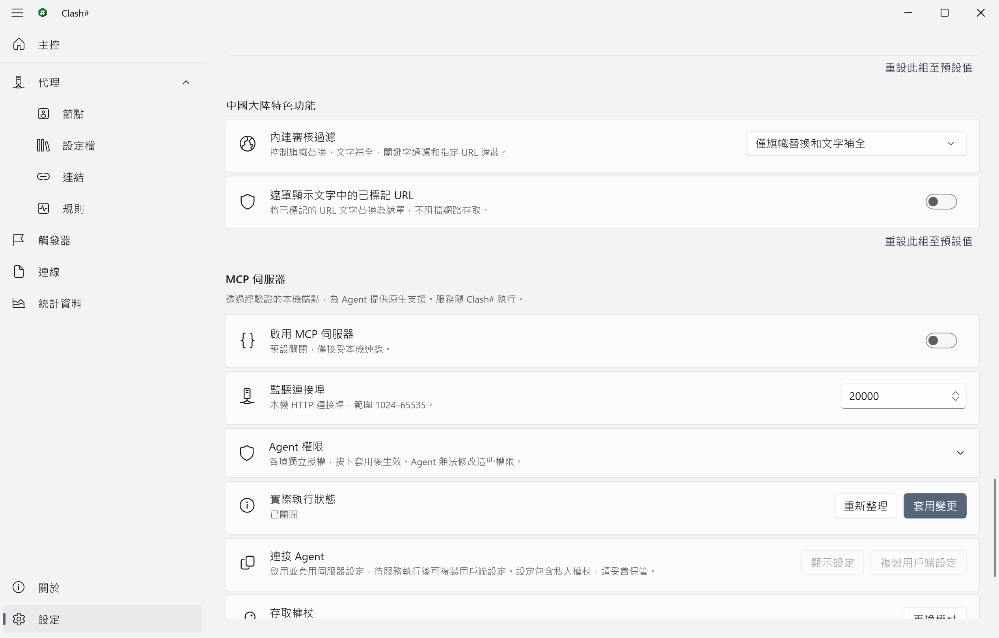

## 資料可攜帶

**設定 › 資料** 可將 Clash# 設定匯出為單個檔案（可選包含代理設定與訂閱），並再次匯入。日誌可單獨匯出為 SQLite 資料庫。流量、連線、節點健康與規則命中統計儲存在本機，按設定檔、節點與時間彙總，清理前提供預覽。

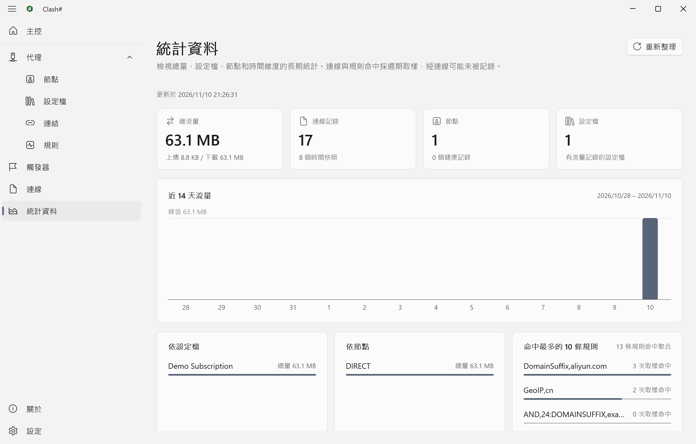&nbsp;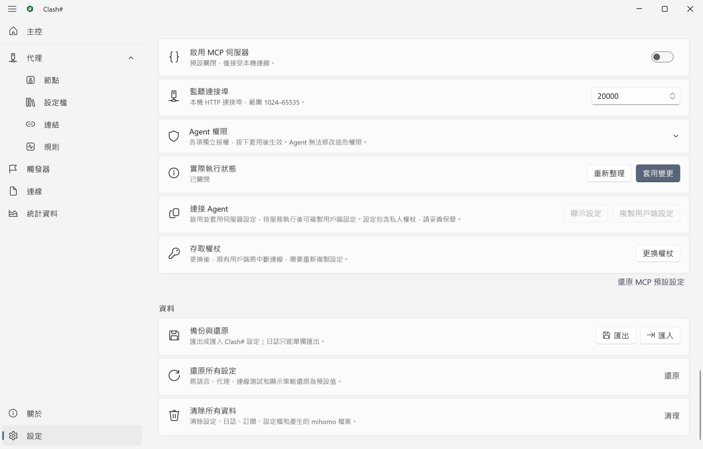

## 安裝

**系統要求**：Windows 11 x64，或帶桌面體驗的 Windows Server 2025。

正式版本釋出後，安裝包提供於 [Releases](https://github.com/Water-Run/ClashSharp/releases) 頁面。

1. 下載並解壓釋出包。`Setup.exe` 須與同目錄的 `payload` 資料夾保持在一起。
2. 在目前使用者會話中執行 `Setup.exe`。應用安裝於執行安裝器的使用者名稱下，無需以管理員身份執行，也無需預裝 .NET。
3. 按 Windows 提示確認管理員授權。安裝器會部署 Mihomo 服務並自動處理 Clash# 軟體包的證書。確認前請核對提示中顯示的發佈者。

修復、升級與解除安裝均透過再次執行同一安裝器完成。

> [!WARNING]
> 解除安裝應透過 `Setup.exe` 進行。僅在 Windows 的「設定 › 應用程式」中移除時，Mihomo 服務等電腦層級資源不會同步清理。

## 快速上手

1. 在 **代理 › 連結** 中新增訂閱連結。Clash# 下載並校驗對應設定檔。
2. 在 **代理 › 設定檔** 中確認該設定檔為目前設定檔。
3. 在 **主控** 中選擇 **依規則接管**。
4. 在 **代理 › 節點** 中選擇節點，可先進行延遲測試。

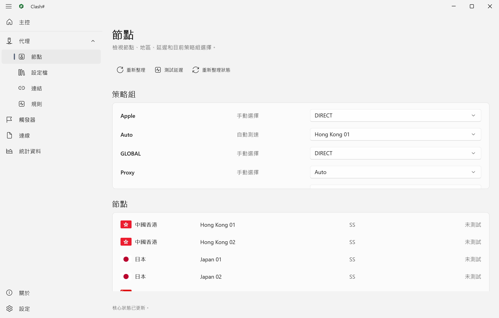&nbsp;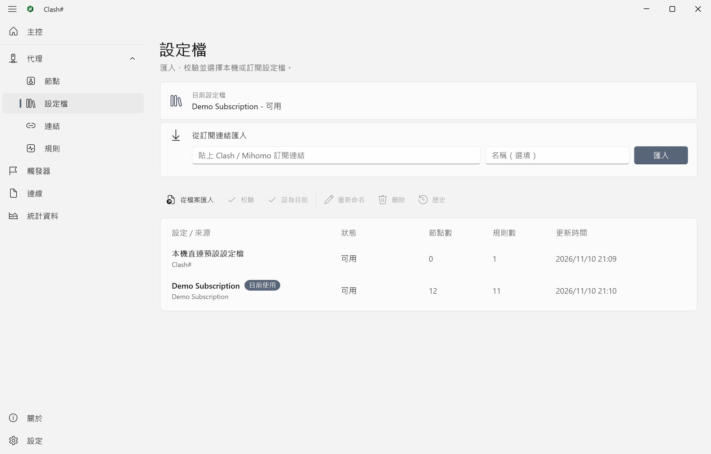

Clash# 每次啟動時顯示啟動導引，彙總訂閱、透明代理服務、啟動還原與代理殘留的檢查結果。該提示可在 **設定 › 啟動時** 中關閉。

本地混合埠預設為 `10000`，HTTP 與 SOCKS 共用。不讀取系統代理的程式可直接使用 `127.0.0.1:10000`。埠可在 **設定 › 代理** 中修改。

關閉主視窗時，Clash# 預設最小化到托盤並繼續執行。結束應使用托盤選單中的「安全結束」；結束時預設停止核心並還原系統代理。

啟用 **設定 › 工作列托盤** 中的「啟用托盤色彩狀態指示」後，托盤圖示以顏色區分目前狀態：

|  |  |  |
| :---: | :---: | :---: |
| 未啟用或待命 | 系統代理 | 透明代理 |

### 頁面

| 頁面 | 用途 |
| :--- | :--- |
| **主控** | 切換模式；以磁貼顯示核心狀態、速率、流量、延遲、訂閱用量、公網 IP 等資訊。 |
| **代理** | 節點、設定檔（含歷史版本）、訂閱連結與規則。 |
| **觸發器** | 自動化任務，自上而下依次評估。 |
| **連線** | 作用中連線及其所屬處理程序、命中規則與代理路徑。 |
| **統計資料** | 按設定檔、節點與時間彙總的長期統計；系統日誌亦由此進入。 |
| **設定** | 語言與外觀、啟動、代理、Windows 整合、MCP 伺服器與權限、通知、托盤、中國大陸特色功能與資料備份。 |

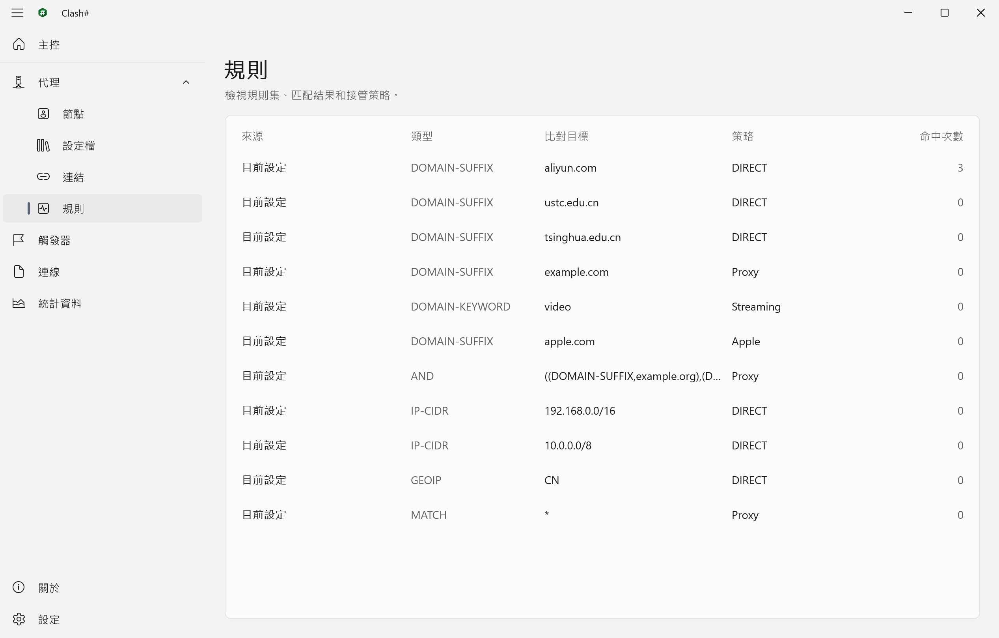&nbsp;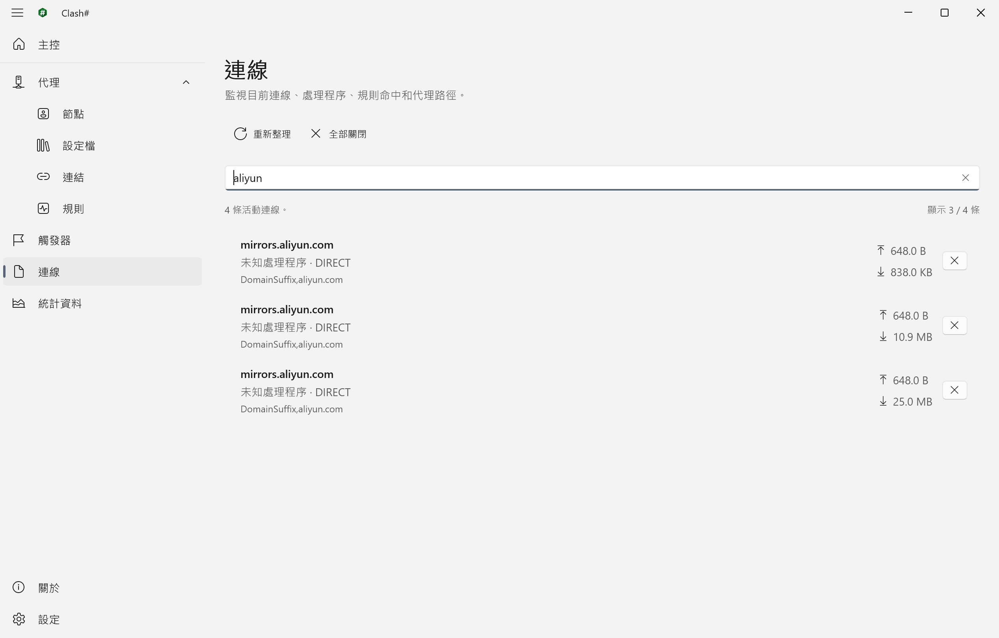

## 常見問題

<details>
<summary><b>WSL、終端或 Microsoft Store 應用無法透過代理存取網路</b></summary>
<br />

上述程式不讀取 Windows 系統代理。**設定 › Windows 整合** 可對相應項目執行診斷，並按結果應用修正；修正可隨時撤銷。開啟透明代理後，此類程式的流量同樣會被接管。
</details>

<details>
<summary><b>啟動時提示衝突</b></summary>
<br />

衝突檢查涵蓋四類情況：外部 mihomo 處理程序、代理埠被佔用、Windows 手動代理已開啟、存在其他 TUN 或 VPN 網路卡。對話方塊逐項說明，並對可安全處理的項目提供修復操作。TUN 與 VPN 網路卡僅作提示，Clash# 不會將其停用。可隨時在 **設定 › 啟動時** 中重新檢查。
</details>

<details>
<summary><b>異常結束後，系統代理仍處於開啟狀態</b></summary>
<br />

Clash# 異常結束時，復原處理程序會立即還原仍歸 Clash# 所有的系統代理。若電腦在此之前已關閉，Clash# 將在下次啟動時檢查並清理殘留。另可在 **設定 › Windows 整合** 中註冊「登入時還原代理」，讓同樣的清理在 Windows 登入時執行，而不必等待 Clash# 啟動。
</details>

<details>
<summary><b>透明代理無法用於我的訂閱</b></summary>
<br />

透明代理服務使用自帶的 GeoData 檔案與一組固定的安全選項執行核心，因此不會採納設定檔裡的下載位址、額外監聽埠或認證資訊。Clash# 會自動略去無害的 GeoData 下載位址（`geox-url`）；若設定檔設定了無法託管的內容（例如 DNS 監聽或額外埠），會給出提示和支援程式碼。請移除該項，或關閉透明代理改用系統代理。
</details>

<details>
<summary><b>一次操作失敗後，之後的操作也都失敗</b></summary>
<br />

失敗的代理變更會被保留並如實報告，而不是當作已應用。切換模式或透明代理開關時，會將它作為你本次操作的一部分自動重試。**設定** 頁提示中的 **重試** 連結可在不改變其他內容的情況下完成同樣的事。
</details>

<details>
<summary><b>地區名稱或旗幟與設定檔不一致</b></summary>
<br />

**設定 › 中國大陸特色功能** 預設啟用旗幟替換與文字補全，按中國大陸的規範調整介面中部分地區的名稱與旗幟。該功能僅作用於介面顯示，不修改設定檔、日誌、搜尋、複製內容與匯出資料，可在同一處關閉。
</details>

<details>
<summary><b>備份與更新</b></summary>
<br />

**設定 › 資料** 可將 Clash# 設定匯出為單個檔案（可選包含代理設定與訂閱），供日後匯入。日誌可單獨匯出為 SQLite 資料庫，不支援匯入日誌。

**關於** 頁會檢查 GitHub Releases 上的新版本。更新透過安裝器安裝。
</details>

## 從原始碼構建

目前實作狀態、候選驗證與開發計畫見[開發文件](./docs/README.md)。

構建需要 Windows x64、PowerShell 7，以及 [`global.json`](./global.json) 指定的 .NET SDK 版本。

```powershell
dotnet restore ClashSharp/ClashSharp.slnx --locked-mode
dotnet build   ClashSharp/ClashSharp.slnx -c Release -p:Platform=x64 --no-restore
dotnet test    ClashSharp/ClashSharp.Tests/ClashSharp.Tests.csproj -c Release -p:Platform=x64 --no-build
```

安裝包的構建說明見 [Installer/README.md](./ClashSharp/Installer/README.md)。

<details>
<summary><b>倉庫結構</b></summary>
<br />

| 路徑 | 內容 |
| :--- | :--- |
| `ClashSharp/ClashSharp` | WinUI 3 主程式 |
| `ClashSharp/ClashSharp.Core` · `.Application` · `.Infrastructure` | 領域模型、應用邏輯，以及 Windows 與儲存適配 |
| `ClashSharp/ClashSharp.MihomoService` | 為透明代理執行核心的 Windows 服務 |
| `ClashSharp/ClashSharp.RecoveryWatchdog` | 異常結束後還原系統代理的復原處理程序 |
| `ClashSharp/ClashSharp.Installer*` | WPF 安裝器及其事務邏輯 |
| `ClashSharp/SandboxTest` | 在 Windows 沙盒中進行的軟體包冒煙測試 |
| `docs/` | 設計與開發記錄 |

</details>

編碼約定見 [CodingStyle.md](./CodingStyle.md)。

## 許可

代理核心為 MetaCubeX 的 [mihomo](https://github.com/MetaCubeX/mihomo)，以 GPL-3.0 釋出。GeoIP 與 GeoSite 資料來自 [meta-rules-dat](https://github.com/MetaCubeX/meta-rules-dat)。

Clash# 以 [AGPL-3.0](./LICENSE) 許可釋出。
