<div align="center">


# Clash#

**从根上原生的 Windows 代理客户端**

[](https://github.com/Water-Run/ClashSharp/actions/workflows/ci.yml)
[](./LICENSE)
[](#安装)
[](./global.json)

[English](./README.md) · **简体中文** · [繁體中文](./README-zh-Hant.md) · [한국어](./README-ko.md) · [Русский](./README-ru.md) · [فارسی](./README-fa.md)

&nbsp;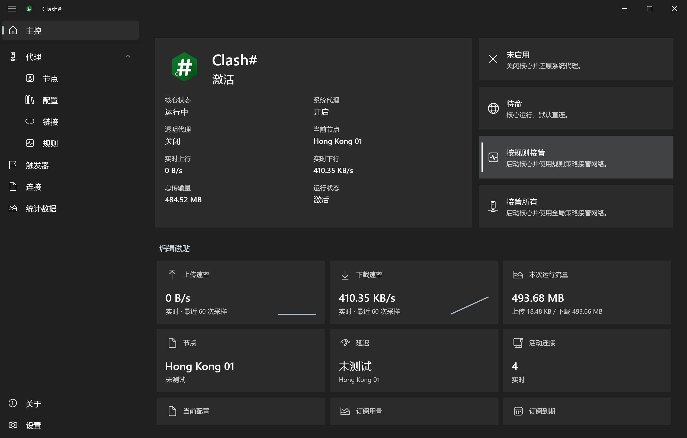

</div>

> [!IMPORTANT]
> Clash# 1.0.0 尚在开发中，目前没有正式发布版本。CI 生成的安装包为未签名的测试构建，不适用于日常使用。

Clash# 是基于 [mihomo](https://github.com/MetaCubeX/mihomo) 内核的 Windows 代理客户端。主程序采用 C#、.NET 10 与 WinUI 3 开发，以 MSIX 包分发，由独立的安装器负责安装与修复。它不是装进窗口里的网页：没有内嵌浏览器，每一个控件、通知、托盘菜单、服务与设置，都是真正的 Windows 组件。

## 为什么选择 Clash#

| | |
| :--- | :--- |
| **从根上原生** | WinUI 3 控件、Fluent 设计、Windows 磁贴、系统通知、通知区域、服务与 Windows 代理设置，全部按 Windows 的方式使用。[详细了解](#从根上原生) |
| **Windows 功能一步到位** | 一个安装器同时部署应用、透明代理服务与软件包证书；退出、崩溃与重启后的恢复均已内置。[详细了解](#windows-功能一步到位) |
| **为 Agent 而备** | 本机 MCP 服务器让 Agent 读取真实状态，并且仅在你允许时才能修改。每项权限都是独立开关。[详细了解](#经你许可的-agentmcp) |
| **独立的安装管理器** | `Setup.exe` 负责安装、修复、升级，并移除它放到机器上的一切；中断后可继续。[详细了解](#独立的安装管理器) |
| **会解释自己的自动化** | 触发器在全部条件满足后按顺序执行动作。[详细了解](#触发器) |
| **中国大陆特色功能** | 可选的地区名称、旗帜与文本显示规范，仅作用于界面。[详细了解](#中国大陆特色功能) |
| **数据可携带** | 设置、配置与订阅可导出导入；日志可导出；统计数据长期留存。[详细了解](#数据可携带) |

## 从根上原生

Clash# 不是在模仿 Windows，而是用 Windows 本身提供的东西搭起来的。除了 WinUI 3 控件和 Fluent 设计，最先遇到的就是只有 Windows 才有的几样：磁贴、系统通知和通知区域。

### 磁贴

主控是一面磁贴墙，沿用 Windows 自开始菜单以来呈现实时信息的方式。每块磁贴是一条会自己更新的信息：内核状态、上传与下载速率、本次与累计流量、当前节点与延迟、活动连接、订阅用量与到期、DNS 设置、内核内存与运行时间、公网出口 IP 等。磁贴的行为也像磁贴：单击执行（例如运行连接测试、查询公网 IP），拖动调整顺序，右键或触摸长按打开它自己的菜单，比如“从主控取消固定”。一共有 74 块磁贴，并非都只是读数：有的带开关或操作，例如系统通知、登录时启动、主题、语言、导出与导入，主控因此也可以当控制面板用。


### 编辑磁贴与布局

“编辑磁贴”打开原生的磁贴列表，带搜索和实时计数。可以先选一个“布局模板”：缺省、较多、极简、技术向、广泛大众或全部磁贴；再勾选想要的磁贴，用“全部显示”“全部隐藏”批量操作，或用“恢复推荐布局”回到起点。“保存为模板”保存你自己的布局，“删除所选模板”删除它，“恢复默认模板”找回内置模板。布局和模板属于可导出、导入的设置。

<p align="center">
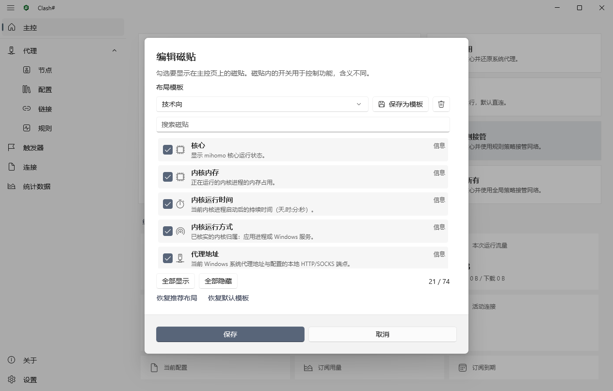&nbsp;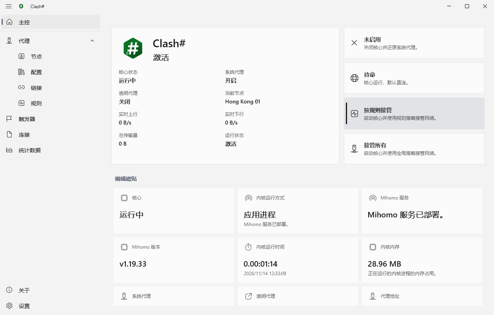
</p>

### 通知

<p align="center">

</p>

它们是真正的 Windows 系统 toast：出现在屏幕角落，也会留在通知中心。

Clash# 告诉你发生了什么变化、涉及哪个对象、接下来该做什么，其余时间保持安静。“启用系统通知”是总开关，级别决定通知的多少：

| 级别 | 会通知的内容 |
| :--- | :--- |
| **仅重要** | 内核意外停止、透明代理服务不可用、接管未能应用或验证、启动检查需要处理，以及当前订阅已到期或流量已用完。 |
| **默认** | 上述内容，加上模式与透明代理变化、配置与节点选择、导入或更新失败、测试超时、触发器消息，以及当前订阅三天内到期或流量已用到 90%。 |
| **详细** | 以上全部，加上导入、更新、导出与设置保存成功。 |

订阅提醒每个阶段只发一次，续费或流量重置后重新开始。失败通知带有与页面相同的原因和支持代码，不必打开窗口也能知道原因。被动检查、已取消的操作与采样不会产生通知。

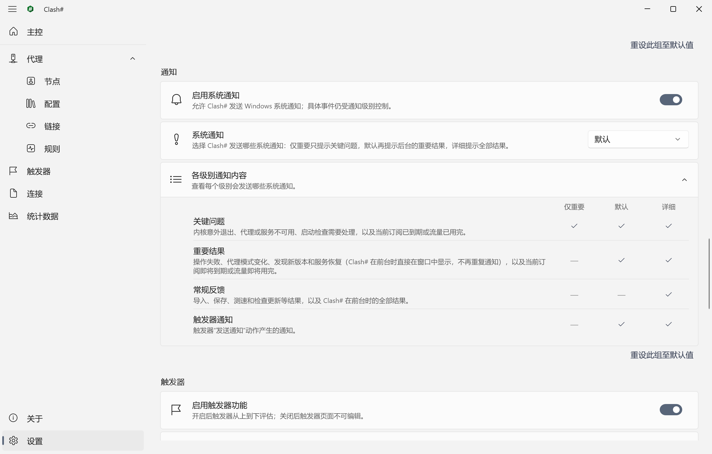

### 通知区域

托盘图标是真正的通知区域图标。右键菜单是 Windows 原生菜单，包含“状态”“模式”“页面”“透明代理”“设置”和“安全退出”，在 **设置 › 任务栏托盘** 里可以选择显示哪些项目以及它们的顺序。开启色彩状态指示后，图标的颜色能让你一眼看出当前状态；在从右到左的语言下，菜单会像 Windows 自己的菜单一样镜像。

<p align="center">
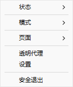
</p>

### 按 Windows 本来的方式使用系统机制

| Windows 机制 | Clash# 如何使用 |
| :--- | :--- |
| **Fluent 设计与材质** | 原生 WinUI 3 控件与 Fluent 图标，跟随系统的浅色／深色主题与系统主题色，支持高对比度主题与文本缩放。 |
| **通知** | 真正的 Windows 通知，一个总开关加三个级别，点击后回到应用。Windows 自身的通知许可与专注设置始终生效。 |
| **通知区域** | 托盘图标以颜色表示当前状态，菜单提供常用操作。 |
| **开机启动** | 登录时启动使用 Windows 自己的启动注册；另有独立的登录清理项，可不等应用启动就还原代理。 |
| **服务** | 透明代理运行在由服务控制管理器管理的 Windows 服务中，对内核进行监督并在失败时自动重启。 |
| **凭据保护** | Agent 令牌与控制器凭据由 Windows 数据保护机制保护。 |
| **进程生命周期** | 子进程放入作业对象，应用停止后不会遗留内核进程。 |
| **Windows 代理设置** | 接管系统代理，并原样还原被它替换的内容。 |
| **MSIX 打包** | 干净的安装与卸载、开始菜单入口与软件包标识。 |
| **界面语言** | 八种界面语言即时切换，含从右到左布局的波斯语。 |

### 八种语言

界面文字即时切换语言，颜色名称等少数由 Windows 提供的文字在下次启动后跟随；波斯语会把页面、对话框和托盘菜单镜像为从右到左。

<p align="center">
&nbsp;&nbsp;&nbsp;
&nbsp;&nbsp;&nbsp;
</p>

## Windows 功能一步到位

### 模式

Clash# 以模式对网络的作用为其命名：

| Clash# | 常见名称 | 行为 |
| :--- | :--- | :--- |
| **未启用** | 关闭 | 停止内核，还原系统代理。 |
| **待命** | 直连 | 内核运行，流量默认直连。 |
| **按规则接管** | 规则 | 按配置中的规则分流。 |
| **接管所有** | 全局 | 全部流量经由所选代理。 |

透明代理（TUN）由 **设置 › 代理** 中的“透明代理”控制，默认开启。开启且 Mihomo 服务可用时，接管通过 TUN 完成，不读取系统代理的程序同样受其覆盖；服务未部署时，接管改由 Windows 系统代理完成。

> [!CAUTION]
> 透明代理接管整台计算机的路由与 DNS。Clash# 按“一台计算机、一个交互用户”设计，不提供多用户会话之间的流量隔离。

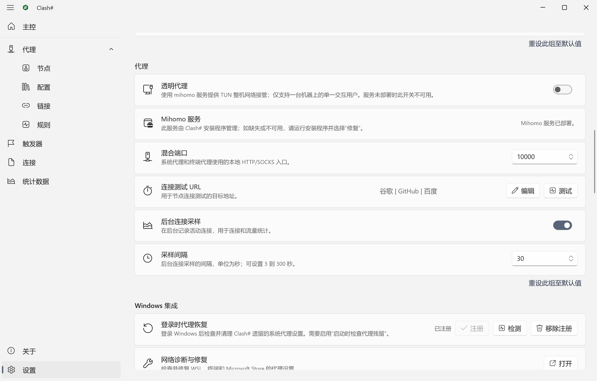

### 无需操心的恢复

| 情形 | Clash# 的做法 |
| :--- | :--- |
| 你退出应用 | 停止内核，并还原归 Clash# 所有的系统代理（可配置）。 |
| 应用崩溃 | 恢复进程立即还原系统代理。 |
| Windows 先于恢复而关机 | 下次启动时检测并清理残留；若注册了启动清理，则在登录时清理。 |
| 内核意外停止 | 通知你，并由服务在限额内重启内核。 |
| 接管无法验证 | 失败的变更会被保留并如实报告，而不是当作已应用；你的下一次操作会处理它。 |

### 启动检查与原生修正

启动代理前，Clash# 会检查外部 mihomo 进程、端口占用、Windows 手动代理以及其他 TUN／VPN 网卡，并对可安全处理的项目提供修复。**设置 › Windows 集成** 分别诊断不读取系统代理的 WSL、终端与 Microsoft Store 应用，并逐项应用或撤销修正。

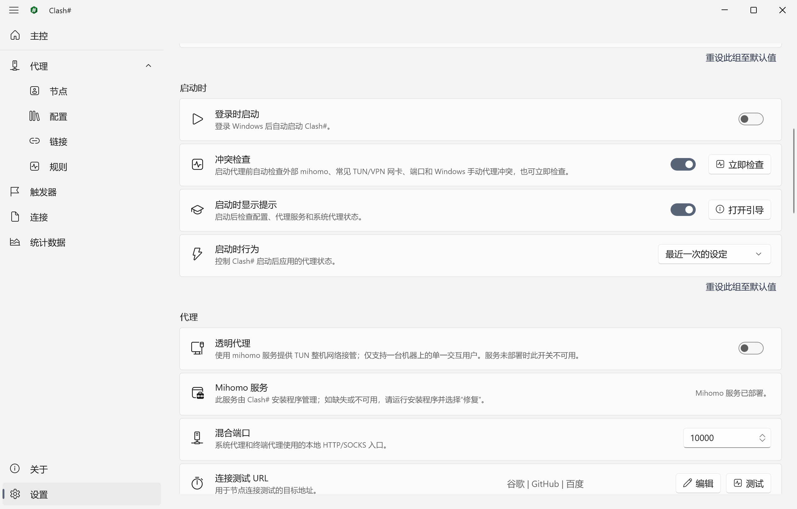

## 经你许可的 Agent（MCP）

本机 MCP 服务器将 Agent 接入真实的状态、设置、配置、诊断及留存历史。它默认关闭，仅监听回环地址（`http://127.0.0.1:20000/mcp`）。各项权限独立开关，代理状态控制需要另外授权，Agent 无法修改自己的权限。

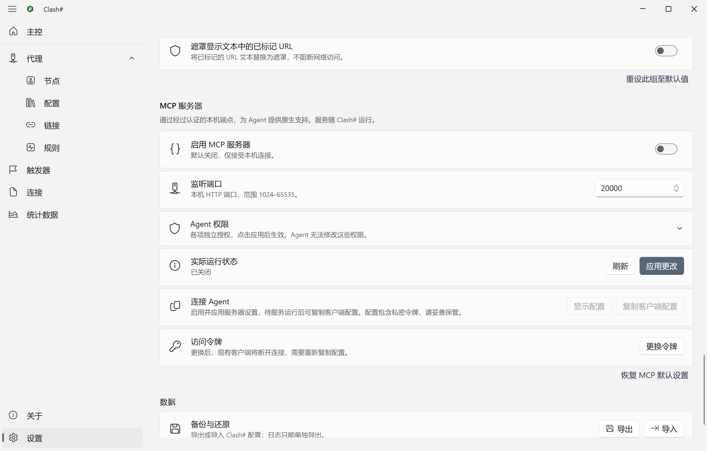

1. 打开 **设置 › MCP 服务器**，启用服务器并选择授权范围。仅预选状态读取。
2. 点击 **应用更改**，确认实际状态为 **正在运行**。
3. 点击 **复制客户端配置**，将端点及认证头配置到支持 Streamable HTTP 的客户端。这份复制内容会被排除在 Windows 剪贴板历史和云同步之外。

权限组合与排障见[连接与权限指南](./docs/guides/native-agent.zh-CN.md)。

## 独立的安装管理器

`Setup.exe` 是一个独立的 Windows 应用，而不是挂在应用上的向导。它为当前用户安装，仅在机器级的部分请求管理员权限，之后可以修复、升级或移除它安装的全部内容，包括它所管理的服务与证书。每一步都有记录，因此中断的操作会继续而不是留下装了一半的机器，也可以恢复到原始状态。安装器与应用一样支持八种语言：默认跟随 Windows 显示语言，开始操作前也可以在窗口右上角切换。

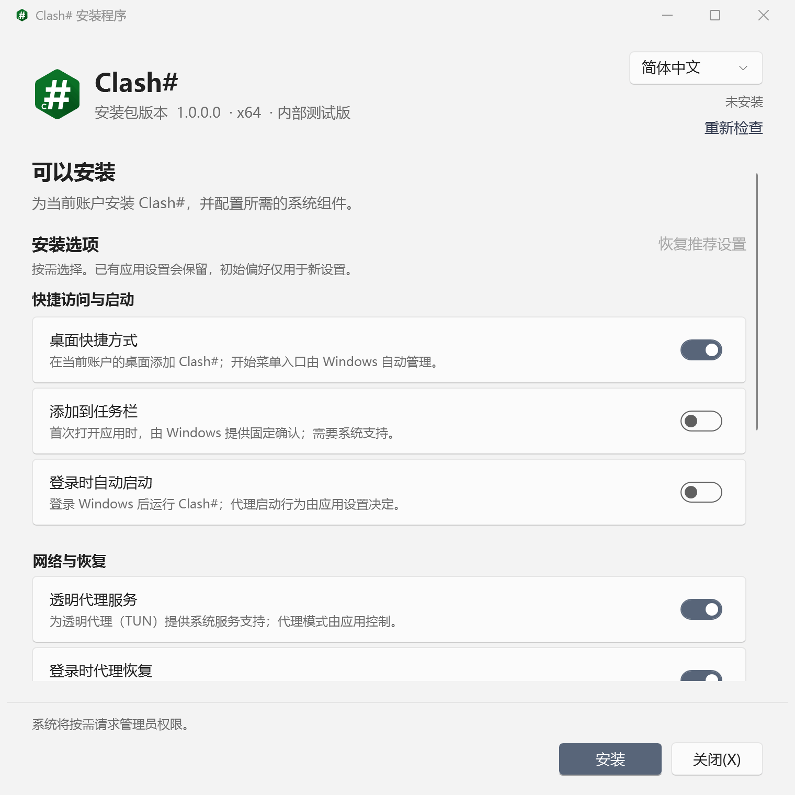

## 触发器

触发器在全部条件满足后，按顺序执行一组动作。条件包括进入程序、启动代理、某级别的通知、单位时间内流量、本次运行流量、速率、活动连接数、运行时间与系统时间。动作包括切换模式、关闭连接、开关透明代理、连接采样或登录时启动、发送通知与退出程序。每个触发器会显示最近一次触发的时间。

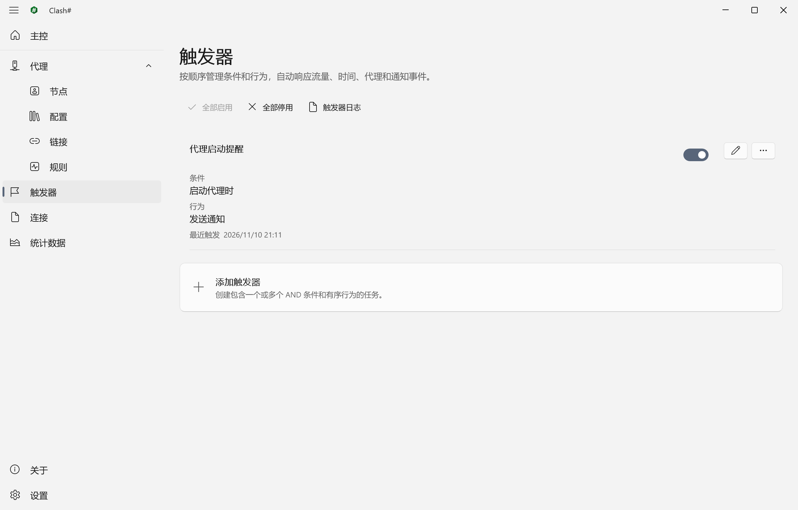

## 中国大陆特色功能

面向在中国大陆使用 Clash# 的可选显示规范，位于 **设置 › 中国大陆特色功能**。它们只改变界面的显示：配置、日志、搜索、复制内容与导出数据不会被修改，也不会阻止任何网络访问。

“内置审核过滤”决定规范的范围，后一项包含前一项的全部内容：

| 选项 | 界面显示 |
| :--- | :--- |
| **仅旗帜替换** | 台湾显示为中华人民共和国国旗；香港与澳门保留各自的区旗。 |
| **仅旗帜替换和文本补全** | 地区名称也遵循同一规范，例如“中国香港”“中国澳门”“中国台湾”。 |
| **旗帜替换, 文本补全和关键字过滤** | 显示文本中的一小批敏感中文词汇也会被遮盖。 |

默认为旗帜替换和文本补全，选择 **不启用** 即全部关闭。另有独立开关“遮罩显示文本中的已标记 URL”，会遮盖内置名单中的地址，默认关闭。

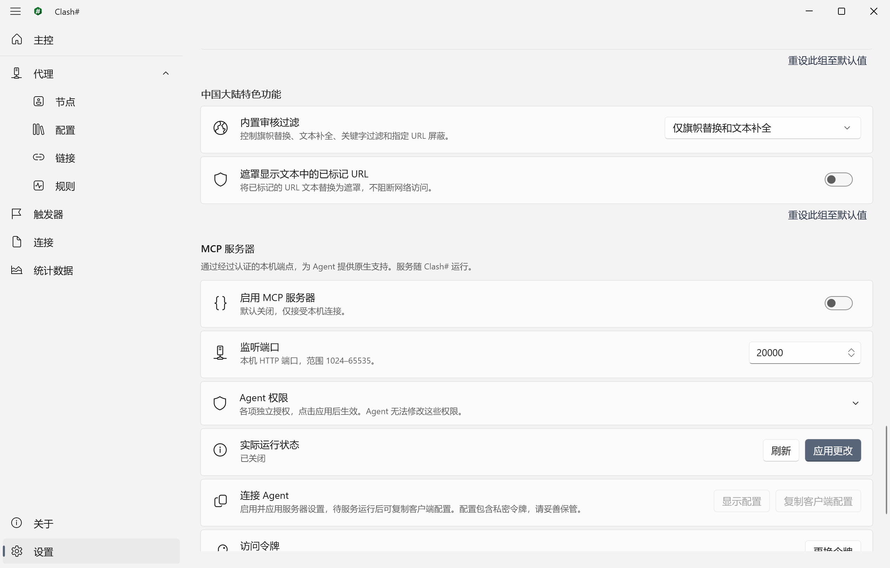

## 数据可携带

**设置 › 数据** 可将 Clash# 设置导出为单个文件（可选包含代理配置与订阅），并再次导入。日志可单独导出为 SQLite 数据库。流量、连接、节点健康与规则命中统计保存在本机，按配置、节点与时间汇总，清理前提供预览。

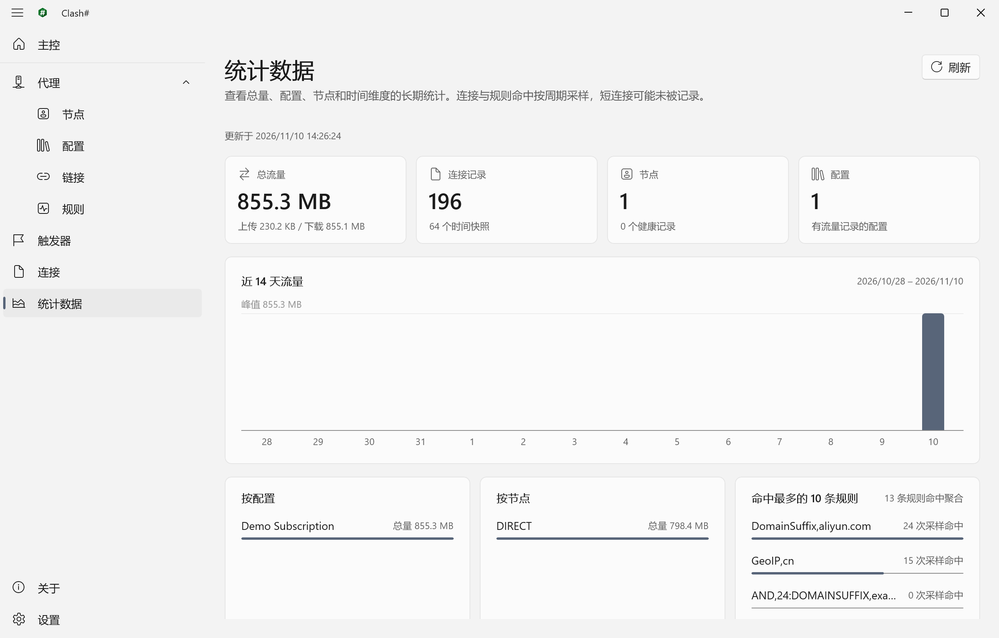&nbsp;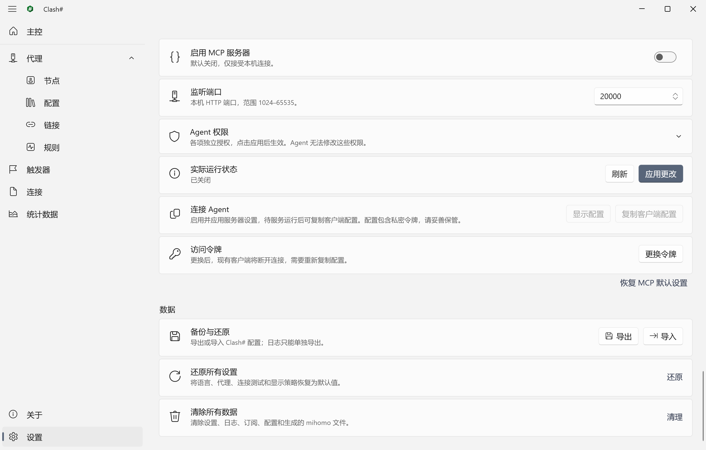

## 安装

**系统要求**：Windows 11 x64，或带桌面体验的 Windows Server 2025。

正式版本发布后，安装包提供于 [Releases](https://github.com/Water-Run/ClashSharp/releases) 页面。

1. 下载并解压发布包。`Setup.exe` 须与同目录的 `payload` 文件夹保持在一起。
2. 在当前用户会话中运行 `Setup.exe`。应用安装于运行安装器的用户名下，无需以管理员身份运行，也无需预装 .NET。
3. 按 Windows 提示确认管理员授权。安装器会部署 Mihomo 服务并自动处理 Clash# 软件包的证书。确认前请核对提示中显示的发布者。

修复、升级与卸载均通过再次运行同一安装器完成。

> [!WARNING]
> 卸载应通过 `Setup.exe` 进行。仅在 Windows 的“设置 › 应用”中移除时，Mihomo 服务等机器级资源不会同步清理。

## 快速上手

1. 在 **代理 › 链接** 中添加订阅链接。Clash# 下载并校验对应配置。
2. 在 **代理 › 配置** 中确认该配置为当前配置。
3. 在 **主控** 中选择 **按规则接管**。
4. 在 **代理 › 节点** 中选择节点，可先进行延迟测试。

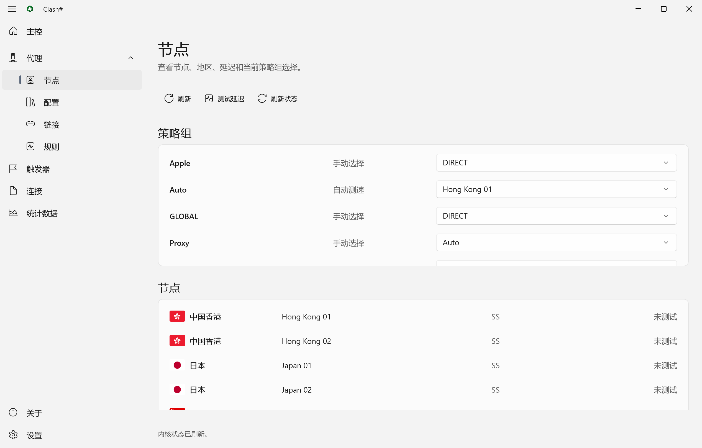&nbsp;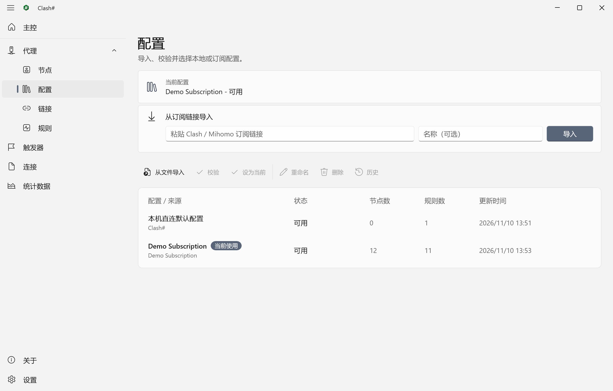

Clash# 每次启动时显示启动提示，汇总订阅、透明代理服务、启动还原与代理残留的检查结果。该提示可在 **设置 › 启动时** 中关闭。

本地混合端口默认为 `10000`，HTTP 与 SOCKS 共用。不读取系统代理的程序可直接使用 `127.0.0.1:10000`。端口可在 **设置 › 代理** 中修改。

关闭主窗口时，Clash# 默认最小化到托盘并继续运行。退出应使用托盘菜单中的“安全退出”；退出时默认停止内核并还原系统代理。

启用 **设置 › 任务栏托盘** 中的“启用托盘色彩状态指示”后，托盘图标以颜色区分当前状态：

|  |  |  |
| :---: | :---: | :---: |
| 未启用或待命 | 系统代理 | 透明代理 |

### 页面

| 页面 | 用途 |
| :--- | :--- |
| **主控** | 切换模式；以磁贴显示内核状态、速率、流量、延迟、订阅用量、公网 IP 等信息。 |
| **代理** | 节点、配置（含历史版本）、订阅链接与规则。 |
| **触发器** | 自动化任务，自上而下依次评估。 |
| **连接** | 活动连接及其所属进程、命中规则与代理路径。 |
| **统计数据** | 按配置、节点与时间汇总的长期统计；系统日志亦由此进入。 |
| **设置** | 语言与外观、启动、代理、Windows 集成、MCP 服务器与权限、通知、托盘、中国大陆特色功能与数据备份。 |

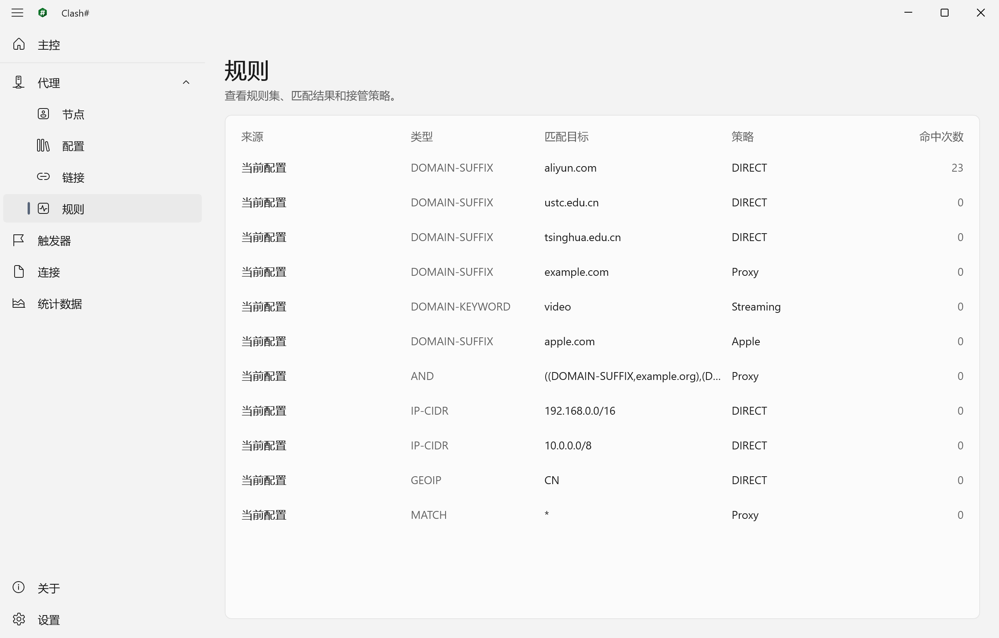&nbsp;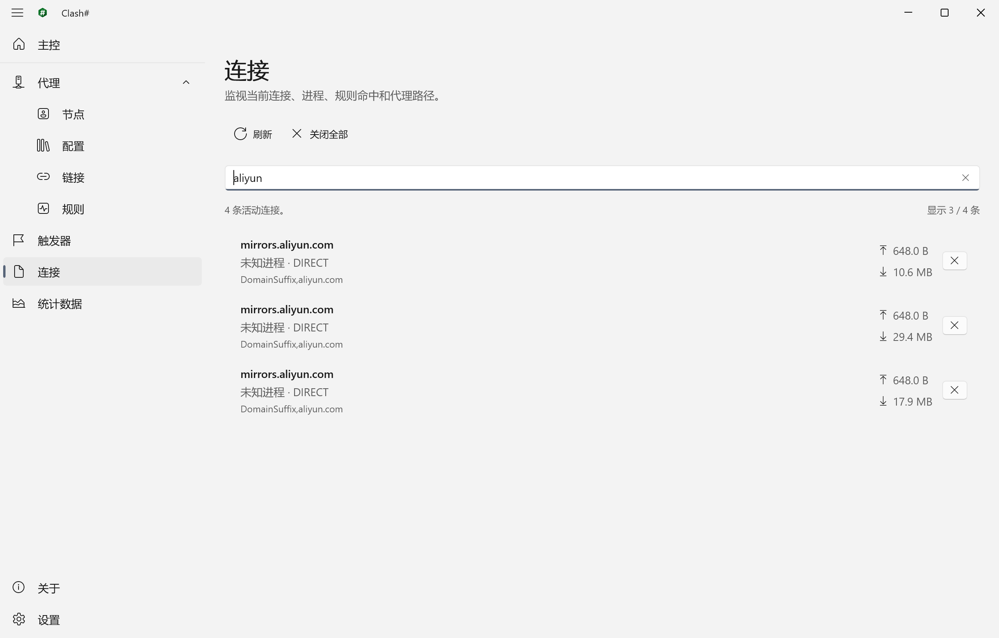

## 常见问题

<details>
<summary><b>WSL、终端或 Microsoft Store 应用无法通过代理访问网络</b></summary>
<br />

上述程序不读取 Windows 系统代理。**设置 › Windows 集成** 可对相应项目执行诊断，并按结果应用修正；修正可随时撤销。开启透明代理后，此类程序的流量同样会被接管。
</details>

<details>
<summary><b>启动时提示冲突</b></summary>
<br />

冲突检查涵盖四类情况：外部 mihomo 进程、代理端口被占用、Windows 手动代理已开启、存在其他 TUN 或 VPN 网卡。对话框逐项说明，并对可安全处理的项目提供修复操作。TUN 与 VPN 网卡仅作提示，Clash# 不会将其停用。可随时在 **设置 › 启动时** 中重新检查。
</details>

<details>
<summary><b>异常退出后，系统代理仍处于开启状态</b></summary>
<br />

Clash# 异常退出时，恢复进程会立即还原仍归 Clash# 所有的系统代理。若计算机在此之前已关闭，Clash# 将在下次启动时检查并清理残留。另可在 **设置 › Windows 集成** 中注册“登录时代理恢复”，让同样的清理在 Windows 登录时执行，而不必等待 Clash# 启动。
</details>

<details>
<summary><b>透明代理无法用于我的订阅</b></summary>
<br />

透明代理服务使用自带的 GeoData 文件与一组固定的安全选项运行内核，因此不会采纳配置里的下载地址、额外监听端口或凭据。Clash# 会自动略去无害的 GeoData 下载地址（`geox-url`）；若配置设置了无法托管的内容（例如 DNS 监听或额外端口），会给出提示和支持代码。请移除该项，或关闭透明代理改用系统代理。
</details>

<details>
<summary><b>一次操作失败后，之后的操作也都失败</b></summary>
<br />

失败的代理变更会被保留并如实报告，而不是当作已应用。切换模式或透明代理开关时，会将它作为你本次操作的一部分自动重试。**设置** 页提示中的 **重试** 链接可在不改变其他内容的情况下完成同样的事。
</details>

<details>
<summary><b>地区名称或旗帜与配置不一致</b></summary>
<br />

**设置 › 中国大陆特色功能** 默认启用旗帜替换与文本补全，按中国大陆的规范调整界面中部分地区的名称与旗帜。该功能仅作用于界面显示，不修改配置、日志、搜索、复制内容与导出数据，可在同一处关闭。
</details>

<details>
<summary><b>备份与更新</b></summary>
<br />

**设置 › 数据** 可将 Clash# 设置导出为单个文件（可选包含代理配置与订阅），供日后导入。日志可单独导出为 SQLite 数据库，不支持导入日志。

**关于** 页会检查 GitHub Releases 上的新版本。更新通过安装器安装。
</details>

## 从源码构建

当前实现状态、候选验证与开发计划见[开发文档](./docs/README.md)。

构建需要 Windows x64、PowerShell 7，以及 [`global.json`](./global.json) 指定的 .NET SDK 版本。

```powershell
dotnet restore ClashSharp/ClashSharp.slnx --locked-mode
dotnet build   ClashSharp/ClashSharp.slnx -c Release -p:Platform=x64 --no-restore
dotnet test    ClashSharp/ClashSharp.Tests/ClashSharp.Tests.csproj -c Release -p:Platform=x64 --no-build
```

安装包的构建说明见 [Installer/README.md](./ClashSharp/Installer/README.md)。

<details>
<summary><b>仓库结构</b></summary>
<br />

| 路径 | 内容 |
| :--- | :--- |
| `ClashSharp/ClashSharp` | WinUI 3 主程序 |
| `ClashSharp/ClashSharp.Core` · `.Application` · `.Infrastructure` | 领域模型、应用逻辑，以及 Windows 与存储适配 |
| `ClashSharp/ClashSharp.MihomoService` | 为透明代理运行内核的 Windows 服务 |
| `ClashSharp/ClashSharp.RecoveryWatchdog` | 异常退出后还原系统代理的恢复进程 |
| `ClashSharp/ClashSharp.Installer*` | WPF 安装器及其事务逻辑 |
| `ClashSharp/SandboxTest` | 在 Windows 沙盒中进行的软件包冒烟测试 |
| `docs/` | 设计与开发记录 |

</details>

编码约定见 [CodingStyle.md](./CodingStyle.md)。

## 许可

代理内核为 MetaCubeX 的 [mihomo](https://github.com/MetaCubeX/mihomo)，以 GPL-3.0 发布。GeoIP 与 GeoSite 数据来自 [meta-rules-dat](https://github.com/MetaCubeX/meta-rules-dat)。

Clash# 以 [AGPL-3.0](./LICENSE) 许可发布。
