<div align="center">


# Clash#

**A Windows proxy client that is native from the root up**

[](https://github.com/Water-Run/ClashSharp/actions/workflows/ci.yml)
[](./LICENSE)
[](#installation)
[](./global.json)

**English** · [简体中文](./README-zh.md) · [繁體中文](./README-zh-Hant.md) · [한국어](./README-ko.md) · [Русский](./README-ru.md) · [فارسی](./README-fa.md)

&nbsp;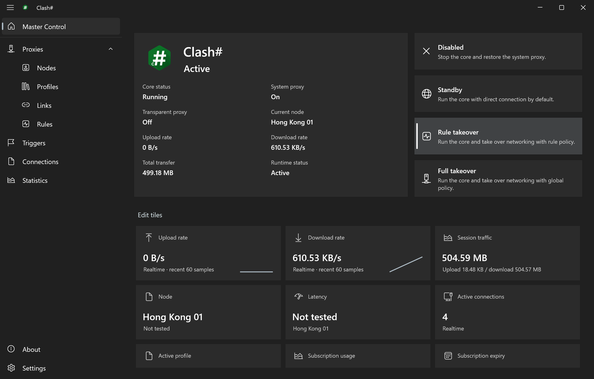

</div>

> [!IMPORTANT]
> Clash# 1.0.0 is under development and has no official release. Packages produced by CI are unsigned test builds and are not intended for everyday use.

Clash# is a proxy client for Windows built on the [mihomo](https://github.com/MetaCubeX/mihomo) core. It is written in C# with .NET 10 and WinUI 3, shipped as an MSIX package, and installed and repaired by its own installer. It is not a web page in a window: there is no embedded browser, and every control, notification, tray menu, service and setting is a real Windows one.

## Why Clash#

| | |
| :--- | :--- |
| **Native from the root up** | WinUI 3 controls, Fluent design, Windows tiles, system notifications, the notification area, services and the Windows proxy settings, used the way Windows intends. [Read more](#native-from-the-root-up) |
| **Windows integration in one step** | One installer deploys the app, the transparent-proxy service and the package certificate. Exit, crash and restart recovery are built in. [Read more](#windows-integration-in-one-step) |
| **Ready for agents** | A local MCP server lets an agent read and, only if you allow it, change the real state. Every permission is a separate switch. [Read more](#agents-with-your-consent-mcp) |
| **A standalone installer manager** | `Setup.exe` installs, repairs, upgrades and removes everything it put on the machine, and resumes after an interruption. [Read more](#a-standalone-installer-manager) |
| **Automation that explains itself** | Triggers run ordered actions once all their conditions hold. [Read more](#triggers) |
| **Mainland China features** | Optional display conventions for region names, flags and text, applied to the interface only. [Read more](#mainland-china-features) |
| **Your data is portable** | Export and import settings, profiles and subscriptions; export logs; keep long-term statistics. [Read more](#your-data-is-portable) |

## Native from the root up

Clash# does not imitate Windows; it is built from what Windows provides. Beyond WinUI 3 controls and Fluent design, the first things you meet are the ones only Windows has: tiles, system notifications and the notification area.

### Tiles

Master Control is a wall of tiles, the way Windows has presented live information since the Start menu. Each tile is one fact that updates by itself: core status, upload and download rate, session and total traffic, current node and latency, active connections, subscription usage and expiry, DNS settings, core memory and uptime, the public egress IP and more. Tiles behave like tiles: click one to act (for example, run the connection test or look up the public IP), drag to rearrange, and right-click or touch and hold for its own commands such as *Unpin from dashboard*. There are 74 tiles in all, and not all are readouts: some hold switches and actions, such as notifications, launch at sign-in, theme, language, export and import, so the dashboard can double as a control panel.


### Edit tiles and layouts

*Edit tiles* opens a native list of every tile, with search and a running count. Start from a *Layout preset*: Default, Extended, Minimal, Technical, General or All tiles. Then tick the tiles you want, use *Show all tiles* or *Hide all tiles*, or go back with *Restore recommended layout*. *Save as template* keeps your own layout, *Delete selected template* removes it and *Restore default templates* brings the built-in ones back. Layouts and templates are part of the settings you export and import.

<p align="center">
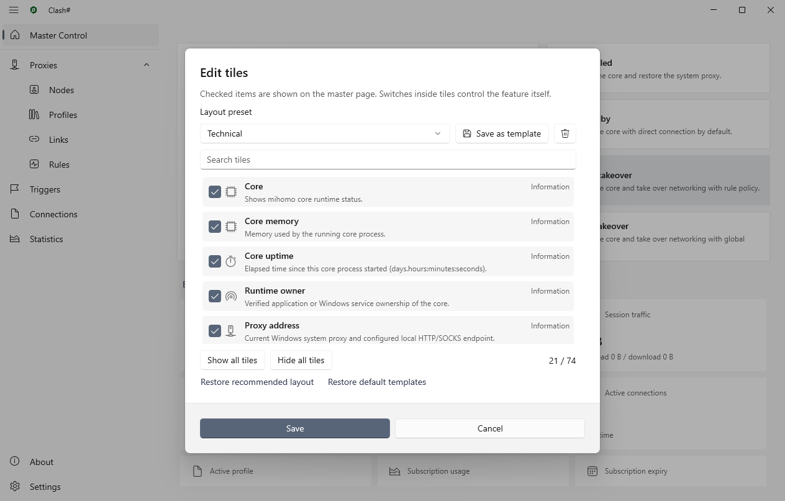&nbsp;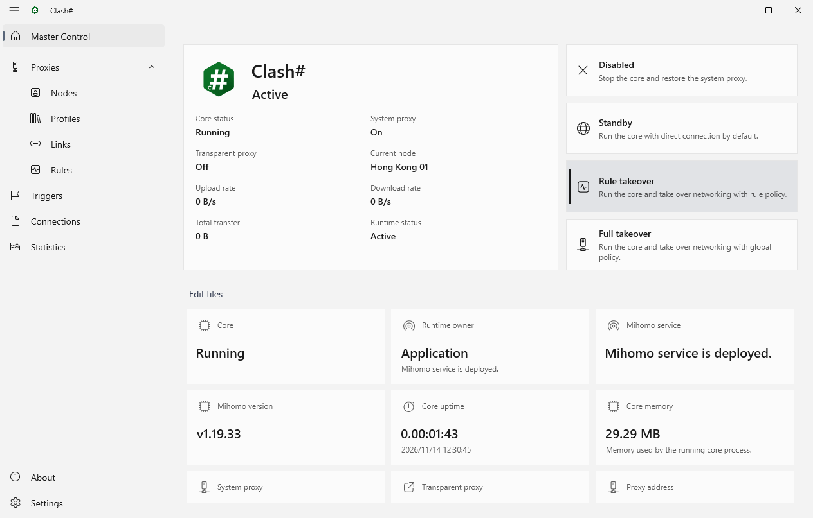
</p>

### Notifications

<p align="center">
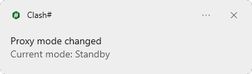
</p>

They are real Windows toasts: they appear at the corner of the screen and stay in the notification center.

Clash# tells you what changed, which object it concerned and what to do next, and it stays quiet otherwise. *Enable system notifications* turns them all on or off, and the level decides how much you hear:

| Level | You are notified about |
| :--- | :--- |
| **Critical only** | The core stopped unexpectedly, the transparent-proxy service became unavailable, a takeover could not be applied or verified, a startup check needs action, or the active subscription has expired or used up its data. |
| **Default** | The above, plus mode and transparent-proxy changes, profile and node selection, failed imports or updates, test timeouts, trigger messages, and an active subscription that expires within three days or has used 90% of its data. |
| **More** | Everything above, plus successful imports, updates, exports and saved settings. |

Each subscription reminder comes once per stage and starts over after a renewal or a quota reset. A failure notification carries the same reason and support code as the page, so you do not need to open the window to know why. Passive checks, canceled actions and sampling never notify.

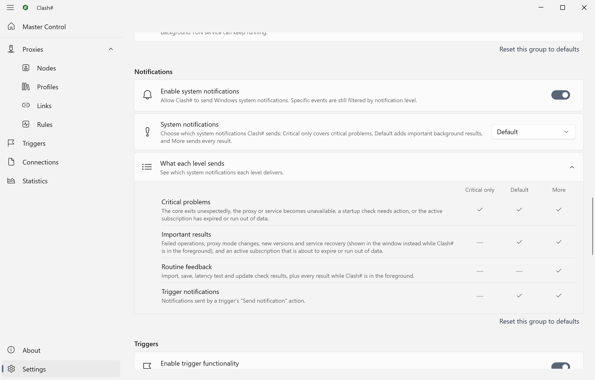

### The notification area

The tray icon is a real notification-area icon. Its right-click menu is the native Windows menu, with *Status*, *Mode*, *Pages*, *Transparent proxy*, *Settings* and *Safe exit*, and under **Settings › Taskbar tray** you choose which entries appear and in what order. With the color status indicator on, the icon shows the state at a glance; in right-to-left languages the menu mirrors like Windows' own.

<p align="center">
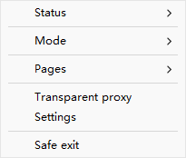
</p>

### Windows mechanisms, used as designed

| Windows mechanism | What Clash# does with it |
| :--- | :--- |
| **Fluent design and materials** | Native WinUI 3 controls and Fluent icons. It follows the system light or dark theme and the system accent color, high-contrast themes and text scaling. |
| **Notifications** | Real Windows notifications with one switch and three levels, and click-through back to the app. Windows' own permission and Focus settings always apply. |
| **Notification area** | A tray icon whose color shows the current state, with a menu for the common actions. |
| **Startup** | Launch at sign-in uses Windows' own startup registration. A separate sign-in cleanup can restore the proxy without waiting for the app. |
| **Services** | Transparent proxy runs in a Windows service managed by the Service Control Manager, with supervision and automatic restart of the core. |
| **Credential protection** | The Agent token and the controller credentials are protected by Windows data protection. |
| **Process lifetime** | Child processes live in a job object, so a stopped app never leaves a core behind. |
| **Windows proxy settings** | Takes over the system proxy and puts back exactly what it replaced. |
| **MSIX packaging** | Clean install and removal, a Start menu entry and a taskbar-friendly identity. |
| **Languages** | Eight interface languages that switch immediately, including right-to-left Persian. |

### Eight languages

The interface switches language immediately; a few texts that Windows supplies, such as color names, follow at the next start. Persian mirrors the pages, dialogs and tray menu right to left.

<p align="center">
&nbsp;&nbsp;&nbsp;
&nbsp;&nbsp;&nbsp;
</p>

## Windows integration in one step

### Modes

Clash# names each mode after its effect on the network:

| Clash# | Common name | Behavior |
| :--- | :--- | :--- |
| **Disabled** | Off | Stops the core and restores the system proxy. |
| **Standby** | Direct | The core runs; traffic goes direct by default. |
| **Rule takeover** | Rule | Traffic is routed by the rules in the profile. |
| **Full takeover** | Global | All traffic goes through the selected proxy. |

Transparent proxy (TUN) is controlled by *Transparent proxy* under **Settings › Proxy** and is on by default. When it is on and the Mihomo service is available, takeover runs through TUN and also covers programs that do not read the system proxy. When the service is not deployed, takeover runs through the Windows system proxy instead.

> [!CAUTION]
> Transparent proxy takes over routing and DNS for the entire computer. Clash# is designed for one computer with one interactive user and does not isolate traffic between user sessions.

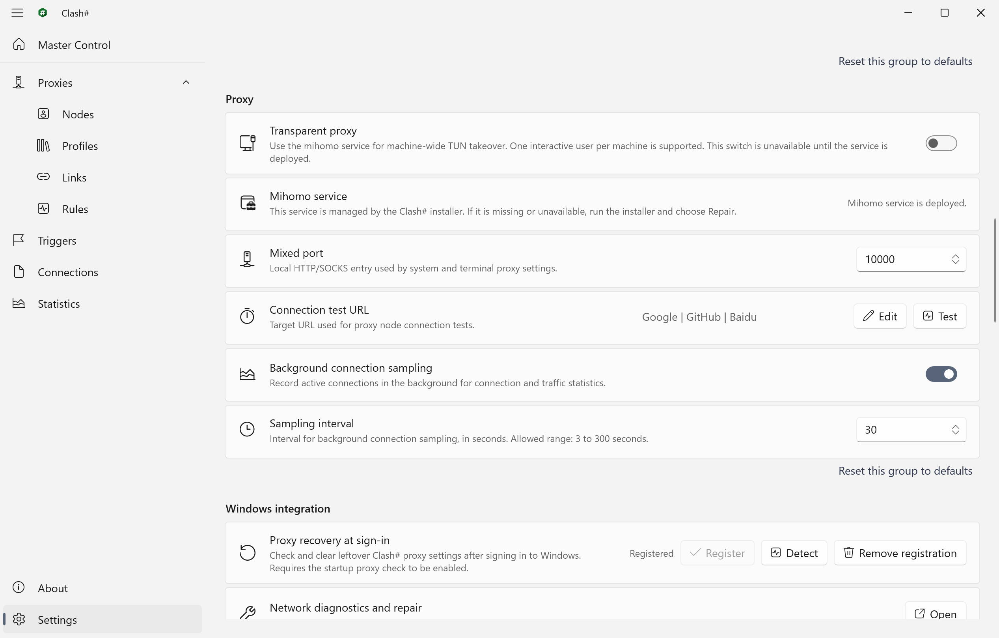

### Recovery you do not have to think about

| Situation | What Clash# does |
| :--- | :--- |
| You exit the app | Stops the core and restores the system proxy that Clash# owns (configurable). |
| The app crashes | A recovery process restores the system proxy immediately. |
| Windows shuts down first | The leftover setting is detected and cleared at the next launch, or at sign-in if the startup cleanup is registered. |
| The core stops unexpectedly | You are notified, and the service restarts the core within a budget. |
| A takeover cannot be verified | The failed change is kept and reported rather than claimed as applied; the next action you take resolves it. |

### Startup checks and native repair

Before proxy mode starts, Clash# checks for an external mihomo process, an occupied port, a Windows manual proxy and other TUN or VPN adapters, and offers fixes for what can be handled safely. **Settings › Windows integration** diagnoses WSL, terminals and Microsoft Store apps separately, which do not read the system proxy, and applies or reverts a fix for each one.

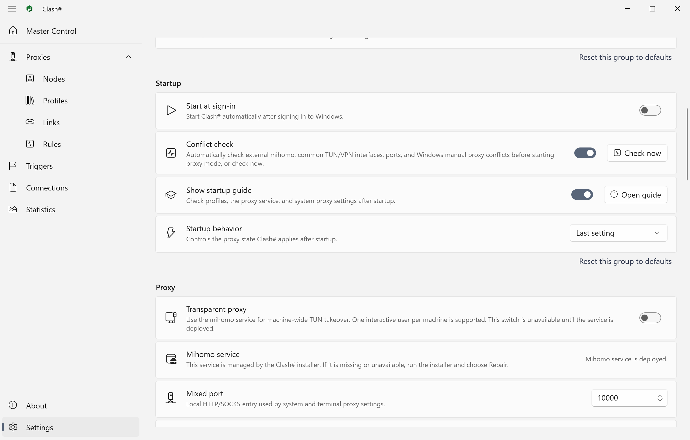

## Agents with your consent (MCP)

A local MCP server connects an agent to the real status, settings, profiles, diagnostics and retained history. It is off by default and listens only on loopback (`http://127.0.0.1:20000/mcp`). Each permission is a separate switch, proxy control needs its own grant, and the agent cannot change its own permissions.

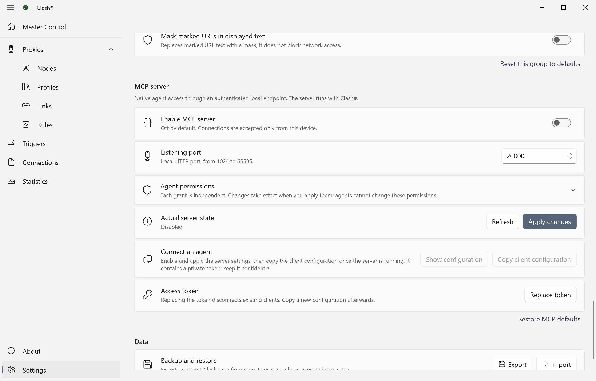

1. Open **Settings › MCP server**, enable the server and choose the permissions to grant. Only status reading is preselected.
2. Select **Apply changes** and confirm that the actual state is **Running**.
3. Use **Copy client configuration** to supply the endpoint and authorization header to a client that supports Streamable HTTP. The copy is excluded from Windows clipboard history and cloud synchronization.

See the [connection and permission guide](./docs/guides/native-agent.md) for permission combinations and troubleshooting.

## A standalone installer manager

`Setup.exe` is a separate Windows application, not a wizard bolted onto the app. It installs for the current user, asks for administrator rights only for the machine-level parts, and later repairs, upgrades or removes exactly what it installed, including the service and the certificate it manages. Every step is recorded, so an interrupted operation resumes instead of leaving a half-installed machine, and the original state can be restored. It speaks the same eight languages as the app: it follows the Windows display language, and you can pick another one in the top corner of the window before you start.

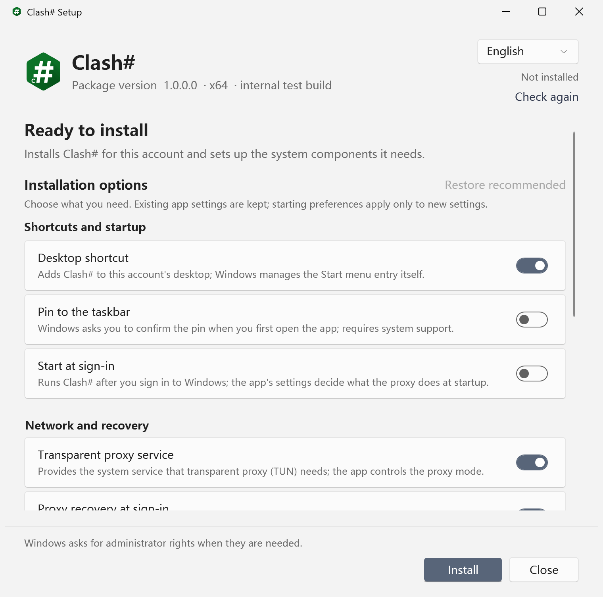

## Triggers

A trigger runs an ordered list of actions once all of its conditions hold. Conditions cover entering the app, starting the proxy, notifications of a chosen level, traffic in a time window, traffic of the current run, rate, active connections, runtime and system time. Actions include switching the mode, closing connections, turning transparent proxy, connection sampling or launch at sign-in on or off, sending a notification and exiting. Each trigger shows when it last fired.

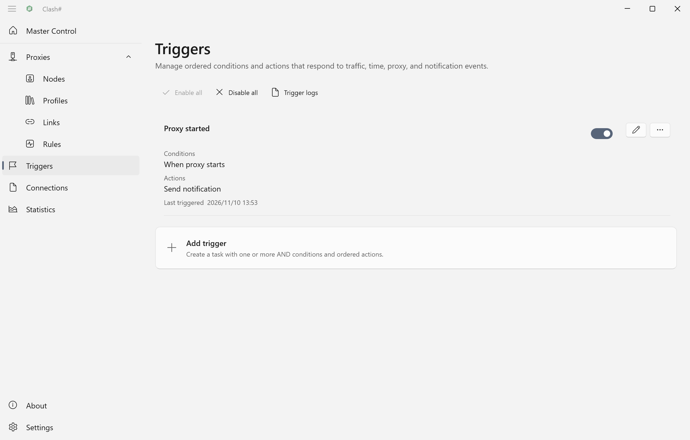

## Mainland China features

Optional display conventions for people who use Clash# in mainland China, found under **Settings › Mainland China features**. They change only what the interface displays: profiles, logs, search, copied text and exported data are never modified, and nothing here blocks network access.

*Built-in review filter* picks how far the conventions go; each option includes the ones before it:

| Option | What the interface shows |
| :--- | :--- |
| **Flag replacement only** | Taiwan appears with the flag of the People's Republic of China; Hong Kong and Macau keep their regional flags. |
| **Flag replacement and text completion only** | Region names also follow the convention, for example "China Hong Kong", "China Macau" and "China Taiwan". |
| **Flag replacement, text completion, and keyword filtering** | A short list of sensitive Chinese terms is also masked in displayed text. |

The default is flag replacement and text completion, and **Disabled** turns everything off. A separate switch, *Mask marked URLs in displayed text*, also masks addresses on a built-in list; it is off by default.

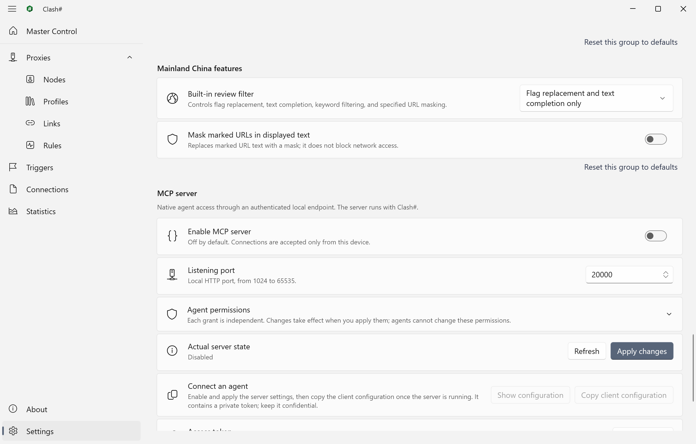

## Your data is portable

**Settings › Data** exports Clash# settings to a single file, optionally including proxy configuration and subscriptions, and imports it again. Logs are exported separately as an SQLite database. Traffic, connection, node-health and rule-hit statistics are kept locally, by profile, node and time, with a clean-up preview before anything is deleted.

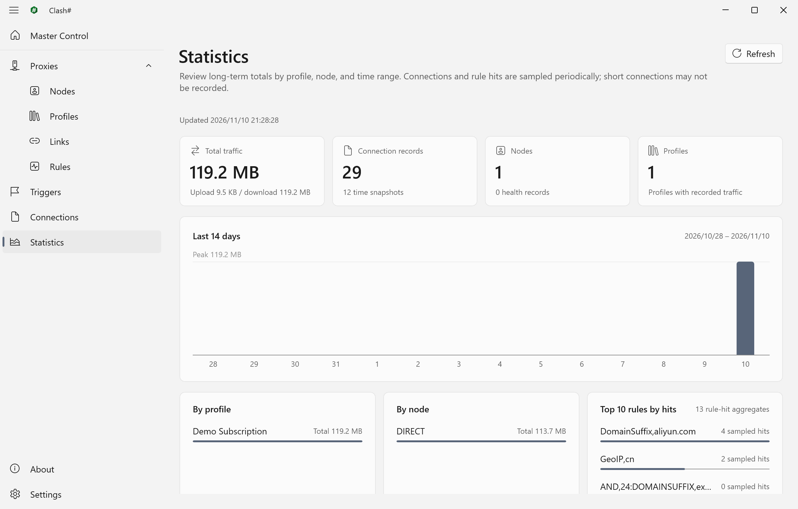&nbsp;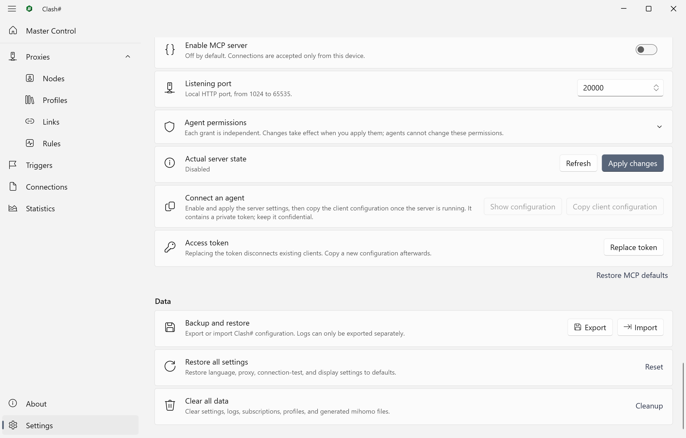

## Installation

**Requirements:** Windows 11 x64, or Windows Server 2025 with Desktop Experience.

Once an official version is released, packages are published on the [Releases](https://github.com/Water-Run/ClashSharp/releases) page.

1. Download and extract the release package. `Setup.exe` must stay next to its `payload` folder.
2. Run `Setup.exe` in the current user session. The application is installed for the user who runs the installer; running as administrator is not required, and .NET does not need to be preinstalled.
3. Confirm the Windows administrator prompt. Setup deploys the Mihomo service and manages the Clash# package certificate automatically. Check the publisher shown in the prompt before approving.

Repair, upgrade and removal are all done by running the same installer again.

> [!WARNING]
> Uninstallation should go through `Setup.exe`. Removing the app only from Windows *Settings › Apps* leaves machine-level resources such as the Mihomo service in place.

## Getting started

1. Add a subscription link under **Proxies › Links**. Clash# downloads and validates the corresponding profile.
2. Confirm under **Proxies › Profiles** that the profile is the current one.
3. Select **Rule takeover** on **Master Control**.
4. Select a node under **Proxies › Nodes**; a latency test can be run first.

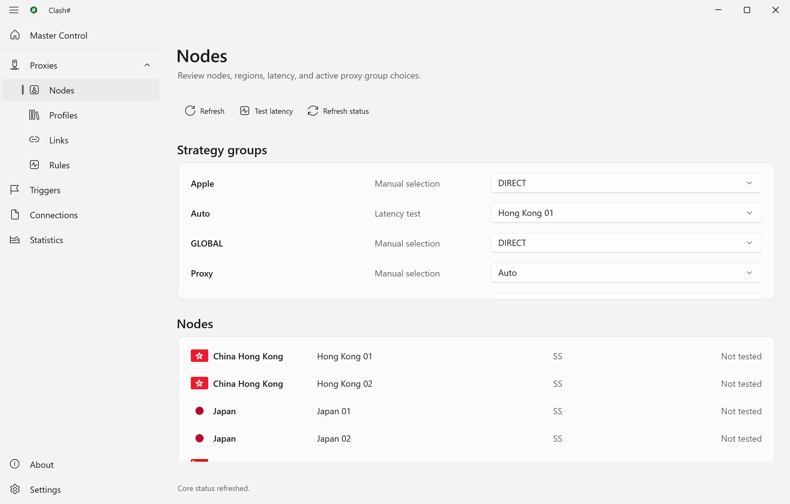&nbsp;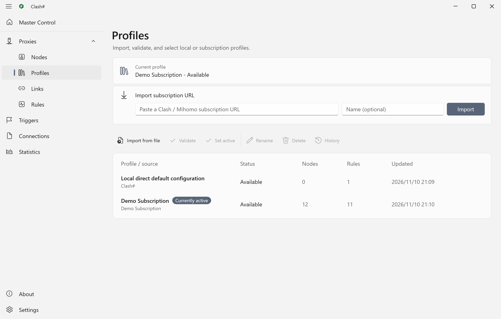

On each launch, Clash# shows a startup guide summarizing the checks for subscription, transparent proxy service, startup restore and stale proxy settings. It can be turned off under **Settings › Startup**.

The local mixed port defaults to `10000` and serves both HTTP and SOCKS. Programs that do not read the system proxy can use `127.0.0.1:10000` directly. The port can be changed under **Settings › Proxy**.

Closing the main window minimizes Clash# to the tray by default, and it keeps running. *Safe exit* in the tray menu is the intended way to quit; on exit, the core stops and the system proxy is restored by default.

With *Enable tray color status indicator* on under **Settings › Taskbar tray**, the tray icon reflects the current state by color:

|  |  |  |
| :---: | :---: | :---: |
| Disabled or Standby | System proxy | Transparent proxy |

### Pages

| Page | Purpose |
| :--- | :--- |
| **Master Control** | Mode switching; tiles show core status, rates, traffic, latency, subscription usage, public IP, and more. |
| **Proxies** | Nodes, profiles (with version history), subscription links, and rules. |
| **Triggers** | Automation tasks, evaluated from top to bottom. |
| **Connections** | Active connections with their process, matched rule, and proxy route. |
| **Statistics** | Long-term totals by profile, node, and time; system logs are also reached from here. |
| **Settings** | Language and appearance, startup, proxy, Windows integration, MCP server and permissions, notifications, tray, Mainland China features and data backup. |

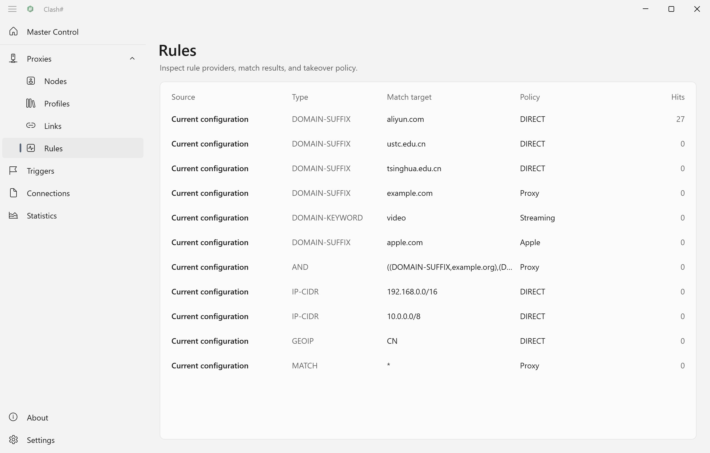&nbsp;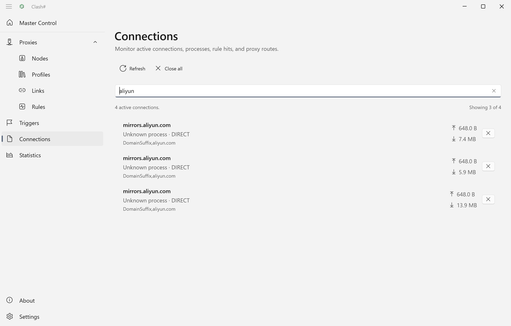

## FAQ

<details>
<summary><b>WSL, a terminal, or a Microsoft Store app cannot reach the network through the proxy</b></summary>
<br />

These programs do not read the Windows system proxy. **Settings › Windows integration** runs a diagnosis for each of them and applies a fix based on the result; each fix can be reverted at any time. With transparent proxy on, traffic from these programs is taken over as well.
</details>

<details>
<summary><b>A conflict is reported at startup</b></summary>
<br />

The conflict check covers four cases: an external mihomo process, an occupied proxy port, an enabled Windows manual proxy, and other TUN or VPN adapters. The dialog explains each item and offers a fix where one can be applied safely. TUN and VPN adapters are only reported; Clash# does not disable them. The check can be run again at any time under **Settings › Startup**.
</details>

<details>
<summary><b>The system proxy remains on after an abnormal exit</b></summary>
<br />

When Clash# exits abnormally, the recovery process immediately restores the system proxy still owned by Clash#. If the computer shut down before that, Clash# checks for and clears the leftover setting at its next launch. *Proxy recovery at sign-in* under **Settings › Windows integration** can also be registered so that the same cleanup runs at Windows sign-in, without waiting for Clash# to start.
</details>

<details>
<summary><b>Transparent proxy does not start with my subscription</b></summary>
<br />

The transparent-proxy service runs the core with its own GeoData files and a fixed set of safe options, so it never takes download addresses, extra listening ports or credentials from a profile. Clash# leaves out the harmless GeoData download address (`geox-url`) automatically and tells you, with a support code, if a profile sets something that cannot be hosted, such as a DNS listener or an extra port. Remove that entry, or turn off transparent proxy to use the system proxy instead.
</details>

<details>
<summary><b>An action failed and every later action fails too</b></summary>
<br />

A failed proxy change is kept and reported instead of being claimed as applied. Changing the mode or the transparent-proxy switch retries it automatically as part of your action. The **Retry** link in the notice on **Settings** does the same without changing anything else.
</details>

<details>
<summary><b>Backup and updates</b></summary>
<br />

**Settings › Data** exports Clash# settings to a single file, optionally including proxy configuration and subscriptions, for later import. Logs can be exported separately as an SQLite database; importing logs is not supported.

The **About** page checks GitHub Releases for new versions. Updates are installed by the installer.
</details>

## Building from source

See the [development documentation](./docs/README.md) for current implementation status, candidate validation and the development plan.

Building requires Windows x64, PowerShell 7, and the .NET SDK version specified in [`global.json`](./global.json).

```powershell
dotnet restore ClashSharp/ClashSharp.slnx --locked-mode
dotnet build   ClashSharp/ClashSharp.slnx -c Release -p:Platform=x64 --no-restore
dotnet test    ClashSharp/ClashSharp.Tests/ClashSharp.Tests.csproj -c Release -p:Platform=x64 --no-build
```

Building the installer package is described in [Installer/README.md](./ClashSharp/Installer/README.md) (Chinese).

<details>
<summary><b>Repository layout</b></summary>
<br />

| Path | Contents |
| :--- | :--- |
| `ClashSharp/ClashSharp` | WinUI 3 application |
| `ClashSharp/ClashSharp.Core` · `.Application` · `.Infrastructure` | Domain model, application logic, and Windows and storage adapters |
| `ClashSharp/ClashSharp.MihomoService` | Windows service that runs the core for transparent proxy |
| `ClashSharp/ClashSharp.RecoveryWatchdog` | Recovery process that restores the system proxy after an abnormal exit |
| `ClashSharp/ClashSharp.Installer*` | WPF installer and its transaction logic |
| `ClashSharp/SandboxTest` | Package smoke tests in Windows Sandbox |
| `docs/` | Design and development records (Chinese) |

</details>

Coding conventions are described in [CodingStyle.md](./CodingStyle.md).

## License

The proxy core is [mihomo](https://github.com/MetaCubeX/mihomo) by MetaCubeX, released under GPL-3.0. GeoIP and GeoSite data come from [meta-rules-dat](https://github.com/MetaCubeX/meta-rules-dat).

Clash# is released under the [AGPL-3.0](./LICENSE) license.
