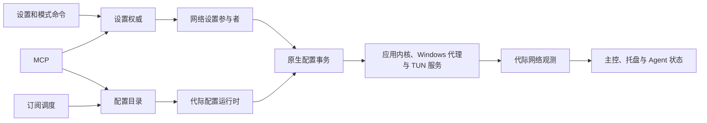

# ClashSharp 功能梳理与代码审查

审查基线为 2026-11-05 的 `0a3ce8e`，对应产品源码 `c531c43`。范围覆盖 19 个解决方案项目、11 个应用页面、后台生产者、特权服务、恢复程序、安装器和发布脚本。检查从生产入口追到数据所有者、外部副作用、提交及恢复边界，并对关键条件用现有测试或隔离探针复核。

## 本轮修复落实

| 编号 | 源码处理 | 回归覆盖 |
| --- | --- | --- |
| A01 | 配置激活、刷新和补偿在原生转换锁内观测当前模式、TUN 与端口，再执行配置事务。 | 真实设置会话保留失败目标后，代际配置刷新仍使用原生已安装值，原失败批次保持原身份。 |
| A02 | 实际活动身份的核对、额外授权和源文件提交共享原生转换锁，删除也核对已安装配置身份。 | 待应用目标与实际配置不同时拒绝低权限编辑，所有权未知时保持源文件。 |
| A03 | 下载保留普通准入，提交时才进入 FIFO。编辑和删除可先完成，提交前重查订阅修订号。修改定义时结束旧下载状态，失败和取消状态在准入释放前记录。 | 慢响应期间编辑或删除、其他变更先完成、旧下载丢弃及取消状态保留、退出撤销与失败状态写入持有期。 |
| A04 | 同一个期限覆盖版本请求的响应头和正文。 | 停滞正文、调用方取消、缓存保留、检查队列释放。 |
| A05 | TUN 配置生成时提前返回稳定 DNS 监听诊断，设置批次保留该代码，八语言提供处理提示。 | 普通系统代理保留 DNS 监听，TUN 提前拒绝并将具体代码传回失败批次。 |
| A06 | 服务协议升级为 v4，区分累计计数与明细完整性。连接条数、聚合文本或编码帧超限时保留计数，统计在不完整快照期间保留连接基线。 | 2048 与 2049 条边界、IPC 回读、不完整快照后的增量计数和新内核代际。 |
| A07 | 导入复用、目录去重与链接编辑统一 URI 身份规则，保留用户信息和路径、查询大小写，忽略片段。 | 查询令牌、路径、用户信息差异，以及主机大小写的等价地址。 |
| A08 | 返回同次锁内观测的代理快照，联网生效证据变化时唤醒托盘，并过滤无关设置变化。 | 最后一次核验之后的代理变更、无关设置的联网身份稳定性、事件订阅及关闭清理。 |

v4 的明细完整性标记需要配套的应用和服务。旧版服务会通过协议版本检查请求配套更新。

实施阶段已完成 19 项目 Release x64 构建，零警告、零错误。主程序一轮全套 4943 项通过，后续定稿的针对性回归 476 项通过，安装器 Core 1141 项及展示层 240 项通过。精确提交的隔离 Windows 全套结果随 CI 收尾补录。

修复入口为锁内配置写入、两阶段订阅变更、协议完整性和原子状态快照。 [配置写入](../../ClashSharp/ClashSharp/Service/NetworkTakeoverService.ObservedProfiles.cs) · [订阅准入](../../ClashSharp/ClashSharp/Service/ProfileCatalogMutationCoordinator.cs) · [完整性协议](../../ClashSharp/ClashSharp.Core/ServiceProtocol/MihomoServiceIpcProtocol.cs) · [故障注入回归](../../ClashSharp/ClashSharp.Tests/Unit/Services/NetworkSettingsRuntimeTests.cs)

## 基线审查结论

优先处理配置目录与设置权威之间的交接。配置激活和活动订阅刷新会从 `Desired` 取网络参数，MCP 则从同一来源判断编辑目标是否为活动配置。一旦网络或配置切换失败，这两处判断可以分别改变后续实际接管状态和活动配置源的写入权限。

## 发现与优先级

| 编号 | 级别 | 发现 | 证据状态 |
| --- | --- | --- | --- |
| A01 | P1 | 配置激活和活动订阅刷新可以应用失败批次中的网络设置 | 生产调用链确认 |
| A02 | P1 | 切换失败后，MCP 可误判实际活动配置的写入权限 | 生产调用链确认，需补故障注入回归 |
| A03 | P2 | 慢订阅下载占用共享变更队列，阻塞其他配置和节点操作 | 生产锁隔离复现，已有慢响应与撤销测试 |
| A04 | P2 | 版本检查的超时漏掉响应体，可长时间占用检查队列 | 生产程序集隔离复现 |
| A05 | P2 | 导入通过的配置可能在启用 TUN 时才出现兼容性失败 | 两层验证器隔离复现 |
| A06 | P2 | TUN 连接条数超限时，连接列表和累计计数一并丢失 | IPC 生产分支确认 |
| A07 | P3 | 订阅 URL 的复用、去重和变更判定不一致 | 比较路径确认，运行时比较探针复现 |
| A08 | P3 | 网络快照跨锁拼接，重试成功也可能只能等待托盘轮询 | 读写次序及事件订阅确认，需并发复现 |

### A01 配置刷新可以应用失败的网络设置

设置权威先持久化目标，再驱动参与者应用并独立回读。失败批次保留目标值，将涉及键的生效状态标为未知。网络设置参与者为未在本次请求中的字段沿用独立观测值。现有单键测试覆盖了这项隔离规则。 [批次失败](https://github.com/Water-Run/ClashSharp/blob/0a3ce8e36273d74daf50102d8ccfc8aed216789e/ClashSharp/ClashSharp.Core/Settings/SettingsApplicationBatchEditor.cs#L37) · [网络参与者](https://github.com/Water-Run/ClashSharp/blob/0a3ce8e36273d74daf50102d8ccfc8aed216789e/ClashSharp/ClashSharp/AppHost/Settings/NetworkSettingsParticipant.cs#L64) · [单键回归](https://github.com/Water-Run/ClashSharp/blob/0a3ce8e36273d74daf50102d8ccfc8aed216789e/ClashSharp/ClashSharp.Tests/Integration/NetworkSettingsParticipantTests.cs#L39)

生产配置目录走另一条路径。手动激活先调用 `ApplyProfileAsync` 再提交活动配置指针，后台更新活动订阅则直接调用 `ImportAndApplyProfileAsync`。两条路径都从 `Desired` 取模式、TUN 和混合端口，随后进入实际配置事务。如果端口修改因为占用失败，端口后来释放，下一次活动订阅更新就可以启用该失败目标。若目标仍不可应用，订阅更新会承担一次与内容无关的失败。后台路径也没有为原设置批次完成对应的重试与回读提交。 [激活入口](https://github.com/Water-Run/ClashSharp/blob/0a3ce8e36273d74daf50102d8ccfc8aed216789e/ClashSharp/ClashSharp/Service/ProfileCatalogService.cs#L1478) · [活动订阅刷新](https://github.com/Water-Run/ClashSharp/blob/0a3ce8e36273d74daf50102d8ccfc8aed216789e/ClashSharp/ClashSharp/Service/ProfileCatalogService.cs#L1026) · [生产运行时参数](https://github.com/Water-Run/ClashSharp/blob/0a3ce8e36273d74daf50102d8ccfc8aed216789e/ClashSharp/ClashSharp/AppHost/Data/GenerationProfileRuntime.cs#L32) · [原生事务](https://github.com/Water-Run/ClashSharp/blob/0a3ce8e36273d74daf50102d8ccfc8aed216789e/ClashSharp/ClashSharp/Service/NetworkTakeoverService.ProfileTransactions.cs#L38)

修复时让配置内容事务持有已核验的原生网络基线，或通过同一设置权威提交需要改变的网络键。加入回归场景，在端口或 TUN 设置失败后刷新活动订阅，断言原生模式和端口维持已验证值，原失败批次仍由显式重试处理。

### A02 切换失败后会误判 MCP 活动配置权限

`clashsharp_save_profile` 的基础权限是修改配置。编辑活动配置时，目录会在获得两层变更锁后追加代理控制权限检查，但它读取的活动 ID 来自 `GenerationRepositorySettings.ActiveProfileId`，取值为 `Desired`。一条可达路径是先由同时拥有两项权限的调用方用 `clashsharp_update_settings` 写入 `ActiveProfileId=B`。设置批次应用失败并保留目标，原生网络仍使用 A。此时只有修改配置权限且持有正确源哈希的客户端可以走“非活动配置”分支写入 A 的源文件。这次调用使用普通导入分支，影响是当前活动配置的磁盘源被替换。后续重新加载该源时可读到新内容。 [直接设置写入](https://github.com/Water-Run/ClashSharp/blob/0a3ce8e36273d74daf50102d8ccfc8aed216789e/ClashSharp/ClashSharp/AppHost/Agent/AppMcpAgentBackend.cs#L306) · [允许写入的网络键](https://github.com/Water-Run/ClashSharp/blob/0a3ce8e36273d74daf50102d8ccfc8aed216789e/ClashSharp/ClashSharp.Core/Agent/McpAccessRules.cs#L22) · [目录权限判断](https://github.com/Water-Run/ClashSharp/blob/0a3ce8e36273d74daf50102d8ccfc8aed216789e/ClashSharp/ClashSharp/Service/ProfileCatalogService.Agent.cs#L84) · [活动 ID 来源](https://github.com/Water-Run/ClashSharp/blob/0a3ce8e36273d74daf50102d8ccfc8aed216789e/ClashSharp/ClashSharp/AppHost/Data/GenerationRepositorySettings.cs#L17) · [写入分支](https://github.com/Water-Run/ClashSharp/blob/0a3ce8e36273d74daf50102d8ccfc8aed216789e/ClashSharp/ClashSharp/Service/ProfileCatalogService.cs#L1349)

将活动身份核对纳入原生配置写入的同一所有权边界。身份无法观测时拒绝将待编辑配置归入普通写权限。回归覆盖 A 实际运行、B 目标失败、无代理控制权限编辑 A，以及有权限时的正常提交和补偿。

### A03 下载占用共享变更队列

手动导入和定时订阅刷新先获取进程级 FIFO 变更许可，再获取订阅和配置目录锁，然后才发起 HTTP 请求。默认下载期限为 30 秒，覆盖响应头和响应体。期间同一队列中的节点选择和其他配置操作无法前进。用生产程序集的目录协调器挂起一次模拟读取，另一项变更在 300 ms 时仍排队，释放读取后才完成。关闭准入会撤销尚可取消的下载，现有测试覆盖了退出撤销以及保留重试计划。 [调度入口](https://github.com/Water-Run/ClashSharp/blob/0a3ce8e36273d74daf50102d8ccfc8aed216789e/ClashSharp/ClashSharp/Service/ProfileCatalogService.cs#L955) · [下载所在的锁范围](https://github.com/Water-Run/ClashSharp/blob/0a3ce8e36273d74daf50102d8ccfc8aed216789e/ClashSharp/ClashSharp/Service/ProfileCatalogService.cs#L997) · [共享 FIFO](https://github.com/Water-Run/ClashSharp/blob/0a3ce8e36273d74daf50102d8ccfc8aed216789e/ClashSharp/ClashSharp/Service/ProfileCatalogMutationCoordinator.cs#L51) · [节点选择](https://github.com/Water-Run/ClashSharp/blob/0a3ce8e36273d74daf50102d8ccfc8aed216789e/ClashSharp/ClashSharp/Service/ProxySelectionService.cs#L41) · [撤销测试](https://github.com/Water-Run/ClashSharp/blob/0a3ce8e36273d74daf50102d8ccfc8aed216789e/ClashSharp/ClashSharp.Tests/Unit/Services/ProfileCatalogServiceTests.cs#L364)

把有界下载移到提交阶段之外。进入共享队列后重新核对数据代际、订阅 ID、URI 和修订号，再写入源文件、历史及运行态。用可控慢响应验证其他本地动作可以先完成，旧下载也无法覆盖期间编辑过的订阅。

### A04 版本检查漏掉响应体超时

版本检查客户端配置 5 秒 `HttpClient.Timeout`，使用 `ResponseHeadersRead`。开始读响应体后只传递外部取消令牌，64 KiB 上限只约束已经收到的字节。服务端发送成功响应头后停住，检查会一直占用该实例的 `_gate`，直到上层取消。关于页和主控各自创建这个检查器，两处均受影响。 [超时和串行入口](https://github.com/Water-Run/ClashSharp/blob/0a3ce8e36273d74daf50102d8ccfc8aed216789e/ClashSharp/ClashSharp/Service/GitHubReleaseUpdateChecker.cs#L55) · [响应体循环](https://github.com/Water-Run/ClashSharp/blob/0a3ce8e36273d74daf50102d8ccfc8aed216789e/ClashSharp/ClashSharp/Service/GitHubReleaseUpdateChecker.cs#L158) · [关于页组合](https://github.com/Water-Run/ClashSharp/blob/0a3ce8e36273d74daf50102d8ccfc8aed216789e/ClashSharp/ClashSharp/Presentation/Composition/AboutPageComposition.cs#L23) · [主控组合](https://github.com/Water-Run/ClashSharp/blob/0a3ce8e36273d74daf50102d8ccfc8aed216789e/ClashSharp/ClashSharp/Presentation/Composition/MasterControlPageComposition.cs#L113)

隔离探针直接调用 Release 程序集，注入 100 ms 超时和一个停滞的响应体。550 ms 时任务仍未结束，随后由调用方取消并正常退出。生产检查可沿用订阅下载的整段期限做法，把同一个期限传给请求和正文读取。回归同时核对主动取消、正文超时、缓存结果和队列释放。 [订阅下载期限](https://github.com/Water-Run/ClashSharp/blob/0a3ce8e36273d74daf50102d8ccfc8aed216789e/ClashSharp/ClashSharp/Service/ProfileCatalogService.cs#L1654)

### A05 导入阶段缺少 TUN 兼容性反馈

应用侧生成配置会覆盖代理端口、控制端点等托管字段，并保留 DNS 映射中的 `listen`。LocalSystem 服务启动前有更严格的配置政策，会拒绝 `dns.listen`。隔离探针用同一份合成 YAML 通过应用侧生成，仓库锁定的 Mihomo v1.19.33 通过 `-t` 校验，服务验证器则返回 `A service-owned DNS listener is not permitted.`。这是有意的权限边界。可用性缺口在于配置导入和 TUN 启用之间缺少对应提示，用户可能在切换接管模式时才得知原因。 [应用侧配置生成](https://github.com/Water-Run/ClashSharp/blob/0a3ce8e36273d74daf50102d8ccfc8aed216789e/ClashSharp/ClashSharp/Service/MihomoRuntimeConfigurationBuilder.cs#L108) · [服务 DNS 检查](https://github.com/Water-Run/ClashSharp/blob/0a3ce8e36273d74daf50102d8ccfc8aed216789e/ClashSharp/ClashSharp.MihomoService/MihomoServiceConfigurationTrustValidator.cs#L632) · [内核固定摘要](https://github.com/Water-Run/ClashSharp/blob/0a3ce8e36273d74daf50102d8ccfc8aed216789e/ClashSharp/ClashSharp/Binaries/mihomo-manifest.json)

在导入、配置详情或 TUN 启用预检中提供同一份兼容性诊断。保持服务检查，并区分应用内核可用和服务 TUN 可用。回归以同一个配置验证普通接管和 TUN 的反馈。

### A06 TUN 明细超限会阻断累计计数

服务控制器代理请求 `/connections`，在读取累计上传和下载计数前检查连接数组。超过 2048 条时整份快照被拒绝。应用端在 TUN 下复用这份响应读取活动连接和实时流量，采样服务也使用它写入统计。因此高连接数时，连接页面、实时计数和该次统计采样会一起受影响。网络切换前的末次采样采用独立期限并记录失败，仍可继续释放网络所有权。 [服务快照上限](https://github.com/Water-Run/ClashSharp/blob/0a3ce8e36273d74daf50102d8ccfc8aed216789e/ClashSharp/ClashSharp.MihomoService/MihomoServiceControllerBroker.cs#L247) · [应用侧读取](https://github.com/Water-Run/ClashSharp/blob/0a3ce8e36273d74daf50102d8ccfc8aed216789e/ClashSharp/ClashSharp/Service/MihomoControllerClient.cs#L258) · [统计入库](https://github.com/Water-Run/ClashSharp/blob/0a3ce8e36273d74daf50102d8ccfc8aed216789e/ClashSharp/ClashSharp/Service/ConnectionSamplingService.cs#L170) · [末次采样边界](https://github.com/Water-Run/ClashSharp/blob/0a3ce8e36273d74daf50102d8ccfc8aed216789e/ClashSharp/ClashSharp/Service/NetworkTakeoverService.DataScope.cs#L29)

让累计计数与连接明细拥有独立的有效性，或者在协议上标记明细超限。统计只能将明确完整的连接集合用于关闭判定和计数基线替换。回归覆盖 2048 条、2049 条和随后回落的连续快照。

### A07 订阅 URL 判定规则不一致

直接导入通过 `Uri.Equals` 查找可复用链接，目录新增和编辑则对整个 URL 使用 `OrdinalIgnoreCase`。同域名下仅路径或查询令牌大小写不同的地址可能被目录视为重复。编辑现有链接时，同类变化会保留旧用量和刷新计划。另一个边界是 `Uri.Equals` 会忽略用户信息，隔离探针确认两条不同用户信息的合成地址比较相等。 [直接导入复用](https://github.com/Water-Run/ClashSharp/blob/0a3ce8e36273d74daf50102d8ccfc8aed216789e/ClashSharp/ClashSharp/ViewModel/SubscriptionImportWorkflow.cs#L23) · [新增去重](https://github.com/Water-Run/ClashSharp/blob/0a3ce8e36273d74daf50102d8ccfc8aed216789e/ClashSharp/ClashSharp/Service/ProfileCatalogService.cs#L396) · [编辑和用量计划](https://github.com/Water-Run/ClashSharp/blob/0a3ce8e36273d74daf50102d8ccfc8aed216789e/ClashSharp/ClashSharp/Service/ProfileCatalogService.cs#L483)

统一 URI 身份规则，并明确是否接受用户信息。保留路径和查询值中的大小写区别，为仅主机大小写不同的地址继续复用同一链接。

### A08 网络快照和托盘唤醒边界

代际网络观测先在 `_transitionGate` 内校验配置、服务和 Windows 代理所有权，再释放门锁。外层重新读 Windows 系统代理标志并组装 `NetworkStateSnapshot`。如果两次读取之间完成切换，就可能返回不同观测时刻的模式和代理标志，影响托盘和 MCP 状态。托盘已经会在目标设置变化时唤醒刷新，但设置重试可以保留相同的 `Desired`，只发布应用状态变化。该路径可能等到下一轮轮询才更新颜色。 [网络所有权校验](https://github.com/Water-Run/ClashSharp/blob/0a3ce8e36273d74daf50102d8ccfc8aed216789e/ClashSharp/ClashSharp/Service/NetworkTakeoverService.NetworkSettings.cs#L90) · [外层拼接](https://github.com/Water-Run/ClashSharp/blob/0a3ce8e36273d74daf50102d8ccfc8aed216789e/ClashSharp/ClashSharp/AppHost/Data/AppDataGenerationRuntimeComposer.cs#L112) · [设置通知来源](https://github.com/Water-Run/ClashSharp/blob/0a3ce8e36273d74daf50102d8ccfc8aed216789e/ClashSharp/ClashSharp/Service/AppSettingsService.Authority.cs#L51) · [托盘订阅](https://github.com/Water-Run/ClashSharp/blob/0a3ce8e36273d74daf50102d8ccfc8aed216789e/ClashSharp/ClashSharp/Presentation/Composition/MainWindowComposition.cs#L176)

从一次锁内观测返回完整快照，托盘用网络批次生效状态变化作为刷新信号。用两个受控并发点覆盖切换中的读状态和失败后的同值重试。

## 功能与代码入口

设置权威与配置目录共享代际所有权，但两个入口到达原生事务的路径不同。托盘、主控状态和 Agent 则从网络观测侧读取运行结果。

| 功能 | 生产入口与主要行为 | 需要保留的边界 |
| --- | --- | --- |
| 启动和退出 | `ClashSharpAppHostFactory` 注册顺序化步骤。先绑定路径、核对安装事务并恢复数据和网络，再创建窗口，最后启动采样和订阅。生命周期协调器关停生产者、释放网络所有权、排空写入。 | 不确定的原生所有权保留恢复义务。 [启动注册](https://github.com/Water-Run/ClashSharp/blob/0a3ce8e36273d74daf50102d8ccfc8aed216789e/ClashSharp/ClashSharp/AppHost/ClashSharpAppHostFactory.cs#L257) · [生命周期协调](https://github.com/Water-Run/ClashSharp/blob/0a3ce8e36273d74daf50102d8ccfc8aed216789e/ClashSharp/ClashSharp.Application/Lifecycle/RuntimeLifecycleCoordinator.cs) |
| 设置和失败重试 | `GenerationSettingsAuthority` 按代际持有 `SettingsAuthoritySession`。规范化值、期望值、生效值和待处理批次分别持久化，参与者核验网络、外观、启动项、采样、触发器和 MCP。 | 生效结论来自匹配批次和尝试身份的独立回读。 [权威入口](https://github.com/Water-Run/ClashSharp/blob/0a3ce8e36273d74daf50102d8ccfc8aed216789e/ClashSharp/ClashSharp.Application/Settings/GenerationSettingsAuthority.cs) · [参与者组装](https://github.com/Water-Run/ClashSharp/blob/0a3ce8e36273d74daf50102d8ccfc8aed216789e/ClashSharp/ClashSharp/AppHost/Data/AppDataGenerationRuntimeComposer.cs#L43) |
| 数据导入、导出和清除 | 包先按范围读取并验证，再在独占准入下准备候选、切换指针和发布新代际。清除全部数据走终态维护路径，先释放资源再删应用数据。 | 导入、重置设置和清除全部数据具有不同的持久化语义。已完成的旧替换记录退出恢复路径，未完成记录仍要校验描述符和归属。 [导入与代际替换](https://github.com/Water-Run/ClashSharp/blob/0a3ce8e36273d74daf50102d8ccfc8aed216789e/ClashSharp/ClashSharp/AppHost/Data/GenerationReplacementCoordinator.cs#L98) · [检查点](https://github.com/Water-Run/ClashSharp/blob/0a3ce8e36273d74daf50102d8ccfc8aed216789e/ClashSharp/ClashSharp/AppHost/Data/FileGenerationReplacementJournal.cs#L147) · [清除全部数据](https://github.com/Water-Run/ClashSharp/blob/0a3ce8e36273d74daf50102d8ccfc8aed216789e/ClashSharp/ClashSharp/AppHost/Data/GenerationDataClearOperationFactory.cs) |
| 主控和托盘 | 四种模式、概览、诊断与 74 个磁贴。六套模板通过稳定 ID 解析，旧默认列表在读入时映射，混合列表保留旧模板。托盘将已观测的接管状态映射为颜色，并保留窗口恢复路径。 | 模板预览使用草稿，保存布局后才应用。托盘显示依赖已观测的网络状态。 [主控](https://github.com/Water-Run/ClashSharp/blob/0a3ce8e36273d74daf50102d8ccfc8aed216789e/ClashSharp/ClashSharp/ViewModel/MasterControlViewModel.cs) · [模板兼容](https://github.com/Water-Run/ClashSharp/blob/0a3ce8e36273d74daf50102d8ccfc8aed216789e/ClashSharp/ClashSharp/Service/MasterInfoTileLayoutService.cs#L71) · [托盘状态](https://github.com/Water-Run/ClashSharp/blob/0a3ce8e36273d74daf50102d8ccfc8aed216789e/ClashSharp/ClashSharp/Presentation/Composition/MainWindowComposition.cs#L316) |
| 配置和订阅 | 页面支持本地文件、拖放和 HTTP(S) 导入，订阅保存用量和调度计划。配置保留带内容摘要的历史，并在目录或原生提交失败时补偿。 | 下载、源文件、生成文件和活动配置是独立状态。 [订阅与历史事务](https://github.com/Water-Run/ClashSharp/blob/0a3ce8e36273d74daf50102d8ccfc8aed216789e/ClashSharp/ClashSharp/Service/ProfileCatalogService.cs#L1012) · [本地导入](https://github.com/Water-Run/ClashSharp/blob/0a3ce8e36273d74daf50102d8ccfc8aed216789e/ClashSharp/ClashSharp/ViewModel/ProfilesViewModel.Import.cs) · [定时更新](https://github.com/Water-Run/ClashSharp/blob/0a3ce8e36273d74daf50102d8ccfc8aed216789e/ClashSharp/ClashSharp/Service/ProfileSubscriptionScheduler.cs) |
| 节点和规则 | 节点页展示配置预览或实际控制器返回的组和节点，支持选择、测速、Provider 更新。规则页读取当前配置和采样命中信息。 | 选择绑定已验证运行时并持久化，在运行时切换后按配置恢复。 [节点命令](https://github.com/Water-Run/ClashSharp/blob/0a3ce8e36273d74daf50102d8ccfc8aed216789e/ClashSharp/ClashSharp/ViewModel/ProxiesViewModel.cs#L404) · [节点归属](https://github.com/Water-Run/ClashSharp/blob/0a3ce8e36273d74daf50102d8ccfc8aed216789e/ClashSharp/ClashSharp/Service/ProxySelectionService.cs) · [规则页](https://github.com/Water-Run/ClashSharp/blob/0a3ce8e36273d74daf50102d8ccfc8aed216789e/ClashSharp/ClashSharp/ViewModel/RulesViewModel.cs) |
| 连接、流量和日志 | 连接页刷新、订阅变化并关闭单条或全部连接。统计使用累计计数和采样快照。日志和历史通过 SQLite 查询、筛选、维护及导出。 | 总流量与节点、规则明细的采样口径不同。Agent 日志详情有独立授权、长度限制和二次脱敏。 [连接页](https://github.com/Water-Run/ClashSharp/blob/0a3ce8e36273d74daf50102d8ccfc8aed216789e/ClashSharp/ClashSharp/ViewModel/ConnectionsViewModel.cs) · [计数基线](https://github.com/Water-Run/ClashSharp/blob/0a3ce8e36273d74daf50102d8ccfc8aed216789e/ClashSharp/ClashSharp/Service/LogStorageService.Traffic.cs#L12) · [日志读取](https://github.com/Water-Run/ClashSharp/blob/0a3ce8e36273d74daf50102d8ccfc8aed216789e/ClashSharp/ClashSharp/Service/LogStorageService.Agent.cs) |
| 触发器 | 调度器接收定时 tick 和运行时事件，规则匹配后通过 SQLite outbox 顺序执行。重启或退出动作由生命周期交接回执协调。 | 已完成、失败、结果不确定和已交接的动作保留不同的恢复状态。 [调度器](https://github.com/Water-Run/ClashSharp/blob/0a3ce8e36273d74daf50102d8ccfc8aed216789e/ClashSharp/ClashSharp.Application/Triggers/TriggerScheduler.cs) · [动作执行](https://github.com/Water-Run/ClashSharp/blob/0a3ce8e36273d74daf50102d8ccfc8aed216789e/ClashSharp/ClashSharp.Application/Triggers/TriggerActionExecutor.cs) · [生命周期交接](https://github.com/Water-Run/ClashSharp/blob/0a3ce8e36273d74daf50102d8ccfc8aed216789e/ClashSharp/ClashSharp.Application/Triggers/TriggerLifecycleHandoffCoordinator.cs) |
| Windows 网络与恢复 | 系统代理模式由应用内核和 Windows 代理所有权控制，TUN 由 LocalSystem 服务管理。IPC 结合用户 SID、DACL、令牌、请求关联和代际身份，watchdog 在原进程退出后核对并恢复代理。 | 服务配置、控制通道和机器资源是独立信任边界。 [网络参与者](https://github.com/Water-Run/ClashSharp/blob/0a3ce8e36273d74daf50102d8ccfc8aed216789e/ClashSharp/ClashSharp/AppHost/Settings/NetworkSettingsParticipant.cs) · [服务 IPC](https://github.com/Water-Run/ClashSharp/blob/0a3ce8e36273d74daf50102d8ccfc8aed216789e/ClashSharp/ClashSharp.MihomoService/MihomoServiceIpcServer.cs) · [watchdog](https://github.com/Water-Run/ClashSharp/blob/0a3ce8e36273d74daf50102d8ccfc8aed216789e/ClashSharp/ClashSharp.RecoveryWatchdog/RecoveryWatchdogRunner.cs) |
| 外观、本地化与通知 | WinUI 主题和自定义强调色区分深浅字典，覆盖框架控件别名。资源表提供八种语言，主窗口处理从右向左布局。通知按用户级别和前台策略分流。 | 外观应用回读真实资源覆盖。代理模式和透明代理变化保留前台通知。 [主题资源](https://github.com/Water-Run/ClashSharp/blob/0a3ce8e36273d74daf50102d8ccfc8aed216789e/ClashSharp/ClashSharp/Service/AppThemeService.cs) · [语言资源](https://github.com/Water-Run/ClashSharp/blob/0a3ce8e36273d74daf50102d8ccfc8aed216789e/ClashSharp/ClashSharp/Strings/LocalizationResources.cs#L39) · [通知策略](https://github.com/Water-Run/ClashSharp/blob/0a3ce8e36273d74daf50102d8ccfc8aed216789e/ClashSharp/ClashSharp/Service/NotificationService.cs#L370) |
| 关于、系统集成和诊断 | 关于页显示版本、运行时和 UTC 构建时间，更新检查只读取固定 GitHub 端点的版本信息。应用管理启动项、窗口位置、启动冲突、托盘和任务栏集成。 | 更新检查和安装维护分属不同入口。任务栏操作依赖 Windows 支持和用户原生确认。 [关于页](https://github.com/Water-Run/ClashSharp/blob/0a3ce8e36273d74daf50102d8ccfc8aed216789e/ClashSharp/ClashSharp/ViewModel/AboutViewModel.cs) · [更新检查](https://github.com/Water-Run/ClashSharp/blob/0a3ce8e36273d74daf50102d8ccfc8aed216789e/ClashSharp/ClashSharp/Service/GitHubReleaseUpdateChecker.cs) · [主窗口](https://github.com/Water-Run/ClashSharp/blob/0a3ce8e36273d74daf50102d8ccfc8aed216789e/ClashSharp/ClashSharp/MainWindow.xaml.cs) |
| MCP | Kestrel 绑定 IPv4 回环，校验 Host、Origin 和 Bearer。默认关闭，目录声明 20 项工具。读写核对权限、令牌和当前代际，写入通过操作 ID 和规范化请求摘要识别同一进程中近期重试。 | 原始配置、历史详情、设置修改和代理控制分别授权。MCP 凭据使用当前用户 DPAPI。 [HTTP 边界](https://github.com/Water-Run/ClashSharp/blob/0a3ce8e36273d74daf50102d8ccfc8aed216789e/ClashSharp/ClashSharp.Infrastructure.Mcp/McpHttpServer.cs#L155) · [工具目录](https://github.com/Water-Run/ClashSharp/blob/0a3ce8e36273d74daf50102d8ccfc8aed216789e/ClashSharp/ClashSharp.Application/Agent/McpToolCatalog.cs) · [操作授权](https://github.com/Water-Run/ClashSharp/blob/0a3ce8e36273d74daf50102d8ccfc8aed216789e/ClashSharp/ClashSharp/AppHost/Agent/AppMcpAgentBackend.cs#L39) · [凭据](https://github.com/Water-Run/ClashSharp/blob/0a3ce8e36273d74daf50102d8ccfc8aed216789e/ClashSharp/ClashSharp.Infrastructure.Mcp/McpProtectedCredentialStore.cs) |
| 安装器和交付 | WPF 壳调用安装器核心，Windows 适配层负责包注册、证书、机器服务、账户迁移及恢复。签名载荷、发布者、文件句柄、同身份包指纹和提权 helper 分别校验。 | 同版本框架重签允许使用相同载荷，主包仍核对完整签名指纹。内部候选的 CI 来源、签名生产和独立审计均有独立门禁。 [安装状态机](https://github.com/Water-Run/ClashSharp/blob/0a3ce8e36273d74daf50102d8ccfc8aed216789e/ClashSharp/ClashSharp.Installer.Core/Execution/InstallerCoordinator.cs) · [包预检](https://github.com/Water-Run/ClashSharp/blob/0a3ce8e36273d74daf50102d8ccfc8aed216789e/ClashSharp/ClashSharp.Installer.Windows/Packages/WindowsPackageDeploymentPreflight.cs) · [内部候选](https://github.com/Water-Run/ClashSharp/blob/0a3ce8e36273d74daf50102d8ccfc8aed216789e/.github/workflows/internal-candidate.yml) |

11 个页面通过 `ApplicationPageFactory` 的类型化路由创建。主控、设置、触发器、连接和统计分别有自己的页面组合。日志页依进入来源挂在统计或触发器导航下。视图层、设置权威与 Windows 适配之间的边界是本轮功能定位的入口。 [页面工厂](https://github.com/Water-Run/ClashSharp/blob/0a3ce8e36273d74daf50102d8ccfc8aed216789e/ClashSharp/ClashSharp/Presentation/Navigation/ApplicationPageFactory.cs) · [路由归属](https://github.com/Water-Run/ClashSharp/blob/0a3ce8e36273d74daf50102d8ccfc8aed216789e/ClashSharp/ClashSharp/Presentation/Navigation/ShellRouteCatalog.cs)

## 静态检查与验证范围

| 检查 | 结果 |
| --- | --- |
| 锁定还原及 Release x64 构建 | 使用 .NET SDK 10.0.403，19 个项目成功构建，零警告、零错误。Release 启用推荐分析级别、代码风格检查和警告即错误。 |
| `dotnet format --verify-no-changes` | 工作区和从基线归档提取的副本均退出 0，分别报告 2084 和 2045 个文件、零格式修改。工作区出现 WinUI 生成文件重复，归档副本出现设计时项目引用缺少 Debug 产物。主项目的格式覆盖因此有保留，Release 编译证据单独成立。 |
| PowerShell AST 和合同 | 64 个脚本和模块零语法错误。CI 变更范围、产品运行、制品、发布环境和候选来源合同均通过。 |
| NuGet 已知漏洞查询 | 查询 19 个项目的直接与传递 NuGet 依赖，本次结果无返回漏洞。Mihomo 二进制安全扫描由单独的发布预检承担。 |
| Release 定向测试 | 693 通过，零失败、零跳过。覆盖分层、MVVM、启动与生命周期、配置和订阅、网络设置、MCP、数据代际和调度器相关用例。 |
| 隔离探针 | 复现停滞响应体、共享变更排队、订阅 URI 比较差异和 DNS 监听的两层验证差异。多层命名 YAML 锚点测试中，321 字节的九层样例生成 544 字节，当前实现保留了引用，这个样例未发生指数展开。 |
| 既有产品证据 | 产品提交 `c531c43` 的完整 CI 为 7705 项通过，签名及蓝机验收详见执行账本。本轮复核在本机执行，蓝机证据仍绑定原候选及其验收场景。 |

仓库统计为 1635 个 C# 文件、23 个 XAML 文件和 64 个 PowerShell 源文件。定向用例与全量构建承担不同的证据范围。对 A01、A02 和 A08 的时序描述来自生产控制流，仍需用独立的失败或并发注入固化。对于正式发行，仓库现有保护预检和 Mihomo 安全扫描，产品验收状态绑定内部签名候选。 [构建策略](https://github.com/Water-Run/ClashSharp/blob/0a3ce8e36273d74daf50102d8ccfc8aed216789e/Directory.Build.props) · [CI 验证](https://github.com/Water-Run/ClashSharp/blob/0a3ce8e36273d74daf50102d8ccfc8aed216789e/.github/workflows/ci.yml) · [正式发布预检](https://github.com/Water-Run/ClashSharp/blob/0a3ce8e36273d74daf50102d8ccfc8aed216789e/.github/workflows/release-preflight.yml) · [产品执行账本](1.0.0-execution-ledger.md)

## 修复顺序与验收条件

1. 先统一活动配置身份与生效网络基线，连同 MCP 活动编辑权限处理 A01 和 A02。验收要求在失败目标保留时，后台刷新维持已验证网络，低权限客户端无法写实际活动配置源。
2. 再拆开订阅下载与提交，补足更新检查的整段期限，并统一 URI 身份。验收覆盖慢响应下的其他操作、编辑期间丢弃旧下载、正文超时释放检查队列。
3. 补 TUN 兼容性诊断和超限统计降级。验收包括同一配置的普通接管与 TUN 差异，以及明细超限后累计计数仍可用。
4. 收口网络观测和托盘应用状态信号。验收覆盖跨事务切换、同值重试和数据代际切换。

维护成本主要集中在设置 ViewModel、配置目录和主控 ViewModel。本次统计分别约为 3160、2510 和 2022 行。上述缺陷集中在运行态读取与副作用的边界，按边界修复可以独立验证。 [设置](https://github.com/Water-Run/ClashSharp/blob/0a3ce8e36273d74daf50102d8ccfc8aed216789e/ClashSharp/ClashSharp/ViewModel/SettingsViewModel.cs) · [配置目录](https://github.com/Water-Run/ClashSharp/blob/0a3ce8e36273d74daf50102d8ccfc8aed216789e/ClashSharp/ClashSharp/Service/ProfileCatalogService.cs) · [主控](https://github.com/Water-Run/ClashSharp/blob/0a3ce8e36273d74daf50102d8ccfc8aed216789e/ClashSharp/ClashSharp/ViewModel/MasterControlViewModel.cs)
